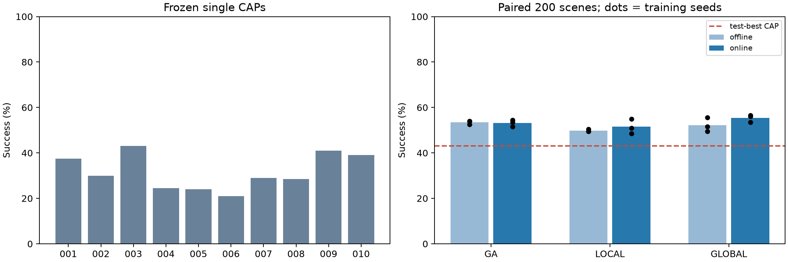
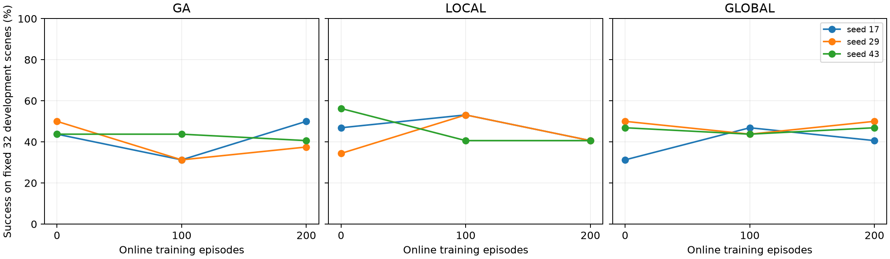
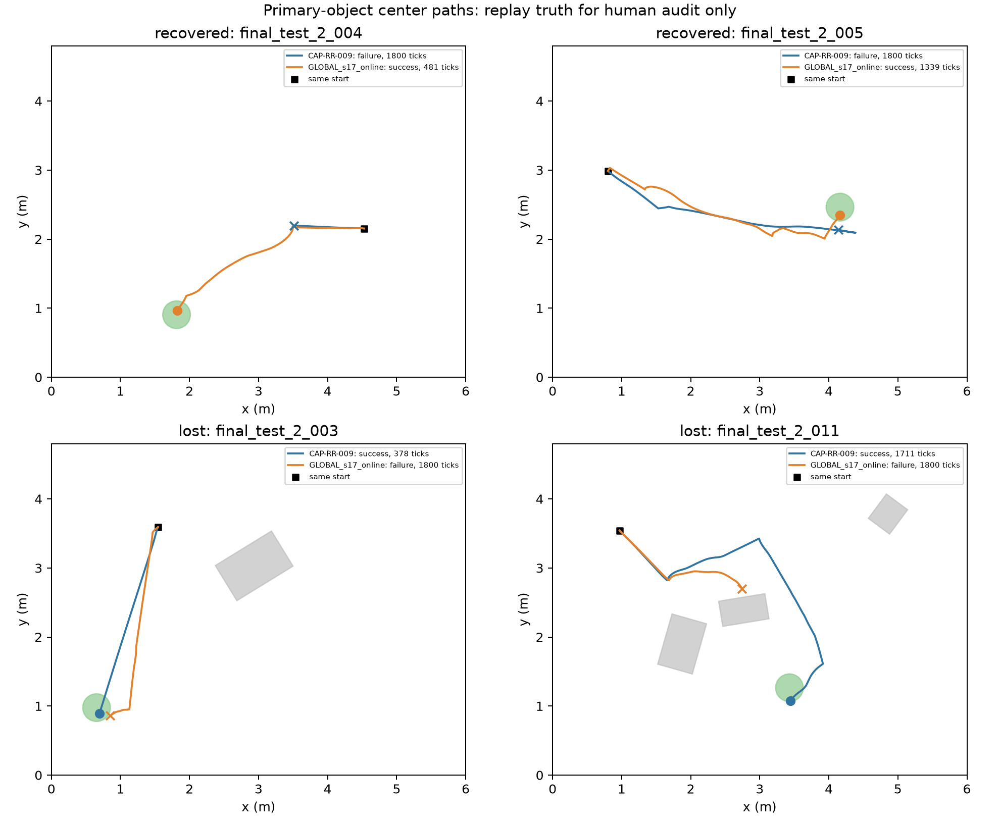

# CAP trace＋RL：完整评估与验收

本报告来自新冻结200场景的同机实验。所有模型固定后才执行最终测试；未按测试挑种子、checkpoint或表示组。

命名说明：本轮日志中的GA表示“公开观测＋全部CAP动作建议＋当前候选动作及建议来源”的无trace基线。A不是旧全合法动作树实验中单独的CAP推荐偏好标志；所有候选均由CAP提出，那个布尔标志本身会退化。本轮与旧GA不是相同方法协议，不能直接合并结果。LOCAL/GLOBAL在这个共同基线上增加相应trace。

## 验收判断

**本轮支持“在CAP建议池上学习动作价值，可以整合部分互补能力并超过最好单CAP”；尚不能把这项优势独立归因于trace或在线RL。** 新冻结200场景上，GLOBAL＋RL三个seed为112/113/107成功，平均55.33%；原10CAP中最强CAP003为86/200、43%。三个seed均超过它。相对预先按开发集选定的CAP009（82/200），平均提高14.33个百分点，配对场景区间为[8.17,20.33]。

无trace的GA离线Q已经为105/108/108，平均53.50%；GA在线为53.17%。因此本轮最坚实的证据是**多CAP候选＋价值学习的组合有效**。这里的GA也执行V预训练与离线Q初始化，并不是纯模仿基线。GLOBAL在线相对GA在线只多2.17个百分点，区间[-2.00,6.50]；相对自身离线多3.17个百分点，区间[-0.50,6.83]。两项区间均跨零。GLOBAL相对LOCAL的点估计更高，但本轮也不足以认定必须合并全部CAP的trace。不能把总计12.33个百分点的单CAP优势全部写成trace或在线RL的贡献。

**整合是有净收益的，但不是无损覆盖。** GLOBAL三个seed分别在CAP003原本失败的场景上新增51/48/43个成功，同时丢失CAP003原有的25/21/22个成功。它保留了7CAP并集151例中的105/108/105例，约70%；仍有43～46个教师可解场景没有解决。另有6/4/2例在10个单CAP均失败时成功。580/600次GLOBAL在线执行无法由同一个CAP在全程的建议解释，说明实际发生了多来源动作组合，而非仅在初态选定一个CAP。

**价值评分的质量仍有明显改进空间。** GLOBAL在线的初态Q均值0.547接近实际成功率0.553，Brier为0.236；分箱和具体失败例仍显示误差，不能把输出直接当作可靠的逐场景成功概率。LOCAL在线平均预测0.799，而实际成功率0.515，存在明显高估。V的训练拟合率超过92%，却没有带来可靠的开发验证初态CAP排序提升：GA与GLOBAL大体停留在59/152，LOCAL为57～63/152。训练拟合率不是可用价值排序的充分证据。

**在线扩充初态已实际执行。** 每个模型使用同一套额外200初态，每例一次在线采集，按seed安排顺序及探索；这些初态与760开发根、已知历史面板和最终200测试均按ID及内容去重。它验证了在额外初态上训练的可行性，但本轮仍采用相同生成器，没有检验跨任务难度分布的外推。200任务/6000更新的预算不能证明已收敛，开发曲线也并不单调。

后续值得继续研究价值选择这条主线。需要进一步验证的是trace在相同前缀、相同候选动作标签上的独立排序增益，以及增加在线预算是否带来可重复提升；GA应继续作为强基线。这些属于后续实验，本轮没有根据最终测试增加训练或挑选checkpoint。今后若依据本批结果改方法，应另冻结确认测试集。

## 主要结论

GLOBAL＋RL平均成功110.67/200，在这批测试的点估计上超过最好的单CAP CAP-RR-003（86/200）。
GLOBAL＋RL−开发选定CAP009：+14.33个百分点，配对场景bootstrap 95%区间[+8.17, +20.33]。本批支持正向收益。
GLOBAL＋RL−测试后最强单CAP（描述性）：+12.33个百分点，配对场景bootstrap 95%区间[+5.50, +19.50]。本批支持正向收益。
自动trace的主比较GLOBAL−GA：+2.17个百分点，配对场景bootstrap 95%区间[-2.00, +6.50]。区间未支持稳定正向收益。
次要比较LOCAL−GA：-1.67个百分点，配对场景bootstrap 95%区间[-6.17, +2.67]。区间未支持稳定正向收益。
跨CAP trace比较GLOBAL−LOCAL：+3.83个百分点，配对场景bootstrap 95%区间[-1.00, +8.83]。区间未支持稳定正向收益。
GLOBAL在线−离线：+3.17个百分点，配对场景bootstrap 95%区间[-0.50, +6.83]。区间未支持稳定正向收益。

## 最终测试

| 表示 | 离线Q：seed17/29/43 | 在线Q：seed17/29/43 | 在线均值 | 在线−离线 |
|---|---|---|---:|---:|
| GA | 105 / 108 / 108 | 103 / 109 / 107 | 53.17% | -0.33 pp |
| LOCAL | 101 / 99 / 99 | 97 / 102 / 110 | 51.50% | +1.67 pp |
| GLOBAL | 99 / 103 / 111 | 112 / 113 / 107 | 55.33% | +3.17 pp |

每个数的分母200；三个种子共用同200初态，不是600个独立场景。

| 单CAP | 成功/200 |
|---|---:|
| CAP-RR-003 | 86 |
| CAP-RR-009 | 82 |
| CAP-RR-010 | 78 |
| CAP-RR-001 | 75 |
| CAP-RR-002 | 60 |
| CAP-RR-007 | 58 |
| CAP-RR-008 | 57 |
| CAP-RR-004 | 49 |
| CAP-RR-005 | 48 |
| CAP-RR-006 | 42 |

开发阶段固定选出的CAP009为82/200；CAP-RR-003是测试后描述性最强单CAP，未用于调参或训练选择。

| 在线策略 | 2物体 | 3物体 | 4物体 | 5物体 |
|---|---:|---:|---:|---:|
| GA | 32.33/50 | 28.00/50 | 25.67/50 | 20.33/50 |
| LOCAL | 32.00/50 | 28.33/50 | 24.67/50 | 18.00/50 |
| GLOBAL | 30.67/50 | 31.00/50 | 28.67/50 | 20.33/50 |
| CAP-RR-003 | 27.00/50 | 19.00/50 | 25.00/50 | 15.00/50 |

神经策略分层数字为三个seed的平均成功数，各物体数共享50根；单CAP为实际成功数。

## 是否整合了互补能力

预先选择的7CAP在原开发集保留560/570个已知可解初态，因此这次筛选不是对10CAP的无损去重。最终测试同时给出7CAP与10CAP并集，区分候选库覆盖损失与学习选择器的损失。

选中7CAP从初态整段执行的成功并集为151/200，原10CAP为152/200。并集是逐初态回看成败的参照，不是可部署策略，也不是逐步混合策略的理论上界。

| 在线组 | 7CAP并集内保留：3seed | CAP009失败而其他CAP可解的恢复数 | CAP009成功却丢失的数量 | 7CAP均失败时新增成功 |
|---|---|---|---|---|
| GA | 96 / 104 / 101 | 37 / 36 / 38 | 23 / 14 / 19 | 7 / 5 / 6 |
| LOCAL | 93 / 97 / 102 | 37 / 35 / 39 | 26 / 20 / 19 | 4 / 5 / 8 |
| GLOBAL | 105 / 108 / 105 | 40 / 40 / 38 | 17 / 14 / 15 | 7 / 5 / 2 |

CAP009之外、7CAP并集内共有69个可恢复场景。应同时看恢复和丢失，不能仅展示成功切换的个例。

| 在线组 | 无法由单个CAP全程建议解释的执行/600 | 这些混合执行中成功数 | 平均最少来源切换次数 |
|---|---:|---:|---:|
| GA | 577 | 314 | 12.31 |
| LOCAL | 599 | 308 | 15.85 |
| GLOBAL | 580 | 328 | 12.45 |

来源统计读取实际所选动作的全部支持CAP，不为重复建议任意指定单一来源。若全轨迹支持集合的交集非空，至少有一个CAP在每个边界都推荐了实际动作；否则必须混合来源。最少切换数按连续区段能否由同一CAP支持计算，不是模型显式记录的路由身份。出现混合本身不证明有收益，应结合上表的能力恢复与丢失判断。600执行仍共享200初态。

## 价值拟合与开发诊断

| 模型 | V训练边界拟合率 | V训练Brier | V验证按根等权Brier | 32开发根：offline/online100/online200 |
|---|---:|---:|---:|---|
| GA_s17 | 94.04% | 0.0441 | 0.1460 | 14 / 10 / 16 |
| GA_s29 | 93.46% | 0.0481 | 0.1575 | 16 / 10 / 12 |
| GA_s43 | 93.32% | 0.0490 | 0.1476 | 14 / 14 / 13 |
| LOCAL_s17 | 95.39% | 0.0351 | 0.1576 | 15 / 17 / 13 |
| LOCAL_s29 | 95.58% | 0.0337 | 0.1570 | 11 / 17 / 13 |
| LOCAL_s43 | 94.61% | 0.0400 | 0.1546 | 18 / 13 / 13 |
| GLOBAL_s17 | 93.33% | 0.0487 | 0.1440 | 10 / 15 / 13 |
| GLOBAL_s29 | 93.76% | 0.0457 | 0.1503 | 16 / 14 / 16 |
| GLOBAL_s43 | 92.40% | 0.0549 | 0.1450 | 15 / 14 / 15 |

V拟合率指以0.5阈值预测后缀成功，不是动作模仿准确率。开发监测未用于选checkpoint。Q初始化标签来自各组冻结V的估计，因此Q阶段比较的是完整表示流程，不是同伪标签输入消融。

| V初态选CAP后整段续接 | 训练根成功/608 | 开发验证根成功/152 |
|---|---:|---:|
| GA_s17 | 252 | 59 |
| GA_s29 | 251 | 59 |
| GA_s43 | 252 | 59 |
| LOCAL_s17 | 352 | 60 |
| LOCAL_s29 | 370 | 57 |
| LOCAL_s43 | 366 | 63 |
| GLOBAL_s17 | 254 | 59 |
| GLOBAL_s29 | 252 | 59 |
| GLOBAL_s43 | 254 | 58 |

这一初态路由诊断使用原5320运行的已保存成败来核对V选出的CAP；没有重新执行物理，也不等同于逐步Q混合策略。开发划分的CAP选择曾用全部760根，因此152根不是整个方法流程的盲测。

| 在线组 | 初态Q均值 | 实际成功率 | 初态Q Brier |
|---|---:|---:|---:|
| GA | 0.6392 | 0.5317 | 0.2559 |
| LOCAL | 0.7987 | 0.5150 | 0.3151 |
| GLOBAL | 0.5468 | 0.5533 | 0.2355 |

此处校准对象是初态选中动作的Q与随后该固定选择器的完整执行结果；不是所有候选动作的反事实价值校准。

| 策略 | 平均实际ticks | 平均决策数 | 每次执行平均worker秒 |
|---|---:|---:|---:|
| GA | 1353.76 | 64.20 | 9.806 |
| LOCAL | 1374.67 | 62.39 | 9.818 |
| GLOBAL | 1332.07 | 59.76 | 9.384 |
| CAP-RR-003 | 1427.08 | 70.47 | 6.511 |

1 tick为0.05物理秒；表中时间是实际推进量，不含额外失败惩罚。worker墙钟用于运行诊断，不能当作充分优化后的部署耗时比较：本轮GA也计算全部trace后再屏蔽，且各worker的初始化计时口径并非严格的算法基准。

## 输入、训练及成本

离线三组共用294285个训练边界；各自200次在线任务产生的回放边界数如下。

| 组别 | seed17在线边界 | seed29在线边界 | seed43在线边界 |
|---|---:|---:|---:|
| GA | 12023 | 11883 | 11297 |
| LOCAL | 11958 | 12335 | 11561 |
| GLOBAL | 11815 | 11646 | 11497 |

离线/在线回放每批各32条，均匀抽决策边界。任务数相同不意味着在线训练状态、轨迹长度或有效样本权重相同；在线组间比较的是完整学习流程。

5320条原始成功/失败运行，共369726次决策；按初态分608训练/152开发验证，训练边界294285、验证边界75441。均匀抽决策边界，长轨迹有更大有效权重；不是轨迹均衡采样。

G为初态＋最近8边界的公开几何，原始维数11304；所有组另读全部7CAP建议602维及2个剩余预算。自动trace共2096槽并附缺失掩码；LOCAL仅开放候选建议来源CAP的trace，重复动作保留所有来源，GLOBAL开放全部。三组同架构、同参数量，Q为1808129参数。

原离线边界平均有3.311个去重后的候选动作；候选数分布为{'4': 116577, '5': 32209, '3': 135996, '2': 70009, '6': 6088, '1': 8272, '7': 575}。全部369726边界中非法CAP建议0次，空候选回退0次。

每模型16000次V更新、8000次Q初始化、200次在线完整任务和6000次Double-DQN更新。在线每50任务固定收集后更新1500次，离线/自身在线回放各50%，normalizer不更新。新在线200初态和最终测试200初态先于拟合冻结，与已知历史内容及彼此不重合；同一场景生成规则，不额外改变难度分布。

V_i(h)用行为CAP i的完整成功/失败后缀监督；离线Q初始化目标为 r＋(1−done) max_i V_i(h_next)，只监督真实执行过的动作。在线目标为 r＋(1−done) Q_target(h_next, argmax_a Q_online(h_next,a))。因此最终Q的续接对象是共同动作选择器，不是承诺一直执行提出该动作的CAP；V与Q的含义不能混用。

奖励为有限1800ticks/300决策内成功1、其余0，gamma=1。64条原decision_budget保留截断身份，但这个有限任务在决策预算耗尽时结束，不bootstrap。实际时长按执行periods计，不按命令ticks或原失败成本计。

正式物理执行8264次、实际11719142ticks。包含在线1800、开发监测864、最终模型3600和CAP基线2000。pilot另48执行，软件集成检查另1执行，均不进入最终测试成功率。最终非法建议计数0，空池回退边界0。

所有新闭环执行使用同一目标机、NumPy雷达后端。原离线数据来自源机原运行，不能把同机最终比较解释成跨机器逐轨迹复现。源码、特征schema、数据及模型哈希随输出保存。

## 解释边界

trace是有损程序计算特征：记录循环外标量/分支及返回路径，没有展开全部循环微状态，也没有证明它对动作价值充分。网络看到程序中间量不等于获得环境真值或准确反事实。初态外的其他CAP续接回报并未全部实测，V最大值初始化仍可能外推；在线RL用真实转移修正，不会自动消除覆盖和表示误差。

按本实现，trace是公开历史与固定程序的确定性计算，不创造新的环境观测。相对只保留初态和最近8边界的G，它可能通过CAP内部记忆提供更长历史的摘要；即使有增益，也不能仅据本轮把原因归为局部表达式语义，而排除历史压缩的作用。GA也读取全部CAP建议，因此已经包含部分程序记忆信息。

候选是7CAP各自提出的完整联合动作，精确去重后至多7个，不重组机器人子动作或额外枚举时长。trace来自已有CAP语义程序，部分变量也参与其原有描述特征计算；本轮没有单独证明自动trace优于手写D特征，也不检验对未见CAP程序的迁移。

初态上的CAP成功并集说明存在可解该初态的整段程序，并不保证各程序的建议可以逐决策互换。混合执行会产生原CAP轨迹之外的前缀；所有CAP虽然都按真实前缀更新记忆，其后续建议仍可能落在训练覆盖之外。因此恢复了多少互补成功、同时丢失了多少原有成功，是本轮必须同时核对的指标。

场景bootstrap区间仅反映这200根上的配对抽样不确定性，条件于这三个训练种子；测试后最优单CAP的区间未校正选择效应。不能从一次规模和三个种子推出普遍优势或样本效率规律。最终初态Q校准和逐场景得失见JSON/CSV，避免用critic拟合率替代任务成功。

## 产物

- `AUDITED_SUMMARY.json`：统计、配对区间、覆盖、校准和完整执行计账。
- `per_case_results.csv`：5600次最终执行逐场景结果。
- `models/`：V、离线Q、每轮在线Q、优化器/RNG及回放身份。
- `evaluation/`、`online/`、`monitor/`：原始决策、公开历史与物理回放。
- `report/success_comparison.png`、`report/learning_curves.png`、`report/replays.html`：最终结果图、开发学习曲线与精选配对回放。

## 成功与失败回放

[交互配对回放](../assets/cap_trace_value_full_20261118/replays.html)包含两例能力恢复、两例能力丢失及两例高Q失败；固定展示GLOBAL seed17与开发选定CAP009，没有挑选表现最好的训练seed。下图只画目标中心路径与静态障碍，机器人、目标姿态及其他可动物体见交互回放。物理真值仅用于人工审查，不是策略输入；距离指标不替代环境成功判定。

| 场景 | CAP009 | GLOBAL seed17在线 | 共同动作前缀后的首次分歧 |
|---|---|---|---|
| final_test_2_004 | 1800 ticks失败，末距目标2.131 m | 481 ticks成功 | 共同执行1个动作后，采用CAP010建议，动作与时长均不同 |
| final_test_2_005 | 1800 ticks失败，末距0.330 m | 1339 ticks成功 | 共同执行9个动作后，采用CAP003/001/002共同建议 |
| final_test_2_003 | 378 ticks成功 | 1800 ticks失败，末距0.230 m | 共同执行1个动作后，采用CAP006建议 |
| final_test_2_011 | 1711 ticks成功 | 1800 ticks失败，末距1.590 m | 共同执行3个动作后，采用CAP003/001/002共同建议 |

这几例说明收益与损失都可能在改选建议后出现；两条完整后续执行都不同，不能据此认定第一次分歧动作就是唯一原因。高估例final_test_5_024的初态Q为0.881，最终仍在1800 ticks预算耗尽时失败；它说明平均校准接近实际成功率并不等于逐例可靠。完整数值见[案例记录](../assets/cap_trace_value_full_20261118/case_metrics.json)。

## 验收记录与文件入口

- 主实验退出0，自动统计退出0；正式8264次物理执行全部完成，包括在线1800、开发监测864、最终5600。无宿主错误、数值/穿透/越界异常；最终非法CAP建议和空池回退均为0。pilot另48、软件集成检查另1，分别计账。
- 9份模型均完成16000＋8000＋6000更新；54个checkpoint文件在最终测试前冻结，统计程序重新核对哈希。三个训练seed共用200测试根；置信区间按场景配对并分层bootstrap，条件于这三个seed。
- 从第一次正式特征提取起到实验退出约5小时50分；其中旧full `_01`在拟合前因回放排序工程修正停止，兼容特征缓存按来源复用。没有重复训练或额外物理试验来挑结果。该口径不是最初编写代码起的总工时；此前的数据验收、主体实现和pilot未计入，报告整理另计。
- 新方法6项针对性软件测试已通过；全量5320轨迹的369726个行为CAP建议均与原记录匹配。本轮没有宣称运行了整个仓库的全量测试套件。
- [完整统计JSON](../assets/cap_trace_value_full_20261118/AUDITED_SUMMARY.json)、[5600次逐场景CSV](../assets/cap_trace_value_full_20261118/per_case_results.csv)、[实际动作来源记录](../assets/cap_trace_value_full_20261118/routing_per_case.json)、[输入协议](../assets/cap_trace_value_full_20261118/inputs.json)、[模型冻结哈希](../assets/cap_trace_value_full_20261118/ALL_MODELS_FROZEN.json)、[报告资产哈希](../assets/cap_trace_value_full_20261118/manifest.json)。
- 原始完整产物：`outputs/semantic_rl/cap_trace_value_full_20261118_02/`；宿主记录：`outputs/semantic_rl_hosts/cap_trace_value_full_20261118_02/`。模型、优化器/RNG、逐轮回放、冻结200测试及200在线fixture均留在原输出目录。
- 方法实现：`experiments/planar_tasks/semantic_rl/program_trace_value_v1/`；完整任务：[冻结任务书](../tasks/CAP_Trace_Value_Full_20261118.md)。报告工具：`tools/cap_trace_value_report.py`与`tools/cap_trace_value_cases.py`。旧数据/旧实验报告保持原样。
