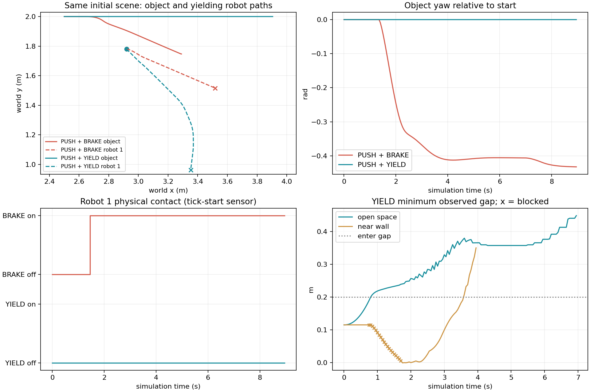

# Option V2：让路、PUSH方向闭环与测台审查

> 后续更新（2026-11-04）：用户已授权并启动[V2独立并行长训](V2_Event_RL_12h_Launch_20261104.md)。下文“尚未训练/原16worker绑定V20”描述的是11月3日实现交付时的历史状态；现有V21长训器、停止链路与行为日志已完成预检查，训练运行中。

2026-11-03。用户授权一次性完成主要修改、发布测台实例，并清理冗余RL输出。状态：**实现和聚焦检查完成，8765更新为V2，等待用户行为审查；没有新策略训练**。

## 为什么改，改了什么

原BRAKE主动将自身速度压向零，不能承担“退出物体前进路径”的职责；其旧避障默认只处理静态障碍。高层缺少既不推物体、也不挡路的选择。另一方面，原选面存在`abs(n·d)`、双机未逐侧筛方向、外部分配绕过方向筛选等漏洞，不能把所有抵抗都归因于RL。

本次成套修改：

1. **新增YIELD，ID46，类型14。** 无威胁时停留；有接近威胁时检查33个速度候选及0.8s轨迹，从观测表面中选择可行的局部退让。参考上限0.40m/s、加速度沿用0.5m/s²；进入/退出净空0.20/0.32m，期望净空0.12m。
2. **保持世界坐标中的退让方向。** 防止最近威胁从物体切换为墙时，法向反转导致“左/右”记忆也反转。可行方向变化时允许改侧，不保证全局可达。
3. **进入YIELD立即提交。** 继承原参考速度、继续限加速度，但不要求先刹停；否则正被推动的机器人可能永远不能让路。
4. **统一PUSH方向。** 初选、单/双机分配、跟踪和执行均使用有符号`n·d≥cos35°`。不匹配的已提交面不再输出推进意图；不给它自动换面。速度挡位变化保持q提交代数，改变方向才重新提交。
5. **新增V2动作/事件/策略接口。** `experiments/option_rl_v21/`，973维、15type×4scale、47个存储ID；RL36个有效单机动作，1168个静态合法有序组合。保留原组合，新增P+Y/R+Y/W+Y/Y+Y及交换角色；仍不开放P+R、ROTATE、FOLLOW给RL。
6. **让路不计入任务进度。** P+Y由P方接触/0.2m进度触发；R+Y由R方触发。纯Y/WAIT每1s回看。PUSH无匹配方向持续0.15s、YIELD blocked持续0.25s会提前交回决策，同一持续问题去重。
7. **V2平移mask去掉矩形尺寸估计。** 只根据当前可见拟合法向判定匹配，与执行器同一条件。legacy ROTATE/FOLLOW仍留在手工测台，未在本轮重新验收；不将本轮称为全option未知形状验收。
8. **修正测台预算与记录。** 段开始设置预算、使用0.05s真实控制时钟，预算段按单tick检查，下一段清空旧账；逐tick保存预算。补齐skill/force/YIELD/方向日志，避免记录白名单丢掉新字段。

YIELD只读取当前扫描、公共边界、自身/队友里程计和现有合法共享运动估计。只补密相邻同类、距离接近的雷达返回，不闭合不可见轮廓，不使用物体真实中心/尺寸。物体运动估计可能有误，未见几何不能保证避碰。PUSH/REPOSITION速度、奖励、物理、成功判据不改；没有添加方向一致奖励、切换惩罚或禁止真正对向PUSH。

## 测台入口与看什么

打开 **http://127.0.0.1:8765/** 并刷新。preset中搜索`V2`；这些场景已正式注册，可以编辑、拖拽和重新Run。新增`yield / direction`图层默认开启：

- 黄色/红色箭头：请求PUSH方向及匹配状态；debug区分“有匹配面”与“实际已分配执行”。
- 青色箭头：选中的退让速度；细线：可行/拒绝的候选速度；红圈：当前威胁返回。
- debug显示当前/预测净空、blocked和保持的退让侧；Timeline区分yield_idle/escape/blocked。
- 原force/speed、q/法向、雷达和接触图层继续可用。`physical_contact`在原始strip中是tick开始的接触传感反馈，与contact-ready控制flag分开。

| 实例 | 观察与结果 | 回放 |
|---|---|---|
| 同起点PUSH+BRAKE | 对向制动并被带走；物体前进0.790m，角偏峰0.432rad；robot1实际接触7.55s | [BRAKE对照](http://127.0.0.1:8765/?run=20261103_215538_49f501) |
| 同起点PUSH+YIELD | robot1侧后方退出，接触0s；前进1.405m，角偏峰约2.38×10⁻⁵rad | [让路](http://127.0.0.1:8765/?run=20261103_215539_8fe6f2) |
| 近墙让路 | 最后退出，但仍接触0.50s、blocked1.0s；峰值角偏0.144rad | [重点边界例](http://127.0.0.1:8765/?run=20261103_215539_2baf31) |
| 真正对向PUSH | 合法两侧E/W，仍会顶牛；物体位移0，双侧接触6.15s | [保留问题](http://127.0.0.1:8765/?run=20261103_215540_29265f) |
| 反面错误方向→让路 | 前1.6s反面E请求被拒绝，未错误向相反方向推；改P+Y后恢复前进 | [方向拒绝](http://127.0.0.1:8765/?run=20261103_215541_47bc93) |
| 同面双北推 | 北移1.069m，角偏峰3.52×10⁻⁵rad | [双推](http://127.0.0.1:8765/?run=20261103_215541_589fec) |
| N+E协推 | 东移0.548m、北移0.900m，角偏峰0.110rad | [相邻面](http://127.0.0.1:8765/?run=20261103_215542_47542c) |
| 无威胁YIELD | 机器人和物体不发生位移 | [静止](http://127.0.0.1:8765/?run=20261103_215542_901be5) |

这是手工定时option序列，不是RL自动执行。最终8例均未满足task success，部分是固定推动时间越过目标；本轮关注动作行为，不以改变终止条件制造成功。上述BRAKE/YIELD对照使用相同V2执行器和起点，主要改变非推动方的动作，不能把它描述为V1策略对V2策略的成功率提升。

净空图中的近墙接触和blocked是保留的负证据。抵消指标取自**协调门控前的机器人电机力请求**；gate_pre/post另存于逐帧mb中，它不等于传到物体的实际接触合力，未用作reward。

## 检查、执行过程与边界

- **62项聚焦测试通过（3.27s）**：13项V2测试＋V20事件、候选、速度/索引、D013 q/接触分配和观测内核。包括YIELD运动中切换、无威胁静止、封闭场景blocked、真实P+Y事件、方向防御、joint logp与checkpoint不兼容、速度变化不重置q、预算时钟和逐tick日志。
- 扩大检查时发现7个旧断言失败：D010控制器fixture6项、D005历史129tick成功1项；已用冻结前完整源码单独调用，**同样7项失败**。原始逐项证据：[preexisting_test_audit.json](../assets/option_v2_20261103/preexisting_test_audit.json)。这些没有改成通过/跳过，也未宣称全测试套件通过。
- 新增HTML/API/JS语法和源码版本检查；测台有随Git保存的场景面板回退，不再依赖旧outputs才能启动；没有完整headless视觉/拖拽测试，交由用户在测台审查。
- 开发过程有5轮正式8例回放（review_002至006，共40条），review_001在场景参数校验处中止、0物理；另有开发探针与测试fixture，不把40冒充全部物理执行次数。最终证据为review_006；早期近墙不理想结果保留到intermediate_runs，移出活动Runs列表以减少重复项。
- 当前只完成小实例执行验证。没有V2 RL训练、全任务矩阵、未知形状泛化、绝对安全保证或新的V1 test结果。
- V2已提供串行训练/采样入口与版本化checkpoint检查；原16worker长训器仍绑定v20，不能直接把V2权重塞进旧runner，也没有自动启动新长训。

当前两个明确的后续问题：近墙/狭窄情况下YIELD受阻后，高层是否及时停止推进；真正合法对向PUSH是否应保留给转动，或待ROTATE成熟后收紧菜单。**本轮没有替用户选择惩罚或禁止对向动作。**

## 原始产物与V1清理

- 最终数据：[metrics.json](../assets/option_v2_20261103/metrics.json)、[源码manifest](../assets/option_v2_20261103/manifest.json)；本机完整回放在`outputs/testbed/runs/`，中间轮次在`outputs/testbed/experiments/20261103_option_v2/`。
- 重生成小回放：`.venv/bin/python -m experiments.option_rl_v21.run_review --out outputs/testbed/experiments/20261103_option_v2/new_review`，输出目录必须不存在；会新增8条运行，按需人工执行。
- [第一版RL基线登记](../../rl_baselines/README.md)：best/final与686项源码冻结；清理冗余输出及已压缩迁移包的解包暂存，释放约2.30GB。原12:50交接是历史截点，当前应使用最终V1包。

跨PC需要现成V2回放时，另拷贝`outputs/handoff/20261103_option_v2/testbed_review_v2.tar.gz`，SHA与16项文件清单见[transfer.json](../assets/option_v2_20261103/transfer.json)，在新仓库根目录解压即可。它只含本轮8条回放和8个preset，不含训练权重；权重使用V1最终包。Git认证问题仍未解决，本轮代码可通过`outputs/handoff/20261103_option_v2/coimagine_option_v2.bundle`接续：在旧远端克隆后`git fetch /path/to/coimagine_option_v2.bundle main`再`git merge --ff-only FETCH_HEAD`。两个压缩包及Git bundle均在本机，不会自动上传。

最终在线检查及冻结V1读取记录：[verification.json](../assets/option_v2_20261103/verification.json)。review_006后仅补场景面板回退/服务启动和训练入口回退，PUSH/YIELD算法hash保持一致。
