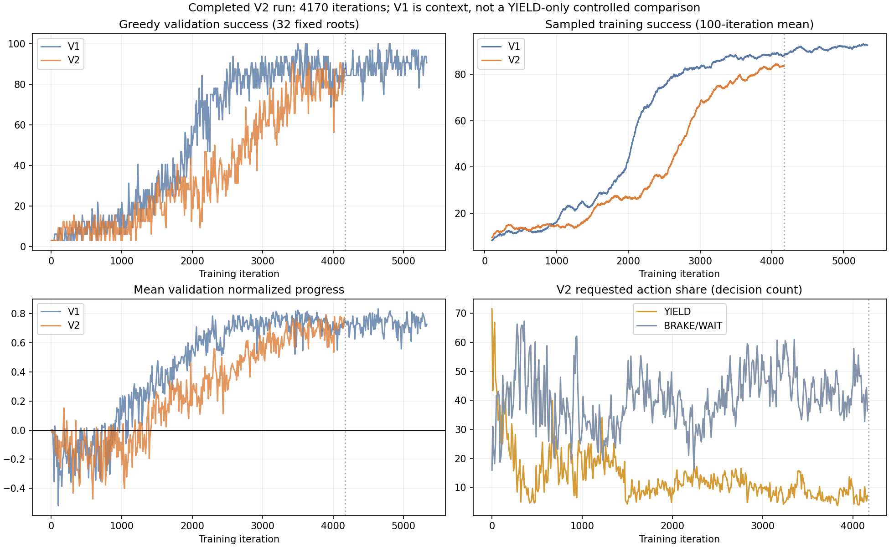

# V2 事件进度 RL：本轮训练总结

复核日期：2026-11-05，Asia/Shanghai。运行目录：`outputs/option_rl_v21/event_12h_20261104/`。

**结论：V2 已学到较高成功率的推动策略，早期平台最终被突破；最佳验证29/32、最近完整验证28/32。尚无独立test结果，也没有证据证明新增YIELD使整体行为优于V1，或已解决挡路/顶牛。**

## 这轮要回答什么

上一轮策略会用BRAKE挡路，或在对侧施加抵抗力。本轮加入局部避让YIELD及PUSH+YIELD等合法组合，同时修正PUSH方向语义，平移动作mask改用当前可见面法向、不用矩形尺寸推断。目的是确认新option体系仍可被RL学会，并观察策略是否主动使用避让减少干扰。

维持原奖励与成功判据，施力惩罚系数为0；没有对向推动惩罚。本轮不是只增YIELD的单因素实验，也没有固定时间决策消融。当前仍是集中共享观测、固定矩形分布、单训练seed；去除平移mask尺寸先验不等于已经证明未知形状泛化。

## 完成情况与模型

| 项目 | 核对结果 |
|---|---|
| 预算与退出 | 单调时钟43,202.74s，约12h；wall_budget_reached；exit code 0，保存后退出 |
| 采样 | 16常驻worker，32有效episode/轮，4,170轮 |
| 总数据 | 133,440 episode；5,657,193 actor transition；约938.9万仿真秒 |
| 健康 | 训练异常0，已记录完整验证异常率均0；82项源码hash全部一致 |
| PPO | old-logp全程最大重算误差1.335e-5，低于2e-5故障阈值；最后100轮KL均值.01488、EV .821、entropy1.389 |
| best.pt | 第3,900轮；已核对checkpoint内部轮次 |
| policy.pt / checkpoint.pt | 第4,170轮；已核对内部轮次；最终4170权重未额外评估 |
| 最新完整验证 | 第4,160轮；4170到点保存，未执行该轮验证 |
| 独立test | **未运行**；新32根面板仍保留 |

`requested_stop`是监督器到预算后的正常请求停止，不是异常崩溃。日志写完成本地时刻为11月4日23:08:44，与开训本地标签12:03:41的差值并不等于12h；两种时钟标签不一致的具体原因本轮未审计，不能把显示时差当作实际预算少跑。训练预算和run_seconds使用单调时钟。

权重SHA、配置、分窗统计及结束状态：[summary.json](../assets/v2_training_final_20261105/summary.json)。best/final/source_snapshot仍在原运行目录，不自动续训或清理。

## 学习效果

| 阶段 | 随机训练成功率均值 | 固定32根贪心验证均值 |
|---|---:|---:|
| 501–1,000轮 | 14.1% | 8.4% |
| 1,501–2,000轮 | 25.7% | 25.8% |
| 2,001–3,000轮 | 43.3% | 40.2% |
| 3,001–4,000轮 | 77.4% | 74.2% |
| 最近200轮：3,971–4,170 | **83.8%** | **79.1%**（19次完整验证） |

前约1,000轮平台较长，约1,400轮后开始出现连续改善。首次验证≥50%在2,320轮，首次≥80%在3,330轮。训练曲线均值来自变化的随机场景，不等于最后一份策略的冻结评估；验证重复同32根，也不是新增独立样本。

| 策略对应验证 | 成功 | 排除初始就在目标内的一根 | 归一化距离改善 | 平均回报 |
|---|---:|---:|---:|---:|
| best@3900 | **29/32，90.6%** | 28/31，90.3% | .794 | +7.10 |
| 最近完整@4160 | **28/32，87.5%** | 27/31，87.1% | .775 | +6.80 |

best平均绝对距离改善.858m、最终平均距离.161m。最后一次完整验证平均绝对改善.844m。最近200轮验证仍有18/32到29/32的波动，不能用峰值代替稳定性；best到4160新增成功1根、丢失2根，成功保留仍非单调。

## 与V1对比

相同12h单调时钟预算，V1完成5,331轮/170,592episode，V2完成4,170轮/133,440episode。两版平均总轮时约8.10s与10.36s；轨迹、感知/控制路径、诊断及动作不同，不能将吞吐差单独归因于YIELD计算。

V1最佳验证32/32，最近完整29/32；V2相应为29/32、28/32。V1的最佳出现在4640轮，比V2总轮次更多。对齐3,971–4,170轮窗口，V1/V2验证均值82.97%/79.11%，归一化改善.700/.707。现有单seed证据不支持“V2已经优于V1”，也不能简单归结为明显退化。

V1旧best@2580曾测test26/32；该结果不属于V1最终best，也不能作为V2test。公平泛化对照仍需冻结权重、各自匹配源码，在相同未用面板上评测。

## 行为上解决了什么，没解决什么

上次重点的root2、24、27，在best3900和最近完整4160中均已成功。best终点距离分别.075/.027/.186m；4160分别.093/.104/.131m。说明此前“推远后闲置”“对抗来回运动”“方向不可用后长期等待”的三个实例，策略已找到成功序列；尚不是每个序列都经过完整20Hz视觉审查。

YIELD并未被完全放弃：best的两侧决策占比约10.0%，最近完整约7.2%。best实际YIELD执行7.10 robot-s/episode，其中active6.00；它已参与行为，但不证明对成功有因果贡献。

**内耗尚未解决。** 最近完整验证每episode平均双侧接触反向施力8.79s，严格低运动子集.203s；BRAKE方接触物体6.78 robot-s。best的相应数值9.97s/.173s/8.63 robot-s。

尤其不能只看每回合对抗秒数下降：比较前平台901–1070与最近200轮，验证episode平均时长85.2→50.7s；反向施力占仿真时间比例约15.9%→17.5%，BRAKE方接触robot-s/仿真秒约.143→.179。因此任务更快完成导致绝对时长减少，不能据此宣布协作更干净。反向力/接触也可能包含合理制动或力矩，需要逐tick结合任务效果判定。

## 剩余失败与下一步

best3900的三个失败均为90s超时，且均有净接近：root9距离2.346→.367m，root23为1.027→.298m，root31为1.854→.668m。最近4160失败为root6/9/17/31，终点.308/.761/.528/.204m。root31只是接近.2m边界，不能仅靠终点距离归因于停车；需要看完整轨迹与速度。

下一步优先对事先按验证选择的best3900做保留test，并将同一失败实例的20Hz动作、接触、力、速度、目标距离做测台回放。若比较V1，必须使用V1冻结源码；若验证YIELD贡献，需要同状态短分支或明确消融，不能靠动作出现比例得出结论。当前没有依据优先再加12h训练或直接加惩罚。

本次总结仅用已有数据，新增物理运行为0；没有评测最终4170策略、没有跑test、没有修改控制器/奖励、没有续训。离线可复算脚本及逐根CSV：`outputs/agent_exchange/V2_training_final_20261105/`。
