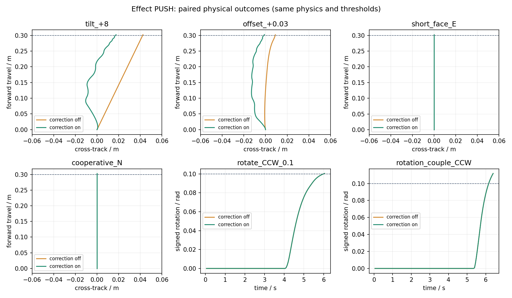

# 效果导向 PUSH v1：实现与调试测台

日期：2026-10-27。基于 `random-start-oriented-v4.7` 的显式可选控制器；已完成小场景调试，尚无新 RL 训练结果。

后续更新：新增[端点跟踪与接触点控制 v2](20261027_Endpoint_Tracking_PUSH_v2.md)。本文数值仍为 v1
的冻结结果；v2 的改善和退化单独报告，旧输出未覆盖。

## 调试入口

- [本地交互测台](../../outputs/option_testbench_v1/effect_push_v1/round_007/index.html)：浏览器直接打开，可切换场景、纠偏开关、播放速度、逐帧与时间轴。
- [便携回放包](../../outputs/option_testbench_v1/effect_push_v1/round_007/viewer_bundle.zip)：解压后打开 `index.html`，无需服务器。
- [逐场景结果](../../outputs/option_testbench_v1/effect_push_v1/round_007/SUMMARY.md)、[冻结运行配置](../../outputs/option_testbench_v1/effect_push_v1/round_007/manifest.json)。完整原始日志在同目录 `logs/`。

回放区分真实物体轨迹与控制器的本侧估计，并显示拟合面、接触目标、几何置信度、估计效果和退出原因。
真值只用于离线显示和评分；控制器使用步前观测，真值帧为执行该控制步后的状态，界面分别标时。



## 本次实现

1. **效果编码**：世界系 8 个平移方向 × `{0.1,0.2,0.3,0.4,0.5} m`；顺/逆时针 × 同样五档数值的角度（单位 **rad**）。保留 16 个非 PUSH 动作，共 66 个 ID。
2. **本侧几何 mask**：用自身朝向及拟合面法向判断方向是否在 30° 可用锥内。物体尺寸采用显式公开矩形先验，默认 `1.0×0.25 m`；不读取真实物体姿态、隐藏摩擦或队友私有历史。mask 只表示局部几何可用性。
3. **同面反馈控制**：固定关联当前接触面；面内接触点按方向、侧偏与角速度误差更新，带限幅、限速和死区；按估计物体位移/转角减速、制动并判断完成。换了另一个面就退出，不在 PUSH 内绕面。
4. **可观测性与失败显式化**：被遮挡的边界不冒充物体角点；不把无法观测的切向位移当效果。短时几何丢失有时限，超时退出。不可用请求明确返回，不自动翻译成 REPOSITION。
5. **双机配合**：同向平移依据自己扫描到的队友方位分开接触角色，避免两机都追逐面中心；仅相容效果意图进入协同路径。此前的 REPOSITION 跨面计程修复保留。

复用同一物理引擎、奖励权重、任务成功条件和 90 s episode 时域；option 的时间预算是显式控制参数。
新动作表为独立版本，默认旧接口仍使用原来的 28 动作，旧权重不自动套用新编码。

## 实测结果与边界

最终调试面板为 **33 个固定开发场景 × 接触点纠偏开/关 = 66 个分支**，全部实际执行完毕，约 32.6 s。
两组都保留速度、间隙和效果终止反馈；开关只隔离**平移接触点纠偏**，不是完整闭环对开环，旋转两组相同。
中间调试轮保留在 `round_001`–`round_006`，本报告只汇报最终 `round_007`，不拼接不同版本成绩。

| 检查 | 结果 |
|---|---|
| 8 个方向，各请求 0.3 m | 均完成，真值约 0.302 m；各场景先将可见面朝向与目标方向对齐，不表示同一接触面能推任意方向 |
| 五档平移 | 请求 0.1–0.5 m，实际约 0.102 / 0.202 / 0.302 / 0.402 / 0.502 m |
| 面倾斜 ±8°，请求 0.3 m | 绝对侧偏约 **4.25 cm → 1.76 cm**；耗时 **8.20 s → 9.95 s**，有额外时间成本 |
| 初始偏置 +0.03 m | 最终绝对侧偏约 **0.91 cm → 0.10 cm** |
| 同侧双机平移 0.3 m | 开启纠偏后约 0.303 m，控制器完成，7.60 s |
| 单机长面旋转 ±0.1 / ±0.3 rad | 实际绝对角约 0.1005 / 0.3004 rad，控制器完成；允许伴随平移 |
| 窄面旋转 0.1 rad | 只达到约 0.0624 rad，窗口耗尽，离线未兑现；仍需优化 |
| 双机力偶旋转 0.1 rad | 实际约 0.1118 rad，在离线角度容差内，但尚未稳定就窗口耗尽，**控制器未声明完成** |
| 反向、切向、不可见、遮挡四个负对照 | 均判不可用并明确退出；不自动换面 |

每组 33 次请求中 29 次几何可用；控制器均声明完成 27 次。
固定离线阈值下，效果兑现为关闭纠偏 **26/29**、开启 **28/29**。
阈值：平移沿目标方向误差 `[-0.02,+0.04] m`、侧偏 ≤0.04 m、转角 ≤10°；旋转角度误差 `[-0.03,+0.08] rad`。
离线角度兑现与控制器完成分别统计，不能混用。最大接触穿透约 0.78 mm，未出现穿透异常退出。
[可转发的完整指标快照](20261027_effect_push_v1_assets/metrics.json) 包含负对照和全部退出。

这些是参与调参的固定小场景，**不是独立测试集成功率、RL 任务成功率或学习效率提升的证据**。
只缩短动作尺度不构成控制改进证明；上面的纠偏对照使用相同请求、物理条件和离线阈值。
当前主要剩余问题是窄面旋转的可控性、双机旋转的制动与稳定，以及遮挡下可保留多少可靠效果估计。
公开已知矩形尺寸也是当前方法的限制，尚未验证未知形状或尺寸误差。

## 复现与继续调试

```bash
# 新目录，完整有界面板；每分支墙钟限时 10 s，总预算 120 s。
.venv/bin/python experiments/option_testbench/effect_push_eval.py \
  --out outputs/option_testbench_v1/effect_push_v1/round_008

# 小面板单参数调试；--cases 后用空格分隔精确名称。
.venv/bin/python experiments/option_testbench/effect_push_eval.py \
  --out outputs/option_testbench_v1/effect_push_v1/round_009 \
  --cases tilt_+8 cooperative_N --heading-gain 0.2 --total-seconds 30
```

配置、阈值、源码哈希在运行前写入 `manifest.json`；后续运行也自动写 `ROUND_PLAN.md`。
`--render-only` 从已有日志重建页面，不重跑物理；渲染源码版本另记在 `render_manifest.json`。
页面内嵌数据以五位小数显示，原始日志精度不变。已有目录禁止覆盖。

主要代码：[控制器与动作表](../../src/coimagine/random_start/effect_push.py)、
[有界测台](../../experiments/option_testbench/effect_push_eval.py)、
[观测边界与回归测试](../../tests/test_effect_push.py)。
供以后 RL 接入的接口为 `ACTIONS / make_effect_skill / action_mask / type_scale_mask / action_id`。
类型×尺度为不等长表：14 类、最多 5 档，非 PUSH 仅 4 档，必须屏蔽无效组合；不能继续使用 `type*4+scale`。
本侧私有 mask 若用于分布式公共动作选择，还需遵守通信信息边界，不能当作双方免费共享的信息。

验证：82 项相关测试通过，其中新增 PUSH 29 项、REPOSITION 13 项。
全量非 slow：**550 passed、10 failed、37 skipped、21 deselected**；10 个失败 ID 与修改前基线相同，
原因均为旧报告/图片/模型/数据文件缺失。没有用补造这些实验产物来让测试变绿。
页面脚本通过 Node 语法与 66 分支首尾帧绘制逻辑检查；尚未进行真实浏览器自动化验收。
run9 产物未改写，本轮没有启动 RL；建议先通过回放确认接触行为，再接新动作表做有预算的训练对照。
