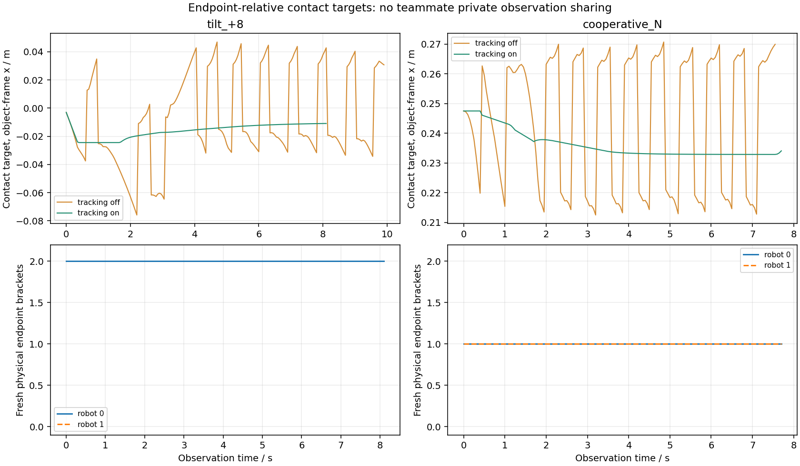

# PUSH v2：本侧端点跟踪与接触点控制

日期：2026-10-27；控制器版本 `effect-push-v2-endpoints`。已实现、测试并执行有界对照，尚未训练 RL。
**端点跟踪明显改善接触目标连续性；当前推动效果有改善也有退化，暂不替换默认控制路径。**

后续更新：[v3 接近提速与相邻初态稳定性](20261027_PUSH_v3_Faster_Approach_and_Local_Stability.md)
已单独实现并对照，本文继续保留 v2 的冻结结果。

## 回放与数据

- [交互测台](../../outputs/option_testbench_v1/endpoint_tracking_v1/round_003/index.html)：选场景、切换端点跟踪开关、逐帧查看两机自己的端点证据和接触目标。
- [便携回放包](../../outputs/option_testbench_v1/endpoint_tracking_v1/round_003/viewer_bundle.zip)：解压后直接打开 HTML，无需服务器。
- [完整结果](../../outputs/option_testbench_v1/endpoint_tracking_v1/round_003/SUMMARY.md)、[运行前冻结配置](../../outputs/option_testbench_v1/endpoint_tracking_v1/round_003/manifest.json)、[端点独立审计](20261027_endpoint_tracking_assets/endpoint_audit.json)。

白圈为当前锚点，绿/黄点为两机分别维护的端点估计，区间线为当前观测约束，灰点为暂存预测。
观测/估计与真值分别标示；另一侧的估计只用于离线显示，控制器不能读取它。
原始日志在测台同目录 `logs/`，旧 v1 `round_007` 与本轮中间版本均保留。



## 实现原则

1. **先判断端点是什么**。两块有效可见面的直线交点可以精化共同角点；单面通过最后命中与相邻射线限定端点区间。
   若邻接射线仍在同一直线上，就继续沿实际命中延伸，避免把拟合分段误当端点。队友/静态物遮挡、量程截断分别标记，不能成为物体角点。
2. **面内插值不增加传感器信息**。派生点在已拟合的单一直线上生成，供几何表达与调试；双面精化采用解析求交。
   实射线仍为 72 条，不改变 `arc_rays` 或观测置信度，不把插值当作新测量。
3. **跟踪物理端点区间**。两个端点均可见时，先与公开面长度约束求交，再更新位置/速度。
   预测仍落在测得区间内时，不因区间中点跳变而移动估计；当前面法向位移由当前拟合线更新，面内位移做因果滤波/预测。
4. **接触目标主要由锚点距离决定**。粘住一个仍可见的端点，以“从该端点向面内移动多少米”指定接触目标。
   另一端被遮挡时，公开矩形尺寸先验可确定面中心，但不会把隐藏端点标成已观测。可见锚点失效后才切换到另一个实际观测到的端点。
5. **不长期延续假端点**。两端都不可观测时只短时预测，最长 0.25 s；预测不能独自证明平移效果完成。
   换面、时钟回退、明显不一致均重置/拒绝。目标在遮挡方向仍受原始可见片段约束，安全判断使用原始扫描与接触反馈。

当前跟踪器仅保存**一个 PUSH option 内**的本侧历史，跨 option 初始化；尚未实现穿越 REPOSITION 的全局角点身份关联。
仍依赖公开的 `1.0×0.25 m` 矩形先验，未验证未知尺寸、非矩形物体、测距噪声或高速运动。

## 实际结果

最终固定开发面板：原 33 场景加双面可见、倾斜同侧协作，共 **35 场景 × 开/关 = 70 分支**，全部实际运行，约 **40.1 s**。
每分支墙钟限时 10 s、批次预算 60 s；奖励、成功条件、物理、尺度、原 option 预算和离线阈值未改。
两个分支均开启原有接触点纠偏。开启端点路径还包括：初始旋转接触目标一次确定、面内对齐时同步接近保留额外 3 cm 间隙的 staging 线。
因此这是端点跟踪与接触点控制整体对照，不是纯滤波单因素消融。

| 检查 | 跟踪关闭 → 开启 |
|---|---|
| 单机 +8° 倾斜面：接触目标每帧变化 P95 | **6.22 cm → 0.071 cm** |
| 平直同侧双机：接触目标每帧变化 P95（机器人 0） | **4.97 cm → 0.042 cm** |
| 平直同侧双机：每机至少一个新鲜端点 | 开启后，两侧各 **155/155** 活动帧可观测；分别维持两端，**0 次锚点切换** |
| 平直同侧双机：锚点离线误差 | 机器人 0 的 RMSE **约 5.18 mm**；这是有界估计，不是精确角点传感器 |
| 倾斜同侧双机：最终侧偏 | **2.23 cm → 1.19 cm**；耗时 **8.40→8.50 s** |
| 单机 +8° 倾斜面：最终侧偏 | **1.76 cm → 3.03 cm**，有退化；耗时 **9.95→8.15 s** |
| 单机 ±0.1 rad 旋转 | 旧路径完成；新路径到约 **0.0894 rad**、窗口结束，**未声明完成**，但仍在冻结的离线角度容差内 |
| 双机 0.1 rad 力偶旋转 | 旧路径未稳定退出；新路径完成，但实际约 **0.1338 rad**，仍有明显超调 |
| 双面可见角点起步 | 锚点可贯穿全部 **280 帧** 跟踪，但远离目标接触位置，14 s 内只推到 **0.0786 m**，未完成 0.3 m 请求 |

这里的目标帧间变化在物体坐标系中、使用与观测时刻匹配的步前真值离线计算；它包含有意的接触点调整，不能简单等同传感器噪声。
控制器没有使用这些真值。平直同侧、倾斜同侧以及力偶旋转三个协作场景中，双方同时活动期间，各自至少一个新鲜端点的覆盖率均为 100%；
倾斜同侧的机器人 1 有一次锚点切换。**这是这些开发场景的实测，不是任意协作构型下的可见性保证。**
关闭跟踪的覆盖率记为 N/A，不能据未输出端点状态断言其看不到端点。

汇总：每组 35 个请求、31 个几何可用；旧/新路径的控制器完成数 **28/27**，冻结离线效果兑现均 **29/31**。
最大接触穿透约 **0.78/0.62 mm**，没有出现穿透异常退出。四个不可用负对照均保留。
因此可以认为接触目标跳变问题得到缓解，**不能宣称整体任务成功或 RL 学习效率已提升**。
下一轮重点应是稳定锚点下的方向外环和旋转准备/制动，而非继续平滑画面或扩大容差。

## 使用与验证

```bash
# 配对对照，两组均开启原接触点纠偏；新目录不覆盖已有结果。
timeout --signal=TERM --kill-after=2s 65s .venv/bin/python \
  experiments/option_testbench/effect_push_eval.py --compare-tracking \
  --total-seconds 60 --out outputs/option_testbench_v1/endpoint_tracking_v1/round_004

.venv/bin/python experiments/option_testbench/endpoint_tracking_audit.py \
  --out outputs/option_testbench_v1/endpoint_tracking_v1/round_004
```

控制器开关：`EffectPushConfig(endpoint_tracking=True)`；默认 `False`，供先审阅回放再决定是否推广。
源码：[端点观测与跟踪](../../src/coimagine/random_start/endpoint_tracking.py)、
[PUSH 接入](../../src/coimagine/random_start/effect_push.py)、
[回归测试](../../tests/test_endpoint_tracking.py)。原始 v1 源码额外保存在本轮输出的 `baseline_sources/`。

验证：**96 项相关测试通过**，含新增 14 项端点边界、双面交点、遮挡、因果/幂等、观测丢失、信息边界及静止物体自身运动对照。
全量非 slow：**564 passed、10 failed、37 skipped、21 deselected**；10 个失败 ID 与上一轮完全一致，均为既有旧文档或实验文件缺失。
HTML 脚本通过 Node 语法检查和 70 分支首尾帧绘制逻辑检查；尚未做真实浏览器自动化验收。
run9 结果未改写、训练动作表未替换，本轮没有新 RL 训练。
