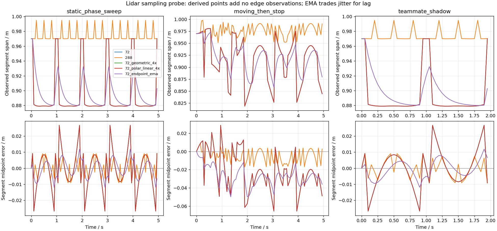

# 雷达离散采样与边界跳变：小对照

日期：2026-10-27。结论：可以做上采样，但**同帧内补点不能补回没有观测到的端点**。
建议优先做带可见性约束的跨帧面/边界估计，补点只用于同面几何表达。
本轮只添加离线诊断，没有改变传感器默认值、PUSH 控制器、观测维度或启动训练。

后续实现：[端点跟踪与接触点控制 v2](20261027_Endpoint_Tracking_PUSH_v2.md) 已完成有界对照，
接触目标连续性改善，但任务效果仍有退化，保持显式开关。下文为最初诊断的冻结结果。

## 当前问题确实存在

当前雷达为 72 条射线，360°、5° 间隔、20 Hz。`scan_patches` 拟合点来自实际命中，
可见线段的长度取决于首尾命中点；一条边缘射线命中/脱离，会造成长度突变。
在上一轮 `round_007/logs/tilt_+8__feedback.json` 的实际 PUSH 回放中，
5.50→5.55 s 的拟合面原始命中点跨度从 **0.8753→0.9849 m**，射线数 **28→29**。
这是原始可见点跨度，不是物体真实长度改变，也不能直接当作物体位移。
新 PUSH 已用相邻射线约束加公开尺寸先验估计面中心，但接触目标还受当前命中片段限制，
因此原始片段抖动仍值得继续处理。

## 实际比较了什么

[诊断脚本](../../experiments/option_testbench/lidar_resolution_probe.py) 在同一组脚本化姿态上运行：
静止物体/机器人朝向微动、物体横移后停止、队友在 2 s 后完全遮挡三种情况。
每种 100 帧、50 ms 间隔；使用原雷达射线求交与原拟合函数。没有运行动力学控制或 RL。
姿态是诊断输入，真值用于生成扫描和离线误差；补点与滤波只读取自身命中及历史。

- **72 / 288 实射线**：真实执行求交，增加实际观测。
- **72 + 同面几何补点 4 倍**：只在同一个已拟合片段的相邻命中之间，插入与拟合直线相交的派生点，不向端点外延伸。
- **72 + 距离线性插值 4 倍**：同样只在该片段内部，直接对距离插值，观察是否引入曲率。
- **72 + 端点跨帧 EMA**：世界坐标下因果平滑，参数 τ=0.15 s、α=0.25；观测丢失/明显跳变就重置。
  这是用来展示平滑与延迟的诊断，不是已验收的控制器边界跟踪算法。

静止物体、朝向 ±3° 微动时的结果：

| 方法 | 最大相邻帧跨度跳变 | 片段中点 RMSE | 开销中位数 |
|---|---:|---:|---:|
| 72 实射线 | 8.89 cm | 1.23 cm | 1.11 ms：扫描+拟合 |
| 288 实射线 | 2.49 cm | 0.58 cm | 4.30 ms：扫描+拟合 |
| 72 + 几何补点 4 倍 | 8.89 cm | 1.23 cm | 另加 0.30 ms |
| 72 + 距离线性插值 4 倍 | 8.89 cm | 1.23 cm | 另加 0.42 ms |
| 72 + 端点 EMA | 2.25 cm | 0.55 cm | 另加 0.038 ms |

计时只覆盖本机该微型场景的扫描/处理步骤，不是整个环境或训练吞吐。
288 射线的扫描+拟合约为 72 射线的 3.9 倍，不能据此说训练会慢 3.9 倍。
当前模拟器没有测距噪声：原平面点本来就基本共线，几何补点不会增加信息。
距离直接线性插值还产生了最高约 0.37 mm 的拟合 RMS；这不是新观测噪声，而是插值失真。



图中 72、几何补点、距离插值的端点跨度与中点误差曲线重合；补点没有向端点外扩展。
遮挡组从 2 s 起没有有效拟合片段，所有方法均保留缺失，不延续一个虚构的可见面；图中有效曲线止于此处。
横移速度 0.12 m/s 的稳定运动段，EMA 中点相对未滤波中点平均落后约 **1.82 cm**，
相当于该速度下约 0.15 s。运动组中点 RMSE 约 **3.02→2.92 cm**，没有随静态抖动一样大幅改善。
滤波并未消除端点截断偏差，不能把画面平滑直接当作效果估计准确。

## 建议的实现方向

1. **保留原始扫描与真实支持数**：派生点另存，不能将 72 条的插值结果当成 288 条独立测量，不能据派生点数抬高置信度。
2. **先分面，再在面内补点**：沿拟合直线而非直接平均极坐标距离；不跨物体/背景、遮挡或不同面的不连续处插值，不把未命中距离 0 当真实距离参与滤波。
3. **分别跟踪直线与端点可见范围**：法向、平面偏移、面内中心/边界分别处理；用自身定位将历史变到同一坐标系，再做因果预测与更新。需要区分机器人自身运动和物体真实运动。
4. **端点是有界估计，不是假角点**：物体边界只知道落在最后一条命中与相邻射线之间；队友遮挡边界不能作为物体角点。保留区间/置信度，观测不足就降级或退出。
5. **控制时考虑延迟**：可做简单运动预测补偿，急转、换面、遮挡和残差异常时重置；测碰撞间隙/安全退出仍用原始扫描与接触反馈，不让平滑掩盖突然出现的障碍。

因此，下一步更值得验证的是 **72 实射线 + 跨帧边界估计 + 可选同面几何补点**。
288 实射线保留为分辨率参考；是否用于训练，要在整个执行循环计时后决定。
此处还未验证跟踪器在真实闭环推动、旋转与部分遮挡下的表现，也未声称改善了 RL。

## 复现与数据

```bash
timeout --signal=TERM --kill-after=2s 45s .venv/bin/python \
  experiments/option_testbench/lidar_resolution_probe.py \
  --out outputs/option_testbench_v1/lidar_resolution_probe/round_002
```

脚本拒绝覆盖已有目录；实际本轮结果为 `round_001`，包含运行前计划、源码哈希与参数的 manifest、
300 帧原始记录、汇总与图。小型指标快照：[summary.json](20261027_lidar_probe_assets/summary.json)。
几何补点端点不变、派生点数量、遮挡后不伪造有效片段及 EMA 因果递推均已从实际记录独立检查。
尚未修改生产感知/控制代码，因此未重复此前的全量测试。
