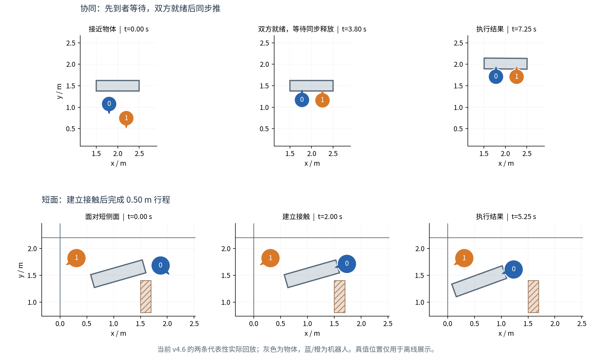
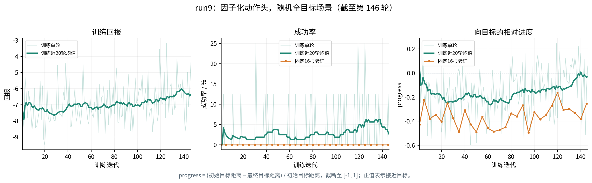

# CoImagine：近期 Option 优化与 RL 训练进展

**汇报日期：2026 年 10 月 27 日**  
**范围：连续二维双机器人协作推动；训练数据截取至当日 11:00，第 146 轮。**

近期主要完成了两方面工作：一是把推动、换面、跟随等 option 的执行目标和接触控制做得更明确、可靠；
二是重新开展 option 级强化学习，调整动作表示与训练初始化。目前已观察到局部技能改善和训练侧学习信号，
但随机任务上的稳定成功仍未建立。

## 1. 本阶段要解决的问题

机器人需要根据局部雷达观测，选择“在哪里推、推多远、何时换面、如何与队友配合”。
如果低层技能本身无法稳定兑现，上层 RL 的失败就难以解释。因此近期先用小场景测台修复和核查 option，
再让 RL 学习技能的选择与组合，为后续的技能后果预测和闭环规划准备动作接口与数据。

当前实验限定在二维仿真。RL 在本阶段主要承担行为学习和数据采集，不将训练技巧本身作为研究创新。

## 2. Option 优化：从接触建立到行程执行与同步协作

| 调整方向 | 主要改动 | 已观察到的效果 |
|---|---|---|
| 明确技能尺度 | PUSH、REPOSITION 改为请求距离，超时单独限制；WAIT、FOLLOW 保留时间尺度 | 区分“达到请求行程”和“预算用尽”，减少单纯依赖固定执行时间 |
| 改善接触与恢复 | 接近时瞄准可见接触区域，加入队友避让，增强短时丢接触后的恢复 | 在既有测台中减少接触丢失与安全中止 |
| 同侧协同推 | 双方先到达待推位置并对齐，均就绪后同步开始 | 避免一方提前推走物体，提高特定同侧构型下的接触连续性 |
| 短侧面接触 | 放宽原先对短可见面的硬拒绝，改为针对窄面的接触点选择 | 原先无法接触的短面能够建立接触，并完成部分距离档位 |
| 跟随技能 | 调整相对位置参考、间隙反馈和准备时间 | 代表性场景中的跟随兑现得到改善，尚不能等同于已证明“支撑增益” |

当前版本中，每台机器人有 **7 类技能 × 4 个尺度，共 28 个动作**；包括三档速度的推动、两个方向的换面、
等待和跟随。推动与换面请求距离为 0.10、0.25、0.50、1.00 m。
这里的推动距离指**机器人建立接触后的有效推动行程**，物体实际移动多少仍需单独评价。

*图 1：当前 v4.6 的两条代表性实际回放。上：一侧较远时，双方就绪后同步推动；下：短面接触后完成 0.50 m 行程。
两例物体实际位移分别约 0.516 m、0.518 m。灰色为物体，蓝/橙为机器人，斜线区域为静态障碍；真值位置仅用于离线展示。*

此前执行测台报告记录，同侧协同样例在建立接触后的接触保持比例达到 100%；这是**特定测试构型**的结果，
不是任意随机场景下的任务成功率。相邻侧协同仍会发生较大旋转、接触丢失或安全中止；部分 1 m 请求也仍会超时。

## 3. RL 调整：从简化动作到恢复完整尺度

RL 使用 option 级 PPO，场景为 4×3 m 无静态障碍空场，包含随机初始位置和随机目标。
策略输入包含两台机器人的局部观测；物体真值不直接进入策略输入。
**当前属于集中式观测的可学性诊断，尚未实现有限消息的分散式部署策略。**

| 阶段 | 为什么调整 | 当前证据与局限 |
|---|---|---|
| 平坦 28 动作 | 直接学习完整动作菜单 | 早期实验未形成稳定成功；其中部分旧实验存在训练封装问题，不能简单归因为动作数太多 |
| 6 个固定动作 | 暂时减少动作组合，让策略先尝试推动与换面 | 历史 run7/8 的固定 16 根评估最高为 **3/16**，但未稳定保持；run8 最后为 **1/16**，且缺少完整尺度 |
| 类型与尺度分头输出 | 恢复全部 28 动作，同时共享不同尺度之间的学习结构 | 当前 run9 正在训练；是否优于平坦编码，仍需相同条件下对照 |

训练配套也做了调整：用基于局部观测的目标启发式进行行为克隆初始化，帮助策略开始执行有形态的推/换面；
修复技能次数早退漏收费、跨 episode 回报串联和进度特征未更新等问题，并增加奖励分量与评估曲线记录。
该启发式在当前同一组 16 根评测中仍为 0 成功，因此它不提供完整的成功示范。

此前尝试过近目标训练和距离退火；**run9 已取消该课程**，使用坐标均匀采样的随机目标场景。
因此历史 6 动作结果与 run9 不构成严格控制变量对照，不能据此宣称因子化已经解决探索问题。

## 4. 最新结果：训练侧有改善，验证成功尚未出现

*图 2：run9 第 1–146 轮的真实记录。浅绿为训练单轮值，深绿为近 20 轮均值，橙色为固定 16 根的确定性验证。
progress 为目标距离的相对减少量，正值表示接近目标。图中只展示 run9，不拼接不同版本或课程的曲线。*

| 训练窗口 | 训练成功次数 / episode 数 | 平均 progress |
|---|---:|---:|
| 第 1–40 轮 | 7/320（2.2%） | −0.192 |
| 第 81–120 轮 | 11/320（3.4%） | −0.139 |
| 第 121–146 轮 | 8/208（3.8%） | −0.036 |

训练回报和目标进度在后段有所改善，但波动仍明显，最后一个窗口也较短。
截至第 146 轮，已完成的 **30 次固定面板验证均为 0/16**；最新验证为第 145 轮，progress 约 −0.255。
这些是重复评估同一面板，不能视为独立测试样本。训练面板中还包含初始已进入目标距离阈值的样本，
因此不能将训练成功的每次出现都解释为学会了完整推动任务。

逐段回放表明，失败形态并不单一：既有重复无效推/换面，也有已经大幅接近目标后无法恢复接触或完成末端纠偏。
例如一份中途 checkpoint 曾把目标距离从 1.254 m 降到 0.295 m，但仍未达到 0.20 m 成功阈值，且该表现未稳定保持。
目前尚不能把远距失败统一归因为“缺少多段换面规划”。

## 5. 当前判断与下一步

**已确认的进展**是低层技能的执行语义更清楚，短面接触、同侧同步协推等代表性能力得到改善；
RL 也出现了更频繁的训练成功和更好的平均进度。**尚未完成的部分**是随机任务上的稳定成功、能力保持与独立泛化验证。

本轮审查还确认了三类需要修复的问题：训练器折扣与环境规定的无折扣任务不一致；部分随机初始场景重叠或越界；
异常终止没有统一计入失败成本。这些问题会干扰训练与结果解释，当前曲线应作为诊断记录保留。

接下来按以下顺序推进：

1. **限时观察当前趋势**：先观察 run9 至约第 200 轮，检查训练改善能否转化为持续的验证进度或成功。
2. **修复并冻结实验条件**：统一回报记账、初始场景合法性和评估面板，保存完整配置与 checkpoint。
3. **定位剩余瓶颈**：按近/中/远距离及失败类型记录技能序列，在相同条件下比较动作编码；再决定是否需要选面监督、历史表示或世界模型辅助规划。

后续正式对照保持任务成功标准与奖励权重一致，保留本轮负结果，不通过筛除失败样本获得更好的数字。

---

资料依据：[Option/RL 执行报告](20261027_Option_v46_RL_Progress_Report.md)、
[v4.6 技能优化记录](20261027_PushSkill_v46_Ready_and_SoftShortFace.md)、
[代码与实验审查](20261027_Option_v46_RL_Code_Review.md)。
图表与[原始训练快照](20261027_option_rl_assets/run9_history_snapshot.json)放在同级资源目录，复制本文时请一并保留该目录。
