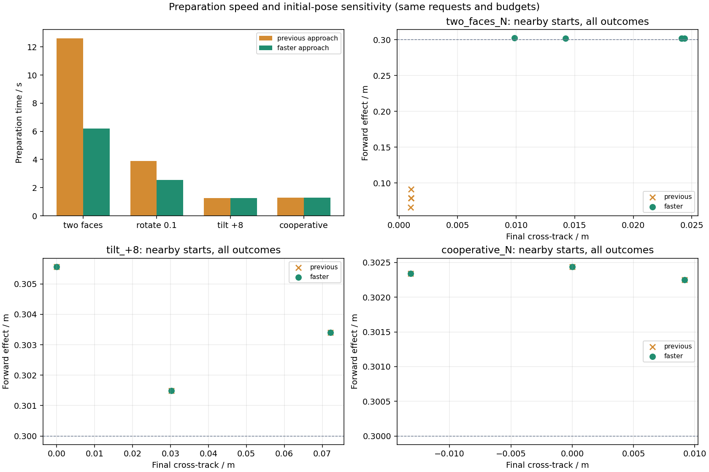

# PUSH v3：接近提速与相邻初态稳定性

日期：2026-10-27；版本 `effect-push-v3-approach`。
本轮只优化切向准备过程，目标是适度提速并保持附近初态的效果稳定性，不追求所有方向误差归零。
未增加训练、奖励、动作尺度、力限幅、物理加速度或 option 时间预算。

后续更新：[v4 异尺度联合执行协议](20261027_PUSH_v4_Independent_Scales_and_Joint_Execution.md)
已按新的用户指示保留法向比例参考、独立尺度，并修改双平移 PUSH 的尺度/退出语义。
本文仍为 v3 物体效果目标语义下的冻结结果，不能与 v4 的参考预算完成率混为一谈。

## 查看回放

- [交互测台](../../outputs/option_testbench_v1/fast_approach_v1/round_004/index.html)，默认选择 `two_faces_N`，可切换加速开/关、逐帧检查；两组均启用端点跟踪与接触点纠偏。
- [便携回放包](../../outputs/option_testbench_v1/fast_approach_v1/round_004/viewer_bundle.zip)，解压后直接打开 HTML。
- [全部效果结果](../../outputs/option_testbench_v1/fast_approach_v1/round_004/SUMMARY.md)、[相邻初态审计](../../outputs/option_testbench_v1/fast_approach_v1/round_004/STABILITY.md)、[冻结运行配置](../../outputs/option_testbench_v1/fast_approach_v1/round_004/manifest.json)。



## 改动

- 离接触较远时，切向速度指令上限由 **0.08 提至 0.20 m/s**。实际速度仍由原速度反馈、阻尼、加速度斜坡和力限幅决定。
- 按剩余切向距离约束制动速度，并加入自身切向速度阻尼；快速接近后，切向速度降至 0.04 m/s 以下才允许提交 PUSH。
- 加速强度依据**初始**切向距离，在 5–15 cm 之间连续增加；小于 5 cm 的微调保留原控制律。没有硬切换两个不同速度档位。
- 接触/间隙很小时仍使用原 0.08 m/s 切向上限；实际推动阶段的方向、接触点反馈与旋转控制律不变。
- 端点跟踪、安全扫描、3 cm 额外 staging 间隙、原 option 预算、奖励与离线兑现阈值保持不变。

第一版对所有准备过程都提速，导致一个近距离倾斜双机场景侧偏增大；该负结果完整保存在 `round_002`。
最终版收紧为按初始距离连续混合；`round_001`、`round_003` 为有界局部调试，最终结果统一使用 `round_004`。

## 实际结果

固定 35 个原场景，增加 10 个邻近初态（机器人 0 的 x ±1 cm；双面场景另加朝向 ±1°），
共 **45 场景 × 加速开/关 = 90 分支**，全部执行完成，约 **56.0 s**。
每分支墙钟上限 10 s、整批预算 60 s；未完成请求不被删除。

| 检查 | 原准备过程 | 提速后 |
|---|---:|---:|
| `two_faces_N`：进入 PUSH 的时间 | 12.60 s | **6.20 s** |
| `two_faces_N`：首次接触 | 13.10 s | **6.70 s** |
| `two_faces_N`：物体沿目标方向位移 | 0.0786 m，预算耗尽 | **0.3021 m，完成** |
| `two_faces_N`：总耗时 | 14.00 s，预算耗尽 | **13.00 s** |
| 单机 0.1 rad 旋转：准备时间 | 3.90 s | **2.55 s** |
| 单机 0.1 rad 旋转：结果 | 0.0894 rad，窗口结束 | **0.1015 rad，5.90 s 完成** |
| 倾斜同侧双机：最终侧偏 | 1.19 cm | **1.19 cm**，小距离准备路径相同 |

汇总：两组各有 41/45 次几何可用请求，控制器完成数 **31→40**，冻结离线效果兑现数 **34→39**（分母为 41 个可用请求）。
没有“原兑现、新未兑现”的新增退化。最大接触穿透两组均约 **0.62 mm**，未发生穿透异常退出。
这里统计的是 option 效果，不是整个 RL 任务成功率。

## 相邻初态检查与限制

全部效果都纳入范围统计，包括超时、未兑现和控制器完成但离线误差超标的结果。

| 场景族 | 提速后的样本 | 实际效果范围 | 其他观察 |
|---|---:|---|---|
| 双面起步：原始、x ±1 cm、朝向 ±1° | **5/5 完成并兑现** | 前向 **0.3019–0.3024 m** | 侧偏 **0.99–2.44 cm**，准备 **6.10–6.30 s** |
| 0.1 rad 旋转：原始、x ±1 cm | **3/3 完成并兑现** | **0.1009–0.1015 rad** | 原版 3 次均窗口结束；提速后总耗时 5.45–5.90 s |
| 平直同侧协作：原始、机器人 0 x ±1 cm | **3/3 完成并兑现** | 前向 **0.3023–0.3024 m** | 侧偏 −1.32 至 +0.91 cm，两版相同 |
| 单机 +8° 倾斜：原始、x ±1 cm | **3 次声明完成，2 次兑现** | 前向 0.3015–0.3056 m | 侧偏 **0.00–7.21 cm**，两版相同，仍有初态敏感性 |

固定相邻初态下，双面起步和短角度旋转的效果集中程度足以支持将此配置作为下一轮数据采集/学习的候选。
这还不是网络拟合精度或 RL 收敛证明，也不能推广为所有状态下都稳定。
尤其单机倾斜面的方向控制仍较敏感，`tilt_+8_dx+0.01` 虽声明完成，但侧偏约 7.21 cm，独立离线评分未兑现。
窄面 0.1 rad 旋转也仍未达到目标。两项均保留在表与回放中，没有扩大容差。

此轮到此停止调优：后续若继续，应单独处理倾斜面运动方向控制；不再为少数场景反复提高准备速度。

## 使用与验证

候选控制器配置：`EffectPushConfig(endpoint_tracking=True, fast_approach=True)`。
默认仍保留旧路径，回放对照和后续适配通过显式配置选择，不重解释旧 checkpoint。

```bash
timeout --signal=TERM --kill-after=2s 65s .venv/bin/python \
  experiments/option_testbench/effect_push_eval.py --compare-approach \
  --total-seconds 60 --out outputs/option_testbench_v1/fast_approach_v1/round_005

.venv/bin/python experiments/option_testbench/approach_stability_audit.py \
  --out outputs/option_testbench_v1/fast_approach_v1/round_005
```

[控制器](../../src/coimagine/random_start/effect_push.py)、[新增回归测试](../../tests/test_effect_push_approach.py)、
[小型稳定性指标快照](20261027_fast_approach_assets/stability.json)。运行前的 v2 源码另外保存在本轮输出的 `baseline_sources/`。

**105 项相关测试通过**：包含新增 9 项速度上限、接触降速、制动对称性、提交速度门限、小修正兼容、信息边界、力/加速度限幅与真实短旋转测试。
本轮未重复全量套件，旧实验文件缺失问题未处理。HTML 通过 Node 语法与 90 分支首尾帧绘制逻辑检查，未做真实浏览器自动化验收。
页面默认场景的渲染调整从保存日志重建；渲染哈希单独记录，原始物理运行 manifest 不改写。
本轮没有训练 RL 或神经网络，也未改写 run9 结果。
