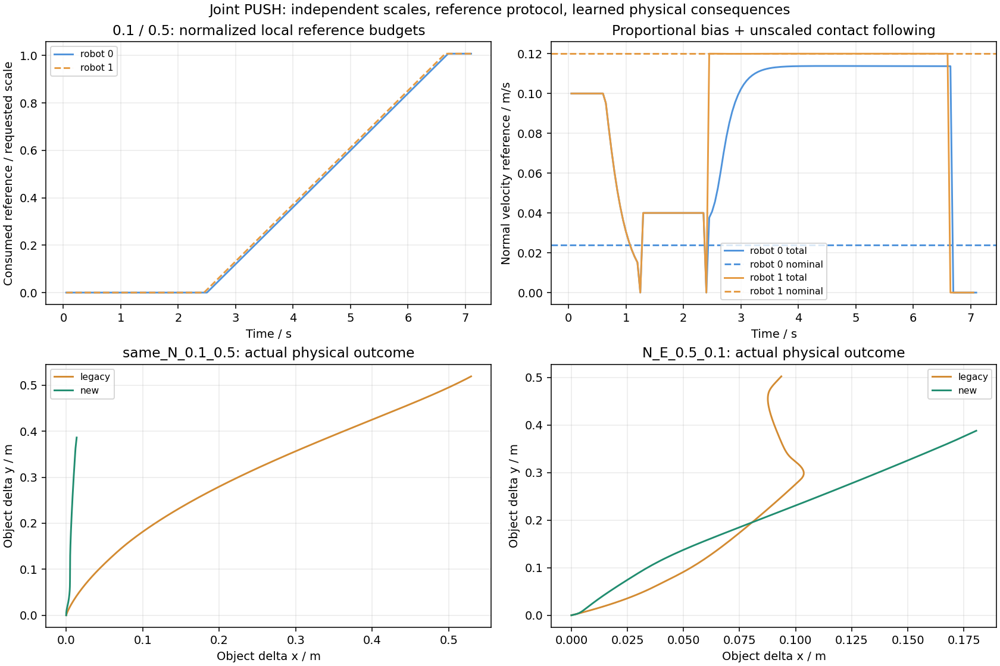

# PUSH v4：独立尺度与法向比例参考执行协议

日期：2026-10-27；版本 `effect-push-v4-joint-reference`。
按最新指示，保留两个 option 各自的方向和尺度，适当保留法向比例参考，使执行过程均匀；
不把两个动作强制对齐为同一物体目标，也不规定它们的真实效果必须向量相加。

## 回放与结果

- [交互测台](../../outputs/option_testbench_v1/joint_execution_v1/round_003/index.html)：默认显示同向 0.1/0.5，可切换旧/新协议，逐帧查看两侧预算、阶段和退出原因。
- [便携回放包](../../outputs/option_testbench_v1/joint_execution_v1/round_003/viewer_bundle.zip)：解压后直接打开 HTML。
- [逐例协议审计](../../outputs/option_testbench_v1/joint_execution_v1/round_003/EXECUTION.md)、[冻结输入与源码哈希](../../outputs/option_testbench_v1/joint_execution_v1/round_003/manifest.json)、[小型审计快照](20261027_joint_execution_assets/execution_audit.json)。



图中虚线为法向推进偏置，实线为含接触跟随补偿的总法向参考；实际速度/受力不承诺按 1:5。
下方物体轨迹是实测结果，没有预设联合位移目标。

## 新的明确语义

**双平移 PUSH 的尺度是名义法向参考预算，不是保证物体位移。**
单 PUSH 仍保留原物体效果目标；联合动作元组及协议版本明确决定采用哪一种模式。

以 0.1/0.5、原法向速度 0.12 m/s 为例：

```text
名义推进时长 T = max(0.1/0.12, 0.5/0.12) = 4.167 s
两侧法向推进偏置 = 0.024 / 0.12 m/s
本侧参考预算 += 本侧偏置 × dt，只在主动阶段且本侧观测到接触时累计
```

若一直有接触，两侧归一化预算进度接近同步；接触丢失则本侧暂停累计，允许不同时间完成。
参考预算的数值不代表实际机器人行程、物体位移或真实力的积分。
控制周期为 50 ms，预算结束有至多一个周期的离散化超量。

法向比例只约束**推进偏置**。控制器仍用本侧扫描历史估计表面法向运动，加入不按尺度缩小的接触跟随/间隙反馈；
总法向参考仍受原配置速度限幅。否则同一刚体移动时，小尺度侧会因为绝对速度被压低而脱离接触。
切向继续跟踪端点相对接触目标，保留 v3 接近加速与安全限幅，不乘尺度比例。

不同方向也采用相同协议。实际 Δx、Δy、Δθ、耗时、接触与退出状态分别记录，留作世界模型的预测目标。
高层无需预先假定“上 0.5＋右 0.1”就等于 `(0.1,0.5)`。

## 生命周期规则

1. 两侧各自准备，使用较长一侧的联合截止窗口；短尺度不会仅因等待队友就提前超时。时长仍有原最大窗口和 90 s 任务时域限制，所有等待正常计费。
2. 两侧 ready 后，共同以未按尺度压低的温和法向速度建立接触；已接触的一侧暂时保持，让另一侧赶上。
3. 两侧确认接触后，释放法向参考阶段。控制器不接收队友扫描、私有历史或真实物体位姿。
4. 每侧用完自己的参考预算后制动，基于自身速度判断退出，不等待仍被队友推动的物体整体静止。
   退出为 `normal_reference_complete`，只表示参考执行结束；制动超过原 0.8 s 上限则明确 `local_brake_timeout`。
5. 一侧退出后执行原 HOLD_BRAKE；另一侧可继续，没有冻结、传送或自动替换其动作。
6. 建联前一侧失败，另一侧下一控制周期以 `peer_prepare_failed` 退出。双方准备误差持续无改善 3 s 时以 `joint_prepare_stalled` 退出。
   仍在有效准备的一侧可以让等待继续；进入建联时重置接触寻求计时，等待时间不冒充接触失败。
7. 主动阶段一侧失败，不静默取消或重启另一侧；阶段、参考预算和两侧退出原因写入逐帧日志及边界记录。

该握手是当前测台执行内核的事件协议；未宣称已完成部署通信比特核算。
物理引擎、力/加速度限幅、任务成功定义、奖励权重和 episode 时域均未改变。

**旋转的量纲单独处理**：含旋转的双 PUSH 采用共同准备/建联与窗口，但保留各自角度目标，退出名为 `local_effect_reached`。
本轮没有将弧度套入米制法向预算或平移比例时钟，混合角度不承诺近同步退出；如需旋转参考预算，应另行设计量纲一致的规则。
所有新配对的最终联合姿态都不作为早先单侧退出的“目标兑现率”，页面标为 N/A。

## 有界实测

最终开发面板 **20 场景 × 新/旧 = 40 分支**，约 **28.6 s**，全部实际执行。
覆盖同向异尺度、不同接触面/方向、相向抵消、同面方向冲突、准备失败、x ±1 cm 扰动和混合旋转角度。
单分支墙钟限时 10 s、批次预算 60 s。中间 `round_001/002` 保留；最终数值只来自 `round_003`。

| 场景 | 新协议结果 |
|---|---|
| 同向 0.1/0.5 | 参考累计约 **0.1008/0.5040 m**；两侧均参考完成，退出时差 **0.05 s**，总耗时 **7.10 s** |
| 同向 0.1/0.5 的真实物体后果 | Δx≈**0.0137 m**、Δy≈**0.3864 m**、转角≈**−3.59°**；没有宣称达到任一名义位移 |
| 向上 0.5、向右 0.1 | 两侧参考完成，退出差 **0.05 s**；实际 Δx≈**0.1805 m**、Δy≈**0.3879 m**、转角≈**10.40°** |
| 相向 0.5/0.5 | 两侧参考完成，实际位移基本 **0**；作为物理抵消结果保留，不称物体目标成功 |
| 一侧方向不可用 | 两侧分别 `peer_prepare_failed / direction_unavailable`，总耗时 **0.10 s**，正常计费 |
| 同面 N / NW 准备互相妨碍 | **4.80 s** 时双方 `joint_prepare_stalled`，参考均 0；不耗尽约 20.7 s 的最大窗口 |
| 混合旋转角度 | 各自 `local_effect_reached`；退出差 **3.70 s**，不属于本轮平移比例预算的近同步结论 |

19 个双平移请求中，**17 个两侧均完成参考预算**，其余为上述两个准备失败对照；
这 17 个的两侧退出时差均不超过 **0.10 s**。这不是物体运动成功率。
最大接触穿透约 **0.235 mm**，未出现穿透异常退出。
独立审计从原始日志检查了 **2418 次参考预算增量**，确认只在主动阶段、本侧接触时累计，
完成后不重启；参考超量在一个控制周期内。

原始及机器人 0 x ±1 cm 的局部扰动结果：

| 组合 | Δx 范围 m | Δy 范围 m | 转角范围 |
|---|---:|---:|---:|
| 同向 0.1/0.5，3 例 | 0.0137–0.0188 | 0.3819–0.3865 | −4.27° 至 −3.52° |
| 上 0.5、右 0.1，3 例 | 0.1763–0.1847 | 0.3868–0.3886 | 10.28°–10.40° |

这些局部样例支持继续收集该协议下的数据，没有证明全状态空间可预测或神经网络已经拟合成功。
不同方向、抵消和准备失败保留了真实的非线性交互；后续模型应学习整个联合后果及其不确定性。
v3 与 v4 的退出/尺度契约不同，不能把两版的完成数直接当成任务性能提升。

## 复现与验证

```bash
timeout --signal=TERM --kill-after=2s 65s .venv/bin/python \
  experiments/option_testbench/effect_push_eval.py --compare-joint-execution \
  --total-seconds 60 --out outputs/option_testbench_v1/joint_execution_v1/round_004

.venv/bin/python experiments/option_testbench/joint_execution_audit.py \
  --out outputs/option_testbench_v1/joint_execution_v1/round_004
```

当前新 EffectPush 默认协议为 `proportional_normal_v1`；推荐组合为
`EffectPushConfig(endpoint_tracking=True, fast_approach=True)`。
`joint_execution="legacy_v3"` 保留原协议；历史纠偏/端点/加速对照 CLI 显式使用旧协议，避免改变它们的语义。
旧 28 动作训练器和非 PUSH 动作不变；本轮未启动 RL 或世界模型训练。
源码：[控制器](../../src/coimagine/random_start/effect_push.py)、[联合执行器](../../src/coimagine/random_start/env.py)、
[协议回归测试](../../tests/test_joint_execution.py)。v3 源码保存在本轮输出的 `baseline_sources/`。

验证分阶段记录：开发阶段全量非 slow **584 passed、10 failed、37 skipped、21 deselected**，
10 个失败 ID 与既有文件缺失基线相同；其后补充无进展退出与接触阶段计时修复，
最终 **118 项相关测试通过**（含 13 项联合协议测试），未再重复全量。
9 s 延迟准备、执行中单侧退出属于明确的合成控制器单元测试，不计入上面的物理实验样例。
渲染对最终评分范围做 N/A 规范化，原始物理日志不改写；渲染源码另有哈希记录。
HTML 通过脚本语法和 40 分支首尾帧绘制逻辑检查，未做真实浏览器自动化验收。
