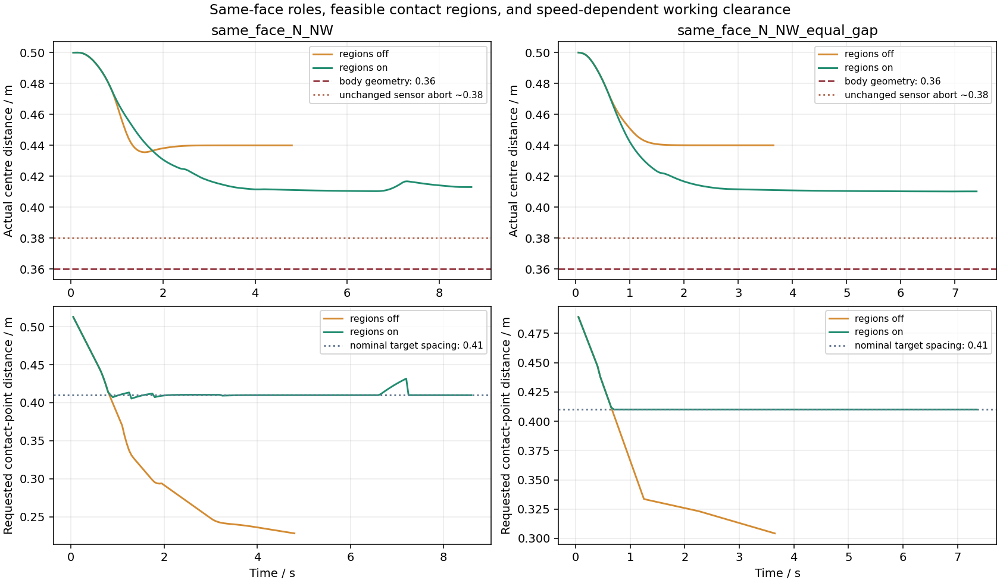

# PUSH v5：同面接触分配与较小工作间距

日期：2026-10-27；版本 `effect-push-v5-contact-regions`。
已实现一版可执行的同面协作方案，并完成有界对照。只分配可行接触区间，不预设两个 option 的联合位移目标。

后续：[v6 实测本体法向行程](20261027_PUSH_v6_Measured_Normal_Travel.md) 已统一单推/双推的平移尺度与退出计程。
本报告保留 v5 参考积分语义和原始结果；不同尺度的新退出时序会改变联合旋转，详见后续报告。

## 入口

- [交互测台](../../outputs/option_testbench_v1/same_face_allocation_v1/round_002/index.html)：默认 N/NW，切换“同面接触分区”开/关。方向纠偏在两组均开启。
- [便携回放包](../../outputs/option_testbench_v1/same_face_allocation_v1/round_002/viewer_bundle.zip)。
- [独立间距审计](../../outputs/option_testbench_v1/same_face_allocation_v1/round_002/ALLOCATION.md)、[配置与输入](../../outputs/option_testbench_v1/same_face_allocation_v1/round_002/manifest.json)、[小型指标快照](20261027_contact_allocation_assets/allocation_audit.json)。



## 0.44 m 是什么，可以放宽多少

此前的约 0.44 m 是避碰斥力与接触目标吸引形成的平衡，不是写死的硬最小距离。
单台机器人半径 0.18 m，所以两台圆形机器人刚好相切时，中心距为 0.36 m。

| 约束 | 当前含义 |
|---|---|
| 0.36 m 中心距 | 实体相切的几何底线，未改 |
| 约 0.38 m 中心距 | 原有实测实体间隙 0.02 m 的安全退出条件，未改 |
| 0.40 m 中心距 | 新同面低速软避碰起点：实体间隙 0.04 m |
| 0.41 m | 接触分配的名义间距：再留 0.01 m 目标余量 |
| 最高 0.48 m 软避碰起点 | 相对闭合较快、初次观测等情况仍保留原缓冲 |

因此放宽的是同面慢速工作的软缓冲，物理半径、硬碰撞与安全退出条件都保持原值。
并不要求所有构型都保持 0.41 m；方向纠偏向外、观测误差或快速接近都可能需要更大间距。

## 完整的接触分配规则

1. **本侧识别同面候选**：只用本侧拟合面、自身位置和雷达观测到的队友圆形回波。
   队友中心须位于该面的外侧并落在其延伸范围附近；异面、相向或信息不足时保留原控制。
   这是局部几何假设，不读取真实 face ID，也不是全状态下的严格识别保证。
2. **先分左右，再锁定顺序**：按两机器人沿面切向的位置，确定本 option 的左/右角色，执行中不交换。
   各侧由“自身位置＋本侧估计的队友位置”构造近似一致的分隔线，避免两侧不同物体中心估计再次把区间挤在一起。
3. **构造可用区间**：每侧区间取四项交集：公开面长度和端点余量、当前可见支持范围、分隔线对应的半边、距观测队友足够远的位置。
   默认端点留 4 cm，机器人目标中心间距为 0.41 m；遮挡端仍受真实可见范围限制。
4. **保留方向偏好，但投影到区间内**：原方向/侧偏/角速度反馈仍给出首选接触点，最终目标取该点在本侧区间上的投影。
   纠偏可以在自己的区域内移动，不能为了追逐名义方向侵入另一侧的接触区域。
   回放保留未约束首选点、实际目标和区间，便于检查何时发生饱和。
5. **速度相关避碰**：低速同面软间隙为 4 cm；闭合速度增大时，加入反应与制动距离，最高恢复原 12 cm 缓冲。
   初次看见队友、短时失观预测时也使用保守缓冲。静态障碍和其他面的避碰规则不变。
6. **失败不绕过**：面太短则 `same_face_no_room`；可见区间不够则 `same_face_lane_unavailable`。
   队友短时失观使用有界本侧历史预测并增加保留余量，超过 0.25 s 则 `same_face_peer_unobserved`。
   退出交给 v4 联合生命周期处理；不在 PUSH 内悄悄交换角色或转为 REPOSITION。
7. **接触后继续使用 v4 参考预算**：法向推进偏置按各自尺度比例分配，切向定位不乘该比例，各侧独立完成并制动。
   真实位移、旋转和接触后果继续由物理决定，供世界模型学习。

以对称的 1 m 面为例，忽略可见性进一步收紧，左右机器人可分得约 `[-0.46,-0.205]`、`[0.205,0.46] m`
的接触区间；中间保留约 0.41 m。实际分隔线来自机器人对的位置估计，随面和队友状态更新，不要求物体中心估计完全一致。
两侧传感误差仍会使它们的区间估计略有差异，因此保留目标余量与在线避碰；没有宣称形式化安全证明。

## 有界实测

最终面板 **24 场景 × 分区关/开 = 48 分支**，全部实际执行，约 **29.3 s**。
覆盖原 N/NW、不对称与等间隙初态、±1 cm 扰动、同向异尺度、异面、相向、窄面和旋转回归。
两组均开启端点跟踪、方向纠偏、接近提速与 v4 参考协议；唯一比较开关同时启用接触分区和对应的局部避碰缓冲。
原始场景及离线阈值未为正结果修改；新增等间隙场景有不同名称与冻结输入。

| 场景 | 原方案 | 分区候选 |
|---|---|---|
| 原 `same_face_N_NW` | 4.80 s 准备停滞退出 | **8.70 s 两侧参考完成**，3.85 s 释放接触阶段 |
| 等间隙 N/NW | 3.65 s 准备停滞退出 | **7.40 s 两侧参考完成**，2.70 s 释放接触阶段 |
| 等间隙 N/NW，机器人 0 x ±1 cm | 均准备停滞 | 均参考完成，总耗时 **7.25–7.40 s** |
| 两机器人试图在 0.25 m 窄面工作 | 准备停滞至 7.50 s | **0.05 s 明确 `same_face_no_room`** |

原 N/NW 的真实最小中心距由 **0.4355 m → 0.4103 m**；
等间隙场景由 **0.4400 m → 0.4101 m**，两侧不再被困在接触目标与旧避碰斥力之间。
两个 ±1 cm 场景的最小中心距也约 **0.4101 m**。
原场景投影后的目标最小间距约 **0.4055 m**，说明本侧估计区间并非完全一致，但明显高于原来约 0.228 m 的互撞请求。

全部候选的最小真实中心距为 **0.4000 m**，出现在立即拒绝的窄面初态；无机器人实体重叠。
最大接触穿透约 **0.235 mm**。独立审计检查了 **3466 个局部目标**，均位于本侧记录的区间内，执行中角色未交换。
原来两侧均参考完成的组合，没有新增退出退化；双平移两侧参考完成数 **17→21**。
这仍是参考执行统计，不是物体任务成功率。

真实物理后果例子：原 N/NW 候选最终 Δx≈−0.1578 m、Δy≈0.3818 m、转角≈0.94°。
因此它可以同时建立接触，不代表两个名义方向各自成为严格的物体运动目标。
窄面、观测不足与路径需要换位的状态仍交由上层选择；没有新增“同面不同向全部禁用”的 mask。

## 使用与验证

候选配置：`EffectPushConfig(endpoint_tracking=True, fast_approach=True, same_face_allocation=True)`。
新分区开关默认仍为 False，便于先审阅回放并保留 v4 对照；旧训练器未自动切换。

```bash
timeout --signal=TERM --kill-after=2s 65s .venv/bin/python \
  experiments/option_testbench/effect_push_eval.py --compare-contact-allocation \
  --total-seconds 60 --out outputs/option_testbench_v1/same_face_allocation_v1/round_003

.venv/bin/python experiments/option_testbench/same_face_allocation_audit.py \
  --out outputs/option_testbench_v1/same_face_allocation_v1/round_003
```

源码：[区间分配](../../src/coimagine/random_start/same_face.py)、[控制器接入](../../src/coimagine/random_start/effect_push.py)、
[回归测试](../../tests/test_same_face_allocation.py)。v4 源码另存于输出的 `baseline_sources/`，旧回放未覆盖。

**130 项相关测试通过**，包括 12 项新增分区、角色顺序、间距缓冲、失观、短面、信息边界及真实 N/NW 接触验证。
本轮未重复全量套件，未处理既有旧实验文件缺失。页面脚本通过 48 分支首尾帧绘制逻辑检查，未做真实浏览器自动化验收。
没有新 RL 或世界模型训练，也未将局部面板结果推广为所有状态的可执行性或安全保证。
