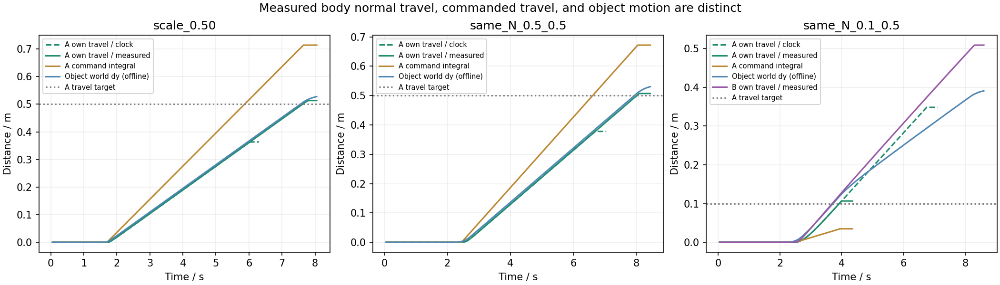

# PUSH v6：用本体实测法向行程统一平移尺度

日期：2026-10-27；版本 `effect-push-v6-normal-travel`。

已将新版 PUSH 的单推/双推平移尺度统一为**机器人在连续接触推进期间的实测法向行程**。
参考速度积分保留作诊断；不是物体位移目标。此次没有启动 RL，也没有改变物理、奖励或任务成功条件。

后续：[v7 完成后接触随动对照](20261027_PUSH_v7_Post_Completion_Contact_Follow.md)。
v7 候选将主动行程与随动行程分开；本报告的 v6 制动与 Hold 结果保留，作为其基线。

## 回放与证据

- [交互测台](../../outputs/option_testbench_v1/normal_travel_v1/round_002/index.html)：切换“本体实测 / 参考积分”，默认单推 0.5。
- [便携回放包](../../outputs/option_testbench_v1/normal_travel_v1/round_002/viewer_bundle.zip)。
- [独立计程复算](../../outputs/option_testbench_v1/normal_travel_v1/round_002/TRAVEL_AUDIT.md)、[冻结输入与源码哈希](../../outputs/option_testbench_v1/normal_travel_v1/round_002/manifest.json)。
- [小型审计快照](20261027_normal_travel_assets/travel_audit.json)。原始逐步日志保存在上述测台的 `logs/`。



## 计程规则

每个控制周期（当前 0.05 s）计算：

```text
delta_s = (own_position_now - own_position_previous) · previous_inward_face_normal
s += delta_s
```

使用同一跟踪面上一周期的世界坐标内法向。法向随物体转动而变化，因此是沿法向的路径积分，
不是所有位移在初始世界方向上的投影。正常执行按每个控制周期更新，计算量很小，无需增加真实雷达射线。

仅在上一周期已进入主动推进/制动、前后两次都观测到本体接触、拟合面有效且法向变化连续时计程。
准备横移、接近过程、首次建立接触和观测缺失区间不计，也不在重获观测后补记。纯切向运动点积为零，后退要扣除。
双推须先完成共同准备/接触握手。只使用本体定位、扫描法向和本体接触反馈；不读物体真值。

达到尺度后进入制动；制动中的实测接触行程仍记入。自身速度稳定且最终未低于目标才报
`normal_travel_complete`；制动回退导致欠程时恢复推进。堵住、失去接触、几何不可观测、超时和安全条件仍可提前失败。
边界反馈中，平移进度使用同一实测行程及目标，提前退出侧切到 Hold 后保留该进度。

旋转仍按角度效果退出，单位为 rad，未改成米。旧 28 动作菜单及 run9 训练器未接入本轮新菜单。

## 有界对照结果

先跑 5 场景 × 2 分支，5.84 s；正式冻结 34 场景 × 2 分支，33.28 s。
限时为每分支 10 s、正式批次 60 s；68 分支均完成执行，无运行预算缺项。这里“执行完成”不等于 option 成功。
场景覆盖八方向、五尺度、小初态偏差、同面等/异尺度、邻面、相向、几何拒绝和旋转回归。
这是开发场景，不是新的随机测试集或 RL 泛化结果。

两组均启用端点跟踪、接近加速和同面接触分区；只切换终止/无进展判断所用的计程。
双推参考组沿用 v5 的参考积分语义；单推参考组是为本轮构造的同控制律反事实，**不冒充历史 v5 单推结果**
（历史单推使用物体效果退出）。因契约改变，不将两组完成数直接解释成控制性能提升。

| 场景 | 参考积分组：本体行程 A/B | 实测组：本体行程 A/B | 实测组：物体世界 y 位移 | 退出 |
|---|---:|---:|---:|---|
| 单推 0.1 | 0.0762 / — m | 0.1148 / — m | 0.1290 m | 实测行程完成 |
| 单推 0.5 | 0.3634 / — m | 0.5134 / — m | 0.5276 m | 实测行程完成 |
| 同面 0.5 / 0.5 | 0.3780 / 0.3780 m | 0.5072 / 0.5072 m | 0.5304 m | 两侧实测行程完成 |
| 同面 0.1 / 0.5 | 0.3485 / 0.3763 m | 0.1066 / 0.5090 m | 0.3911 m | 两侧实测行程完成，明显旋转 |
| 相向 0.5 / 0.5 | 0 / 0 m，参考组仍报完成 | 0 / 0 m | 0 m | 两侧无进展退出 |

实测组 44 个平移请求中：37 个实测行程完成，3 个无进展，4 个几何拒绝/准备失败。
37 个完成请求在包含制动的最终计程中超量约 2.1–14.8 mm，平均 9.6 mm。
这只是当前短测台上的行程超量范围，不是任意场景下的误差上界；也没有把物体位移当作该契约的兑现指标。

## 不同尺度的明确取舍

法向推进偏置仍按尺度比例分配，切向定位不乘该比例。但同面刚性接触会耦合两机器人速度，
不能同时保证实际行程 1:5 和接近同时退出。现在优先满足各自实测行程；短尺度侧提前退出并制动。

本轮同面 `0.1 / 0.5`：A 在 4.30 s 退出，B 在 8.55 s 退出；最终物体旋转约 −30.00°，
参考积分组仅约 −3.52°。N/NW 原场景最终转角也从约 0.94° 增至 25.61°，等间隙场景从 3.79° 增至 29.53°。
这是实测尺度改变退出时序后的**真实联合后果**，不能声称推动方向更稳定。
相向 `0.5 / 0.1` 中，较小尺度侧累计实测行程为 −0.1292 m，最终无进展退出；不会把被推退当作完成。

因此本轮完成的是行程契约修正。世界模型仍需学习不同尺度、不同退出时序及 Hold 制动对物体运动的影响。
如果后续要求异尺度时尽量维持整体朝向，需要另行明确退出后的随动/制动规则；本轮未自行加入联合位移或转角目标。

## 验证与边界

独立审计由保存的机器人位姿重建步前位置差，再沿前一观测法向复算，不调用控制器计程函数。
共复算 68 分支、10,673 个记录点，最大累计差约 `5.3e-17 m`；同时检查所有实测完成声明达到各自尺度。
该审计核实计程实现一致性，不证明观测法向或接触识别在真机上的准确性。

共 136 项相关定向测试通过（含 15 项旧环境兼容测试）；覆盖切向不计、倒退扣除、前一法向、缺失观测/接触、不计准备、制动欠程恢复、
单推/双推一致、相向不误报、异尺度独立退出、旧协议显式保留等。具体文件为
`tests/test_normal_travel.py` 及已有 PUSH/端点/联合执行/同面分区/REPOSITION/测台/时钟测试。
回放通过 JavaScript 语法及 68 分支各首/中/末帧的 mock DOM/canvas 检查；未做真实浏览器交互测试。
未跑全量 pytest，也没有新增 RL 或真机结果。

从 sim-to-real 角度，本体位移闭环可减少“同一参考速度在不同平台产生不同实际行程”的影响，
但这是设计动机，尚无真机证据。定位漂移、轮滑、接触误判、法向误差以及物体摩擦/转动差异仍然存在。
接触制动行程和准备阶段物体运动也会让物体总位移不同于名义尺度。

## 使用与保留旧语义

新平移默认为 `EffectPushConfig(translation_completion="normal_travel")`。
测台启用全部已审阅控制模块时，再显式传入 `endpoint_tracking=True, fast_approach=True, same_face_allocation=True`。
重放参考积分契约用 `translation_completion="normal_reference"`；旧物体效果契约用
`translation_completion="object_effect", joint_execution="legacy_v3"`。
两侧平移不允许混用不同完成计量方式；不可用动作不会自动变成 REPOSITION。
此前输出均保留。本轮到此交付，未继续自动调参或开展长时间训练。
