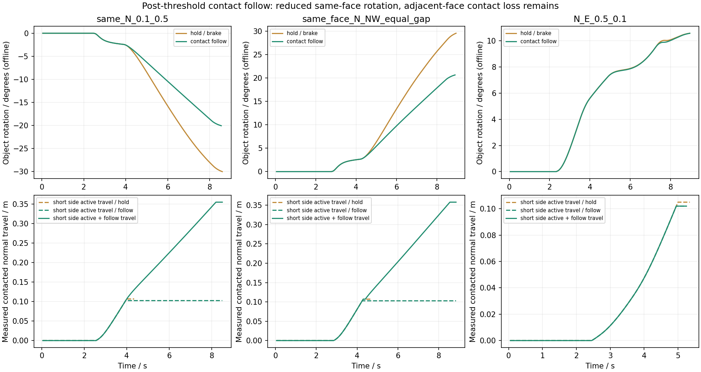

# PUSH v7：短尺度完成后的受限接触随动

日期：2026-10-27；版本 `effect-push-v7-post-follow`。

已实现“主动行程完成 → 接触随动 → 联合制动”，并与 v6 原地制动做了冻结场景对照。
**同面异尺度的转角有所减小，局部初态敏感性也有所降低；相邻面随动仍会失去接触。**
因此保留为可选模式，默认仍为原地制动，没有直接替换所有双推组合，也没有启动 RL。

后续：[v8 按间隙联合重接近](20261027_PUSH_v8_Joint_Contact_Recovery.md) 诊断了这里的失联：
普通失败场景仍在毫米级邻近，v8 允许其继续；真正超过距离阈值则暂停两侧并恢复。实际接触率与邻近保持分别报告。

## 回放与产物

- [交互测台](../../outputs/option_testbench_v1/post_push_follow_v1/round_002/index.html)：默认 `same_N_0.1_0.5`，切换“接触随动 / 原地制动”。
- [便携回放包](../../outputs/option_testbench_v1/post_push_follow_v1/round_002/viewer_bundle.zip)。
- [完整审计表](../../outputs/option_testbench_v1/post_push_follow_v1/round_002/FOLLOW_AUDIT.md)、[冻结场景与配置](../../outputs/option_testbench_v1/post_push_follow_v1/round_002/manifest.json)。
- [小型审计快照](20261027_post_follow_assets/follow_audit.json)。逐步原始日志保留在测台目录的 `logs/`。

## 本轮只改变什么

两组均使用本体坐标差沿面法向的实测行程、端点跟踪、较快接近和同面接触区域。
请求的两个方向与尺度相同，物理、奖励、任务终止和成功阈值相同。改变的是达到自身行程后的控制及相应阶段记账：

- **基线**：达到行程后制动，稳定退出；剩余联合执行时间继续用零目标速度 Hold。
- **候选**：达到行程后直接取消主动推进偏置，转为受限接触随动；所有主动阶段完成或失败后，下一控制周期发出联合制动信号。

没有预设两侧合成方向、最终位移或最终转角，也不要求实际推进速度严格按尺度比例变化。
短尺度侧不先停下再追赶。主动完成时间与最终退出时间分别记录，失败不能因先前达到主动尺度而被改记为随动成功。

## 随动控制与边界

1. 保持本侧原有面关联、端点相对接触角色及接触区域约束，不换面。
   随动后停止名义方向/侧偏的接触点纠偏，避免完成后继续争取原始推动效果。
2. 法向速度参考使用本侧扫描估计的接触面运动速度，加有界间隙反馈；**主动推进偏置为零**。
   切向继续跟踪接触目标，沿用原切向速度上限。
3. 随动合速度指令上限 0.16 m/s，指令力总幅值上限 3 N，法向指令力分量绝对值上限 0.75 N。
   原加速度斜坡、15 N 执行器上限和安全检查保留。这些是指令限制，不是实际接触冲量或受外推速度的保证。
4. 连续失去接触超过 0.25 s，报 `follow_contact_lost`；达到 8 s 或本体随动路程 0.75 m，分别触发明确退出。
   另受原联合时间窗、几何可观测性与碰撞约束。失败侧回到已有 Hold，尚在主动推进的另一侧可继续。
5. 两侧主动完成/失败状态均已确定后，下一周期统一制动。只使用上一周期已有状态，不偷看对方当前扫描或未来反馈。
   本轮是执行测台，不据此宣称满足 B-bit 分布式通信预算。

随动仍可能向物体施力，不声称“零作用”。控制输入只含本体观测；物体/机器人真值仅供离线审计与作图。

## 尺度语义：主动行程与随动路程另记

候选中的 `0.1` 表示**主动推动阶段达到约 0.1 m 法向行程**，不是整个联合周期只移动 0.1 m。
进入随动后冻结主动行程和参考积分；随后连续接触时的法向行程、以及全部本体随动路程分别记录。
最后联合制动产生的尾随行程也归入随动账，不补到主动尺度中。

例如同面 `0.1 / 0.5` 候选：

| 项目 | 短侧 A | 长侧 B |
|---|---:|---:|
| 主动完成时刻 | 3.90 s | 8.10 s |
| 主动法向行程 | 0.1024 m | 0.5030 m |
| 后续接触法向行程（含联合制动） | 0.2522 m | 0.0043 m |
| 最终退出时刻 | 8.45 s | 8.50 s |

A 在记录为随动控制的 85 帧中均观测到接触，指令力峰值约 0.662 N。
最终退出接近同步不等于两个主动阶段同步，也不表示两侧实际行程仍为 1:5。

## 对照结果

首轮 5 场景 × 2 分支，7.72 s；正式 24 场景 × 2 分支，31.53 s。
冻结限时为 10 s/分支、60 s/批次；48 分支均执行完毕，无预算缺项。“执行完毕”不等于技能成功。
正式面板包括同面等/异尺度、N/NW、相邻面、相向、±1 cm 初态偏差、不可用/短面拒绝、旋转和单推回归。
与历史 v6 重合的 15 个基线场景，其逐帧真值状态和施力序列完全一致。

以下只比较物理后果；没有把转角更小重新定义成任务成功：

| 场景 | 原地制动：最终转角 | 接触随动：最终转角 | 物体原名义方向位移：制动 → 随动 | 候选情况 |
|---|---:|---:|---:|---|
| 同面 0.1 / 0.2 | −7.80° | −4.90° | 0.197 → 0.209 m | 两侧完成 |
| 同面 0.1 / 0.5 | −30.00° | −20.05° | 0.391 → 0.444 m | 两侧完成 |
| 同面 0.3 / 0.5 | −16.16° | −9.62° | 0.465 → 0.493 m | 两侧完成 |
| 同面 0.5 / 0.1 | +30.00° | +20.05° | 0.391 → 0.444 m | 两侧完成 |
| 同面 N/NW 原场景 | +25.61° | +17.70° | 0.362 → 0.412 m | 短侧随动接触帧占 96.5% |
| 同面 N/NW 等间隙 | +29.53° | +20.63° | 0.318 → 0.378 m | 短侧随动接触帧占 98.8% |
| 邻面 N/E 0.5 / 0.1 | +10.57° | +10.56° | 0.550 → 0.550 m | 短侧随动失联 |

同面 0.1/0.1、0.3/0.3、0.5/0.5 的最终位移保持一致，转角仍近零。
原来的相向无进展、不可用方向、短面拒绝，以及旋转/单推行为均保留。

**负结果完整保留**：邻面 N/E 的 `0.1/0.5`、`0.5/0.1` 及后者 ±1 cm 两个变体，共 4 个短侧请求达到主动尺度后，
未能持续跟随同一接触面，均报 `follow_contact_lost`。N/E 等尺度 0.3/0.3 则完成。
物体大部分继续运动发生在失联后的阶段，不能把这些请求报告成成功的持续随动。

两组均有 38 个平移请求达到主动行程阈值；基线 38 个最终报行程完成，候选为 34 个最终完成 + 4 个随动失败。
另有 3 个无进展、4 个几何拒绝/准备失败，两组一致。旋转/等待单独计。
本轮没有“成功率提升”的结论，也不能直接外推 RL 学习效率。

## ±1 cm 局部稳定性

每组只包含基础场景及机器人 A 的世界 x 偏移 ±1 cm，共三个点，不是随机分布或置信区间：

| 基础场景 | 最终角度三点范围：制动 → 随动 | 最终物体位置最大两两间距：制动 → 随动 |
|---|---:|---:|
| 同面 0.1 / 0.5 | 0.631° → 0.341° | 11.27 → 8.93 mm |
| 同面 N/NW 等间隙 | 1.396° → 0.822° | 11.65 → 7.19 mm |
| 邻面 N/E 0.5 / 0.1 | 0.078° → 0.121° | 6.97 → 6.35 mm |

前两个同面小邻域没有出现新的巨大结果跳变；邻面的随动失败没有因局部几何偏差而消失。
这支持继续保留同面随动候选，不证明全场景可预测性或神经模型易学性。

## 验证与当前建议

- 独立审计用保存的步前本体位置差和前一观测法向，分别复算主动/随动计程及随动路程。
  共 48 分支、12,301 个记录点，最大复算差约 `5.5e-17 m`；核对完成阈值、计程冻结及随动指令限幅。
- 本轮相关定向测试 156 项通过，含 20 项随动测试；检查直接切换、分账、接触/路程/时长退出、队友失败释放、
  下一周期时序、信息边界、混用协议拒绝，以及篡改日志时独立审计能否检出。未跑全量 pytest。
- 回放通过 JavaScript 语法与 48 分支首/中/末共 144 帧 mock DOM/canvas 检查，未做真实浏览器操作测试。
- 候选最小真实机器人中心距 0.400 m（包含短面初态拒绝），未发生实体重叠；最大物体穿透诊断约 0.619 mm。

建议把该版本作为**同面协作的可选执行方式**继续观察；目前没有充分证据将它作为所有双 PUSH 的默认收尾。
残余转角说明取消制动阻力仍不能消除主动长侧与低作用随动侧之间的施力差异，这是物理后果，未强行对齐联合目标。
相邻面接触保持是后续独立问题，本轮不继续自动调参。

启用：`EffectPushConfig(endpoint_tracking=True, fast_approach=True, same_face_allocation=True,
post_push="contact_follow")`。对照为相同配置的 `post_push="hold_brake"`（默认）。
仅成对实测行程平移会启用随动；单推、旋转和旧 28 动作训练器未改动。历史输出均保留。
