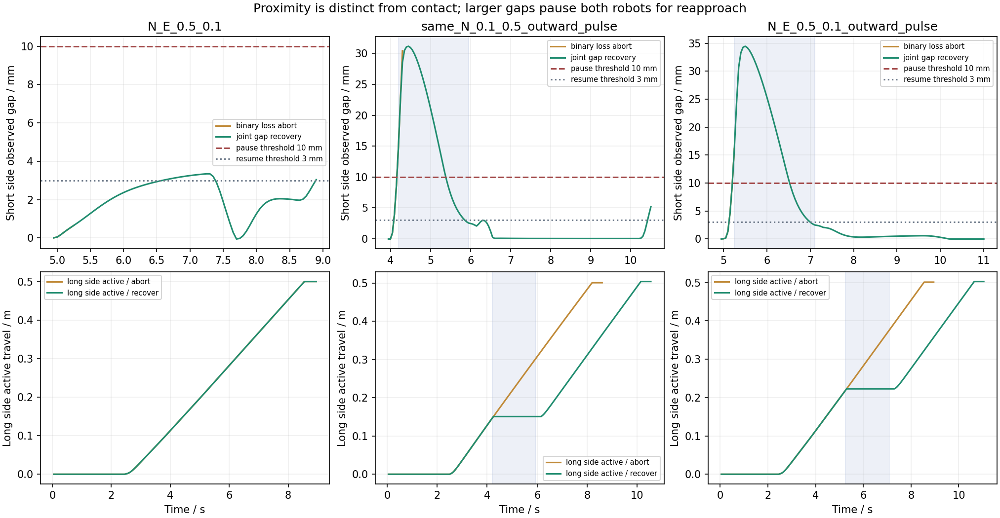

# PUSH v8：按间隙暂停两侧、重接近后继续

日期：2026-10-27；版本 `effect-push-v8-joint-recovery`。

已按用户建议实现距离滞回和联合恢复。**原来四个普通相邻面场景不再因短暂断触而退出；两个人为标注的外向力扰动诊断均完成重接近并继续。**
这里允许毫米级邻近，不把它报告成连续物理接触。没有改奖励、任务成功阈值、碰撞几何或物理参数，也没有启动 RL。

回放界面后续更新：右侧可切换机器人 0/1，目标、进度、曲线和几何高亮同步切换且保持当前帧；
诊断信息默认折叠。已用真实 Chromium 浏览器检查 52 分支 × 两侧 × 首/中/末共 312 个视图，
包括旋转 0.1/0.5 rad、异向位移投影、等待动作和窄屏布局。原始输入、指标与逐步日志未改变。

## 入口与证据

- [交互测台](../../outputs/option_testbench_v1/joint_contact_recovery_v1/round_002/index.html)：切换“联合恢复 / 失联退出”；默认带明确外向扰动的同面恢复诊断。
- [便携回放包](../../outputs/option_testbench_v1/joint_contact_recovery_v1/round_002/viewer_bundle.zip)。
- [逐场景审计](../../outputs/option_testbench_v1/joint_contact_recovery_v1/round_002/RECOVERY_AUDIT.md)、[冻结输入/配置](../../outputs/option_testbench_v1/joint_contact_recovery_v1/round_002/manifest.json)。
- [小型审计快照](20261027_joint_recovery_assets/recovery_audit.json)。完整精度原始数据在测台目录的 `logs/`。

## 原来为什么失联

v7 的四个失败是二值接触信号连续为假超过 0.25 s，并非雷达完全失去面或端点。
退出时本侧拟合间隙只有约 **0.64–0.74 mm**；端点状态仍为 `observed`，面置信度约 0.81–0.92。
随动速度指令未到 0.16 m/s 总上限，指令力也未触及 3 N 总限幅，因此不能归因为总速度/总施力限幅卡住。
切向参考已可能触及其较小上限，存在跟踪滞后，但这不是失去雷达几何。

两个机制叠加：随动设有 **1 mm 正目标间隙**，而终止规则又要求持续实际贴合；
同时纯速度反馈在有限增益、机器人阻尼和物体运动变化下存在滞后。微小分离即足以让二值接触变假。
例如 N/E 0.5/0.1 在切入随动时，法向参考速度略低于本体速度，先卸载接触，后续在毫米级邻近跟随。
交互诊断中单独将目标间隙改成零仍出现退出；本轮正式修正针对的是接触状态机，不把“零间隙”当作已验证的完整解法。

## 新规则

1. **短暂断触但仍近**：间隙不超过 10 mm 时，二值接触信号暂时为假不会单独触发退出。
   继续本来的推进或随动控制。主动物理接触行程仍只在实际接触条件满足时累计。
2. **距离确实拉开**：任一侧在已进入联合执行后观测到间隙超过 10 mm，发出恢复请求。
   执行器在下一控制周期暂停两侧主动推进，保存各自原来的 `push` / `follow` 阶段。
3. **两侧重接近**：各自只用自己的扫描、面关联及接触目标，法向接近参考最多 0.04 m/s。
   已进入 3 mm 内的一侧不继续施加主动法向接近速度；切向定位和安全避碰仍保留。
4. **共同恢复**：两侧均观测到间隙不超过 3 mm，法向自身速度不超过 0.06 m/s，并连续就绪 0.1 s，
   下一周期恢复之前的阶段。10/3 mm 两阈值提供滞回，避免在一个阈值附近反复切换。
5. **有界失败**：每次恢复最多 2 s，最多三次；恢复中任一侧失败，另一侧明确报 `peer_recovery_failed`。
   几何失观、安全退出和原联合期限仍有效，不盲目接近失去关联的面。

暂停的是主动推进，不会瞬间把物体或机器人速度清零；惯性、制动和接近接触仍产生真实物理后果。
因此 10 mm 是触发阈值，不能宣称恢复瞬间间隙永远不超过 10 mm。
阶段信号只使用上一周期已有的请求/就绪报告，不读取对方私有扫描或物体真值。
这是执行测台，不据此宣称满足某一 B-bit 分布式通信预算。

## 计程与成本

主动推进、随动接触行程、恢复行程三项分开：

- 主动与随动行程仍要求连续实际接触；近而未接触不会被补记为推动。
- 恢复中的本体位置差沿前一有效观测法向积分，允许未接触；另记全部本体恢复路程。
- 恢复不增加主动尺度、随动接触行程或参考推进积分，也不会重置已完成的主动额度。
- 主动阶段的无进展钟在恢复期间暂停；原联合截止时间、90 s 任务时钟和费用始终继续。

## 正式对照：24 个普通场景 + 2 个明确扰动诊断

先跑 5 场景 × 2 分支，8.16 s；正式 26 场景 × 2 分支，35.79 s。
限时仍为 10 s/分支、60 s/批次，52 分支均执行完毕，无预算缺项。执行完毕不等于任务成功。
两组均用 v7 随动，只有失联处理规则不同。24 个普通基线的逐帧真值与施力序列完全复现历史 v7。

### 原四个普通失联场景

| 场景 | v7 退出 | v8 退出 | v8 短侧随动最大间隙 | v8 短侧实际接触帧占比 |
|---|---|---|---:|---:|
| N/E 0.5/0.1 | 短侧失联 | 两侧完成 | 3.35 mm | 4.1% |
| N/E 0.1/0.5 | 短侧失联 | 两侧完成 | 6.39 mm | 5.5% |
| N/E 0.5/0.1，A 的 x +1 cm | 短侧失联 | 两侧完成 | 3.38 mm | 1.4% |
| N/E 0.5/0.1，A 的 x −1 cm | 短侧失联 | 两侧完成 | 3.82 mm | 8.1% |

这四组随动控制记录都保持在 10 mm 内，**没有触发大间隙恢复，也没有实现持续贴合**。
v8 的“完成”代表主动额度完成且后续邻近保持符合新契约，不能与 v7 严格接触退出率直接比较为控制成功率提升。
物体最终转角仍在约 10° 附近，没有因此变成纯平移。

### 两个恢复机制诊断

为了实际触发大间隙，在冻结输入中预先声明同一短外向施力扰动：4 N，持续 0.25 s。
同面诊断施加在 A，3.95–4.20 s，世界向南；N/E 诊断施加在 B，5.00–5.25 s，世界向西。
两组用相同扰动，经原物理积分推进，合成命令仍受原 15 N 上限约束；无瞬移、无物理参数更改。
原始行区分控制器名义施力与加性扰动。它们是故障/恢复机制检查，不冒充自然随机场景。

| 诊断 | 恢复开始 → 继续 | 暂停时长 | 恢复中的最大观测间隙 | 总时长：v7 → v8 |
|---|---|---:|---:|---:|
| 同面 0.1/0.5 + 外向扰动 | 4.20 → 5.95 s | 1.75 s | 31.16 mm | 8.60 → 10.55 s |
| N/E 0.5/0.1 + 外向扰动 | 5.25 → 7.10 s | 1.85 s | 34.46 mm | 8.95 → 11.05 s |

v7 短侧均报失联退出；v8 均暂停两侧、回到恢复阈值内并继续，最后两侧完成主动额度。
额外时间真实计入，没有以暂停为由免收费用。图中的长侧主动行程平台对应恢复期间，未把接近路程充作推动进度。
恢复改变了物理轨迹，不能因此承诺最终转角与未受扰动场景一致。

## 验证与保留边界

- 52 分支、14,710 个记录点独立复算三个计程账本，最大差约 `3.8e-17 m`；检查暂停和恢复的因果时序、共同就绪、施力上限及扰动分账。
- 179 项相关定向测试通过，含 23 项联合恢复测试；包括小间隙不误停、真实力扰动后重接近、恢复不计主动进度、滞回就绪、超时、次数预算、队友恢复失败、参数不一致拒绝及账本篡改检出。未跑全量 pytest。
- JavaScript 语法和 52 分支首/中/末共 156 帧 mock DOM/canvas 检查通过；未做真实浏览器操作测试。
- 基础环境、动作菜单、RL 奖励、任务阈值及旧 28 动作训练器未改。没有新增 RL 结果。
- 原 v7 输出保留。运行源码冻结于 manifest；后续显示模板和回放渲染脚本的哈希单列于 `render_manifest.json`，不重写冻结输入或逐步日志。

启用：`EffectPushConfig(endpoint_tracking=True, fast_approach=True, same_face_allocation=True,
post_push="contact_follow", contact_recovery="joint_approach")`。旧 `contact_recovery="abort"` 保留作默认对照。
本轮到此交付；更强的持续贴合力控制、噪声定位和全随机泛化尚未验证。
