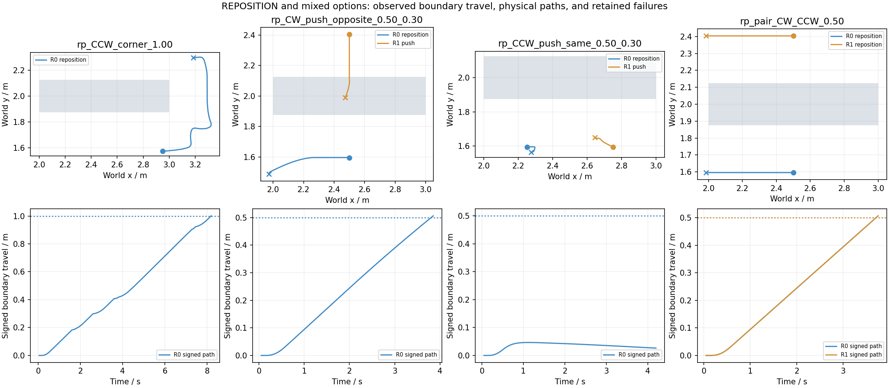

# REPOSITION 与其他 Option 的组合测台

日期：2026-10-27。只扩展测台、统计与回放；未改控制器、动作菜单、物理、奖励或任务条件，未启动 RL。

## 查看

- [合并后的同一测台](../../outputs/option_testbench_v1/joint_contact_recovery_v1/round_002/index.html)：原 52 分支 + 新 24 分支，共 76 个回放。默认筛选“含 REPOSITION”。
- [合并便携包](../../outputs/option_testbench_v1/joint_contact_recovery_v1/round_002/viewer_bundle.zip)。
- [新增分支单独查看](../../outputs/option_testbench_v1/reposition_combinations_v1/round_002/index.html)、[逐分支审计](../../outputs/option_testbench_v1/reposition_combinations_v1/round_002/COMBINATIONS_AUDIT.md)。
- [新增分支冻结输入](../../outputs/option_testbench_v1/reposition_combinations_v1/round_002/manifest.json)、[审计快照](20261027_reposition_combinations_assets/reposition_audit.json)。

## 覆盖范围

| 类型筛选 | 分支数 | 内容 |
|---|---:|---|
| 换位＋等待 | 12 | CW/CCW × 0.10/0.25/0.50/1.00 m、两个靠近转角的 1 m 请求、角色交换、不可见物体拒绝 |
| 换位＋推动 | 5 | 同面/对面、CW/CCW、PUSH 与 REPOSITION 对调机器人编号 |
| 换位＋跟随 | 4 | CW/CCW 各配 SUPPORT_FOLLOW 的 2 s、6 s 请求 |
| 双换位 | 3 | CW/CW、CCW/CCW、CW/CCW |

这里只有一组当前执行配置，没有为不改变 REPOSITION 的反馈开关重复跑伪对照。
混合组合按已有共享时钟执行，先退出的一侧进入 Hold；上一轮 v8 联合接触恢复只对双 PUSH 生效，本轮未扩展它。
合并只是显示层读取两个独立来源；原 52 分支的 manifest、metrics 和原始日志哈希均保持不变。
来源清单在合并页面旁的 `viewer_sources.json`，右侧诊断详情也列出记录来源。

## 回放补齐

- 统计与回放不再假定机器人 0 一定执行 PUSH。两侧分别显示自己的动作、单位、目标与日志进度。
- REPOSITION 显示有符号沿面行程，允许法向变化后继续；不把物体位移填成它的实际效果。
- 所选机器人显示本体轨迹、当前指令切向、拟合面与观测换面事件数。事件数不是不同真实面 ID 的数量。
- SUPPORT_FOLLOW 使用日志中的实际维持时间，WAIT 使用自身执行时间；提前退出后的记录保留。
- 单配置分支隐藏版本切换；选回原有 PUSH 场景时，其成对对照开关仍可用。
- 常用状态仍保持精简，详细信息默认折叠。

## 实跑与结果

预检查 6 分支用时 2.42 s；正式 24 分支用时 8.96 s。
限时为 10 s/分支、60 s/批次；24 分支均执行完毕，无预算缺项。执行完毕不等于请求成功。

27 个 REPOSITION 请求中，25 个报 `reposition_complete`，两个保留失败：

- `rp_CCW_push_same_0.50_0.30`：同面迎向正在 PUSH 的机器人，换位只累计约 0.026 m 后无进展；PUSH 侧安全退出。
- `rp_CW_invisible`：看不到物体，报 `not_observed`，未伪造路径进度。

两个靠近转角的 CW/CCW 1 m 请求均完成，独立复算约 1.001 m。
每个记录了 5 次观测换面事件，说明过程没有因事件直接退出；不据此声称绕过了 5 个独立物理面。
所有完成请求均满足独立计程达到请求距离。

## 保留的 FOLLOW 时长问题

本轮四个 SUPPORT_FOLLOW 请求虽然均报 `follow_complete`，实际维持时间却为：

| 请求 | 日志实际维持时间 |
|---|---:|
| 2 s | 约 5.05 s |
| 6 s | 约 9.05 s |

代码中结束条件拿 `follow_time` 与包含准备余量的 `time_budget` 比较；准备余量在此成为额外维持时间。
测台照实显示请求和实测值，不将控制器的完成声明等同于符合请求时长。本轮未把这个控制器问题与测台扩展混在一起修正。

## 验证

- 使用原始本体坐标差、前一周期指令切向、可观测与接触标记，独立复算有符号、前进和后退行程。
  审计 24 分支、2,454 个周期，最大复算差为 0；不使用控制器自身的位移缓存。
- 92 项定向测试通过，覆盖新增混合统计/回放、既有 REPOSITION 转角、PUSH、联合执行与随动；未跑全量 pytest。
- 真实 Chromium 检查合并后的 76 分支 × 两侧 × 首/中/末，共 456 个视图。组合筛选数量、机器人切换、原有对照切换、FOLLOW 实测时长和窄屏布局均通过，无页面错误。
- 本轮最小机器人中心距约 0.3794 m，未发生实体重叠；最大穿透诊断约 0.646 mm。安全退出样例没有被排除。

本轮到此交付。可先从“含 REPOSITION”看转角，也可直接筛选“换位＋推动”观察配合与干扰。
