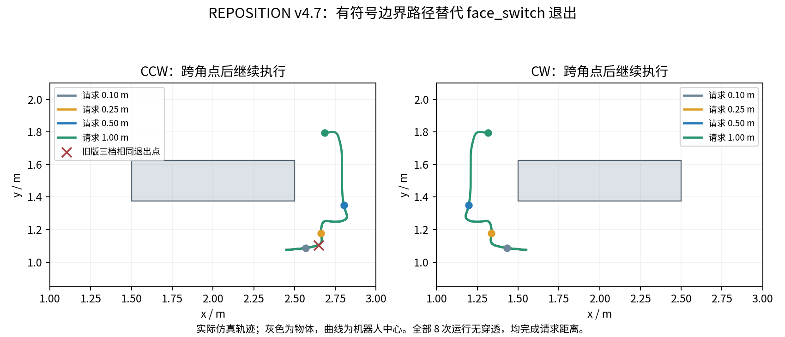

# REPOSITION v4.7 修复与效果导向 PUSH 方案

日期：2026-10-27。当前已实现并验证 REPOSITION 修复；下文 PUSH 为设计方案，尚未替换旧动作表或启动训练。

后续更新（同日）：PUSH 方案已作为独立、显式启用的 `effect-push-v1` 实现，附实际测台与负结果，见
[Effect PUSH 实现与测台](20261027_Effect_PUSH_v1_Testbench.md)。本文保留提出方案时的记录；旧 RL 动作表未替换，未启动新训练。

## 1. 已实现：换面是 REPOSITION 的过程，不是退出原因

- 去掉 `face_switch` 退出；继续沿新观测面的切向移动。
- 修复跨面计程：位移投影到上一控制周期实际声明的局部切向，累计有符号边界路径，反向运动扣回。
  不能再将整个绕行路径投影到最初的世界方向。
- 不计接触/不可见期间的运动，重新观测后不回填缺失进度。
- 保留速度变化限幅、安全、意外接触、观测丢失、无进展及原始时间预算退出。
- 换面次数作为观测事件记录，不使用真实 face ID。
- 版本升为 `random-start-oriented-v4.7`；动作 ID、奖励、90 s 任务时域和观测维度未变，历史 run9 不覆盖。

合法的镜像角点小场景中，CW、CCW 各四档实测结果一致到下列精度：

| 请求边界路径 | 实际计程 | 联合耗时 | 退出 |
|---|---:|---:|---|
| 0.10 m | 0.101 m | 2.00 s | reposition_complete |
| 0.25 m | 0.254 m | 2.30 s | reposition_complete |
| 0.50 m | 0.503 m | 4.60 s | reposition_complete |
| 1.00 m | 1.001 m | 8.20 s | reposition_complete |

旧版 0.25/0.50/1.00 m 三档均在第一次换面时退出，最终位置相同。修复后档位得到可区分的结果，8 次运行均无穿透。
这是两个镜像构型的功能验证，不是一般场景成功率或 RL 提升证明。



原始轨迹：`outputs/option_testbench_v1/reposition_face_switch_fix/results.json`；
可转发的小型数据：[results_summary.json](20261027_reposition_v47_assets/results_summary.json)。
测试覆盖有符号跨面计程、反向扣回、接触/遮挡不回填、原有退出条件及 CW/CCW 实际跨角点。

验证：40 项既有相关测试通过；新增 13 项回归测试通过。
全量非 slow 运行得到 518 passed、10 failed、37 skipped（收集了最初新增的 10 项；随后补充的
3 项退出保护测试已连同新增测试集单独验证）。10 项失败与此前基线一致，均为旧文档/图片/模型/数据文件缺失。
没有新训练成绩，也未将 run9 的旧结果重新解释为 v4.7 的结果。

## 2. PUSH 方向：让低层闭环实现高层效果意图

用户提出平移方向、旋转方向和较短距离的方案，值得验证。当前 PUSH 已有速度反馈、间隙反馈和接触恢复；
缺少的是围绕指定物体运动效果的外环，以及稳定的接触面/接触点关联。
应保留这些内环，在其外层加入任务误差反馈，而不是把当前实现描述为完全开环。

建议分开表达：

- **期望效果**：世界坐标系 8 个平移方向，或顺/逆时针旋转。
- **目标尺度**：平移候选为用户提出的 `{0.10,0.20,0.30,0.40,0.50} m`；旋转用角度，不能复用米。
- **控制参数**：速度与力限幅主要服务接触稳定和误差收敛，是否仍作为高层动作维度由对照决定。
- **完成状态**：达到可观测的效果、预算用尽、目标面失效、不可行，必须分开报告。

短尺度有望减少单次误差积累、增加重新观测与提交动作的机会，但也会增加决策次数和重新接近成本。
它是否更容易学，需要同条件短训练验证；不能仅凭删除 1 m 档宣称控制性能改善。

## 3. 同一接触面内的反馈控制

建议的控制流程：

```text
效果意图 + 本侧扫描历史
        ↓
选择当前可见且可实现该意图的接触面/接触区域
        ↓
建立接触并关联该面，保存局部几何与置信度
        ↓
估计方向/旋转误差，以及确实可观测时的侧向偏差
        ↓
有界、限速地沿同一面的切向调整接触位置
        ↓
速度/间隙内环执行 → 再观测 → 检查效果与退出条件
```

接触目标应来自带历史关联的合法表面估计，而不是每帧把“当前可见片段中点”当真实面中心。
后者会随遮挡与机器人位置变化而跳动，正是需要控制的敏感性来源之一。
允许同一面内滑移接触点；无法再确认同一面时退出/重新观测，不静默换到另一面继续完成原 PUSH。

但“同一面”不能用世界法向不变来定义：物体转动时，同一面的世界法向也会改变。
需要用观测历史的几何关联识别面，而不是简单以法向转过某个角度判为换面。

## 4. “偏左就左移接触点”需要放进明确的坐标与力矩关系

接触点主要改变推动力矩：`tau = (p_contact - c) × F`。
在常见的从下向上推例子中，沿面左移接触点可产生顺时针修正力矩，这与用户的纠偏直觉相容。
但接触面、推动方向、受力与转动状态变化后，不能直接复用固定世界坐标的左右规则。

应先定义期望方向及其左右切向，根据观测到的角度误差、角速度与可观测侧向误差确定修正力矩，
再求接触点偏移的方向和幅度，并限制在有可靠观测的安全片段内。
不确定的摩擦中心不能用仿真真值代入；先用保守小增益，在同一前缀上测量误差是否缩小。

平面推动的可行运动受接触和摩擦约束，当前接触面不一定能实现任意 8 向平移。
这是推动的欠驱动性，而不是增加标签即可消除的问题。
参考：[Motion Cones, RSS 2018](https://www.roboticsproceedings.org/rss14/p58.pdf)，
[Stable Pushing, Lynch & Mason 1996](https://publications.ri.cmu.edu/stable-pushing-mechanics-controllability-and-planning)。
不适用的意图应明确返回不可执行/需先 REPOSITION，不能暗中改成另一个方向。
单点推还可能同时带来平移与旋转；若要求近似纯旋转，应对双机力偶单独定义契约。

## 5. 观测边界与新动作表

- 对当前直线面的法向、距离、置信度以及角度变化，可以从本侧扫描和自身里程计估计。
- 沿同一无限直线的切向平移仅凭线本身不可区分；需要稳定可见角点或其他可关联特征，不能把扫描片段中点的移动直接当成物体侧移。
- 遮挡导致无法确认位移/接触面时，反馈应降级或明确退出，不能从环境读取物体位姿补齐。
- 真值物体轨迹只用于离线绘图与效果验收，不作为控制器输入。
- 方向标签与距离尺度增加后，现有 `type*4+scale` 与 28 动作权重不能直接复用。
  新编码需要显式类型—尺度码表与对应 mask，平移和旋转保留各自单位。
- 方向可行性判断只使用合法观测；未来分散式版本还需遵守公共候选 ID 与消息预算约束。

在可观测性不足时，应继续区别“机器人接触行程完成”和“期望物体效果达到”，不能把前者改名成后者。

## 6. 建议的验证顺序

1. 当前提交先验证 REPOSITION 修复，保留旧反例与版本。
2. 用小测台实现平移 PUSH 的“同面关联 + 短尺度 + 角度/可观测偏差反馈”，先不叠加新 RL 训练。
3. 对同一初始几何做小幅位置扰动，比较无外环与有外环的方向误差、旋转、接触丢失、尾部偏差与实际费用。
4. 加入不可见/不可行方向负例，确保控制器不会靠隐藏真值完成目标。
5. 平移版兑现后，再定义旋转尺度与单推/双推的旋转契约。
6. 效果稳定后升级 RL 动作接口，再按既定计划动态生成训练场景、固定验证集。

这套设计有机会让条件后果分布更集中，但接触模式切换附近仍可能存在不连续性。
应报告失败比例和误差分位数，不能要求反馈把所有物理分支变成平滑、单峰的结果。
