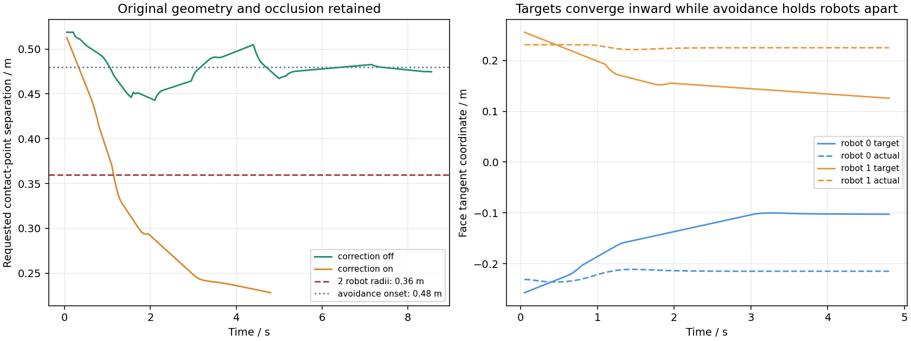

# Same-face N / NW：接触失败诊断

日期：2026-10-27；诊断对象为 `effect-push-v4-joint-reference` 的 `same_face_N_NW`。
**主要原因是接触目标互相挤占、与避碰控制冲突；队友遮挡和端点估计偏差进一步放大了问题。**
没有修改生产控制器、动作 mask、奖励或物理，也没有启动训练。

后续更新：[v5 同面接触分配方案](20261027_PUSH_v5_Same_Face_Contact_Allocation.md) 已作为显式候选实现并验证。
本文保留诊断时的原始条件与结论。

## 回放与证据

- [诊断测台](../../outputs/option_testbench_v1/same_face_diagnosis/round_001/index.html)：默认原始 N/NW 场景，切换接触点纠偏开/关。关闭是诊断消融，不是已采纳的控制方案。
- [便携回放包](../../outputs/option_testbench_v1/same_face_diagnosis/round_001/viewer_bundle.zip)。
- [原始诊断指标快照](20261027_same_face_assets/diagnosis.json)、[冻结输入](../../outputs/option_testbench_v1/same_face_diagnosis/round_001/manifest.json)。



## 原始日志说明了什么

- 仿真雷达只有最近交点与遮挡，没有建模两台激光雷达的发射串扰；队友圆形几何确实会遮挡物体回波。
- 两侧最终接触目标的间距为 **0.228 m**，低于两机器人半径之和 **0.36 m**。
  同一个平面上，两台圆形机器人不可能同时到达这两个接触点而不重叠。
- 避碰从约 1 s 起持续生效，两机器人的实际中心间距停在约 **0.44 m**；最终切向误差约 **0.112 / 0.099 m**，
  明显超过 ready 的 0.025 m 条件。因此继续等待也不能释放接触建联。
- 接触目标每帧变化 P95 约 **4.28 / 3.00 mm**，最大约 **6.81 / 8.76 mm**，不是持续的大幅随机跳变。
  机器人 0 一直观测到一个端点、没有换锚点；机器人 1 在 1–2 个可见端点之间变化，有一次正常的锚点侧切换。
  一次切换到另一物体端点的约 1 m 坐标变化，不能当作同一个端点的 1 m 跟踪误差。

## 为什么目标会向中间挤

实际面的内法向是 **112.5°**；名义 N、NW 分别是 90°、135°。
两侧方向误差为相反的 **±22.5°**，各自都在当前 30° 可用锥内。
两侧初始角色偏置为 ±0.24 m，但方向纠偏分别把右侧目标往左、左侧目标往右移动。

仅考虑方向项，扣除 1° 死区后的接触点偏移约为：

```text
0.20 m/rad × (22.5° − 1°) ≈ 0.075 m / 每侧
理想无估计误差时的目标间距 ≈ 0.48 − 2×0.075 = 0.33 m < 0.36 m
```

因此，即使端点完全准确，当前接触目标也会冲突。当前实现只分开了初始角色，
**没有约束后续方向/侧偏纠偏后的接触点仍属于各自安全区域**。

遮挡与粗射线端点区间仍有影响：原始失败场景中，物体没有移动，但两侧面中心切向估计误差最终约 **+4.48 / −2.78 cm**。
它们又进入侧偏纠偏，进一步将两侧目标往中间挤，使实际目标间距从理论约 0.33 m 缩到约 0.23 m。
这是连续估计偏差和控制反馈的耦合，不能只靠把显示线段画得更平滑解决。

## 小对照：保留遮挡，改变控制或初始几何

运行前登记四组显式场景，各自比较接触点纠偏开/关，共 **8 个真实分支**。
两组均保留相同雷达、端点跟踪、避碰、参考预算、物理与奖励。所有失败保留。

| 初态与名义方向 | 纠偏开启 | 纠偏关闭，仅诊断 |
|---|---|---|
| 原始初态，N/NW | 无法接触，4.80 s 准备无进展退出 | 两侧接触并完成参考预算，8.55 s |
| 等间隙初态，N/NW | 无法接触，3.65 s 准备无进展退出 | 两侧接触并完成参考预算，7.10 s |
| 原始初态，N/N | 两侧接触并完成参考预算，10.15 s | 两侧接触并完成参考预算，8.55 s |
| 等间隙初态，N/N | 两侧接触并完成参考预算，8.15 s | 两侧接触并完成参考预算，7.10 s |

原始初态还存在不对称：机器人到物体的间隙约 **0.1957 / 0.0043 m**。
生成器的协作位置偏置沿名义目标切向放置，未随倾斜接触面旋转，因而它不是等间隙场景。
新诊断单独增加按实际面切向放置、两侧各 **0.10 m** 间隙的场景，名称和输入均明确区分，未改写旧报告条件。
修正间隙后 N/NW 开启纠偏仍失败，说明初态不对称不是唯一或必要原因。

上述消融说明：保留遮挡时接触本身可以成立，当前失败主要由接触点反馈/分配冲突驱动。
它不证明关闭纠偏是最终方案，也不证明同一物体能同时满足两个独立的精确运动方向。
关闭纠偏后的物体沿面法向附近运动并伴随旋转，这仍只是名义方向组合的真实物理后果。

## 是否排除同面不同向

**不建议仅按“同面且方向名称不同”全部排除。**当前采用名义控制意图语义，
不同意图允许得到共同的、并非精确满足任一方向的物理后果；应由模型学习这种耦合。

应优先修正接触位置的可执行性：给同面两侧预留不重叠的接触区间，
将方向与侧偏纠偏限制在各自区间内，结合端点不确定性保留余量。
如果当前可见面的可用区间确实不能容纳两台机器人，或本侧方向已超出局部可用锥，再明确拒绝或先换位。
这类约束必须依据本侧可见几何、队友观测及允许共享的信息，不能读取真实 face ID 或隐藏状态构造部署 mask。

当前 N/NW 场景可标记为“现有控制器的接触分配冲突”，保留负结果。
本轮未新增任何排除规则，也未部署接触分区修复，先交付诊断供下一轮决定。

复现：

```bash
timeout --signal=TERM --kill-after=2s 65s .venv/bin/python \
  experiments/option_testbench/same_face_diagnosis.py \
  --out outputs/option_testbench_v1/same_face_diagnosis/round_002
```

单分支墙钟限时 10 s，总预算 60 s。源码：[诊断脚本](../../experiments/option_testbench/same_face_diagnosis.py)。
全部 8 分支实际完成，已检查配对初态/扫描一致、配置只改变纠偏开关、等间隙构造、来源哈希和页面脚本。
生产代码未改，未重复全量测试；回放脚本通过 8 分支首尾帧绘制逻辑检查，未做真实浏览器自动化验收。
