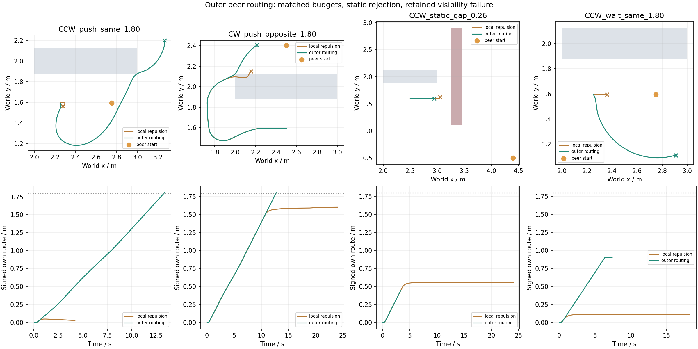

# REPOSITION：同伴外侧绕行与静态通道停止

2026-10-28。小场景控制器对照，无 RL 训练。新面板使用既有 v9 的 68 动作菜单；RP 尺度仍为 0.2 / 0.4 / 0.8 / 1.2 / 1.8 m。

已实现：同伴挡住沿物体的路径时，RP 可扩大绕行范围；本侧扫描显示静态通道被阻挡时停止。局部测试支持这一调整，但没有解决所有遮挡，也不证明全局路径可达。

## 原因与调整

原控制器同时要求保持距物体约 0.10 m 的间隙，并对同伴施加局部排斥。两者可能相互抵消，导致卡住；还可能让正在 PUSH 的同伴先触发安全退出。

新配置为 `EffectPushConfig(reposition_boundary="rounded_scan", reposition_peer_detour="outer_arc")`，历史调用默认仍为关闭。主要调整：

- 把本侧可见物体的偏置轮廓和同伴的安全圆盘组合成外轮廓，保持请求的 CW / CCW 方向行走。用平滑距离场过渡，离开同伴附近后回到物体轮廓。
- 同伴圆盘参考中心距为 0.50 m，即两机半径之和 0.36 m 加名义路由间隙 0.14 m。这是控制参考，非动态过程中保证的最小间隙。
- 同伴位置使用协议已有的共享运动学；物体几何仍只来自本侧雷达。没有读取物体真值、隐藏角点、同伴 option 或同伴私有历史。
- 同伴阴影会让有限线段的垂足不可观测。若绕行已经启动，且当前仍有有效拟合平面，可将该平面的延长线用作保守排斥约束，继续围绕同伴行走；不把阴影端点当物理角点。完全丢失有效物体观测时仍停止。

用户随后补充：靠近静态障碍时，通道可能根本容不下机器人。因此新增本侧扫描的短程扫掠圆盘检查：沿计划速度方向预测 0.6 s，静态回波进入机器人半径加 0.04 m 的范围则以 `blocked_static_route` 退出 RP。原静态避障、2 cm 安全退出及力/速度/加速度限制均保留。

这是对当前局部运动方向的拦截，不是全局路径不存在的证明；没有回波也不代表已确认通道畅通。尚未实现障碍物全局路径搜索。

## 最终对照结果

冻结结果：[round_004](../../outputs/option_testbench_v1/reposition_peer_detour_v1/round_004/PEER_AUDIT.md)。21 场景 × 开/关 = 42 分支；6 s/分支、60 s/批次的墙钟限制，实际运行 30.24 s，42 个分支均完成记录。这里“完成记录”包括失败退出。

两组只切换外侧绕行及其静态通道拦截；场景、原始扫描密度、距离请求、原 24 s 上限、物理、奖励与任务成功条件相同。

| 场景 | 原局部排斥 | 新绕行 |
|---|---|---|
| 同面、前方同伴 PUSH，RP 1.8 m，CW / CCW | RP 卡住，同伴 safety_abort | 两侧均完成各自行程；约 13.35 s |
| 对侧同伴 PUSH，RP 1.8 m，CW / CCW | 24 s 耗尽，仅记录约 1.603 m | 约 12.75 s，记录约 1.805 m |
| 同面 CCW，RP 0.8 m | RP 卡住 | 完成约 0.801 m |
| 同面长 RP，初始 x ±1 cm | 均卡住 | 均完成各自行程 |
| 物体与障碍间隙 0.26 m，CW / CCW | 耗尽预算 | 约 3.30 s，blocked_static_route |
| 同伴挡路且外侧有静态障碍，CW / CCW | RP 卡住，同伴 safety_abort | RP 约 0.90 s 停止绕行；另一侧独立执行至其预算退出 |
| 物体与障碍间隙 0.78 m，CW / CCW | 正常完成 | 与原轨迹、施力逐周期完全一致 |
| 同伴远离的单机 RP，CW / CCW | 正常完成 | 与原轨迹、施力逐周期完全一致 |
| 同面同伴原地 WAIT，CW / CCW | 卡住 | 外侧绕行后 patch_lost；未解决 |
| 物体不可见 | not_observed | not_observed |

0.26 m 小于机器人直径 0.36 m，上述间隙是离线几何标签；控制器实际只检查本侧静态扫描。四个新静态停止分支的最大穿透均为 0。RP 与 PUSH 独立退出：RP 停止不意味着另一侧也立即停止。

按 **23 个 RP 请求/组** 统计（双 RP 各计两次）：

| 退出 | 原控制 | 新控制 |
|---|---:|---:|
| reposition_complete | 9 | 16 |
| blocked_no_progress | 9 | 0 |
| option_budget | 4 | 0 |
| blocked_static_route | 0 | 4 |
| patch_lost | 0 | 2 |
| not_observed | 1 | 1 |

这不是随机任务成功率。同面 1.8 m 的两组新轨迹，实际机器人最小边缘间隙约 0.079 m；最大单周期指令切向变化约 5.36°。这些局部结果不构成任意初态下的安全保证。



## 预算与局限

RP 仍按本体位移投影到**上一周期实际指令切向**来累计有符号行程。新增绕行也消耗这个预算；反向位移扣除，接触/无观测区间不计，重获观测后不补记。独立复算最大误差为 2.22e-16 m。

因此“完成 1.8 m”并不等于到达背面。同面长 RP 的新轨迹虽已绕开同伴并完成行程，结束时仍在侧面附近；短尺度也可能在绕过同伴前就用完。没有把额外绕行变成免费路程，也没有自动扩大时间预算。

两组 WAIT 场景在外绕后被同伴完全遮挡，约 7.4 s 以 patch_lost 退出，记录约 0.902 m。这是保留的负结果，没有用物体真值或无限期外推来掩盖。

先前尝试保留在 round_001–003：最初参考切换有转向跳变；随后发现有限线段因同伴遮挡消失时，退回原控制会重新靠近同伴。最终加入平滑组合与“当前可见平面仅作保守排斥”后改善 RP+PUSH，但没有消除完整遮挡。

## 验证与测台

- 合并页的 204 个分支 × 两侧 × 首/中/末帧共 1224 次浏览器视图检查通过，无脚本错误，390 px 宽度无横向溢出。
- 145 项针对性测试通过（26.11 s），未运行全套。覆盖顺逆时针绕行、独立计程、静态窄通道停止、宽通道不退化、遮挡负例、障碍序列化和显式配置。
- 与旧新尺度轮次共有的 9 个 baseline 分支，真值轨迹与施力逐周期完全复现。
- 测台加载真实障碍；修正了原 `instance_from_dict` 无条件丢弃障碍列表的问题。旧场景障碍列表为空，历史条件不变。
- [常用合并测台](../../outputs/option_testbench_v1/joint_contact_recovery_v1/round_002/index.html) 默认显示“同伴外侧绕行”，可切换“外侧绕行 / 局部排斥”、机器人 0 / 1；画出静态障碍与正在使用的同伴参考圆。旧数据保留，旧菜单按各自冻结清单解释。
- [本轮独立测台](../../outputs/option_testbench_v1/reposition_peer_detour_v1/round_004/index.html)、[审计 JSON](20261028_reposition_peer_assets/peer_audit.json)。

复现入口（请换到新的空输出目录）：

```bash
.venv/bin/python experiments/option_testbench/effect_push_eval.py \
  --compare-reposition-peer --out outputs/option_testbench_v1/reposition_peer_detour_v1/round_NEW \
  --branch-seconds 6 --total-seconds 60
.venv/bin/python experiments/option_testbench/reposition_peer_audit.py \
  --out outputs/option_testbench_v1/reposition_peer_detour_v1/round_NEW
```
