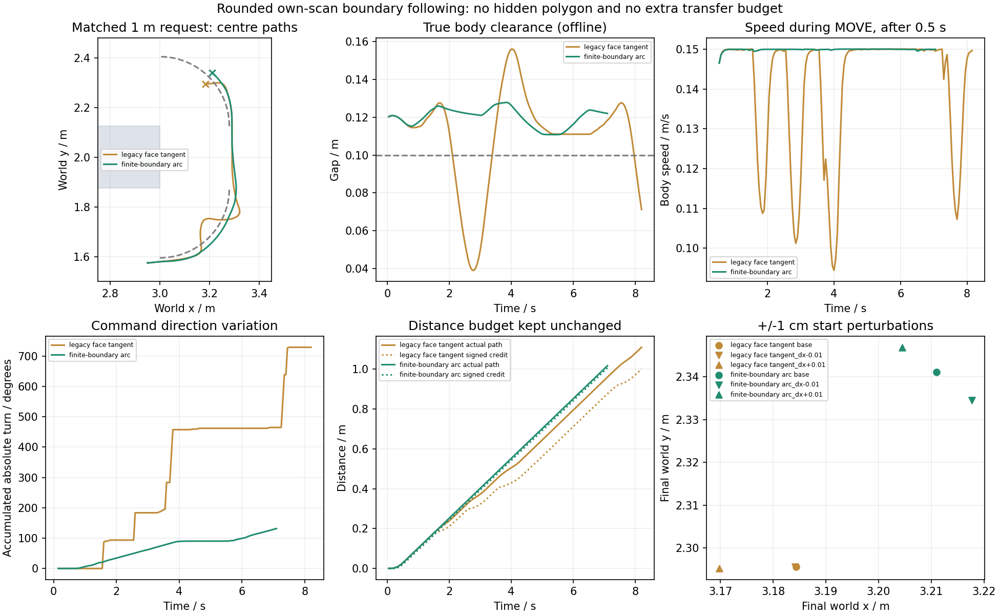
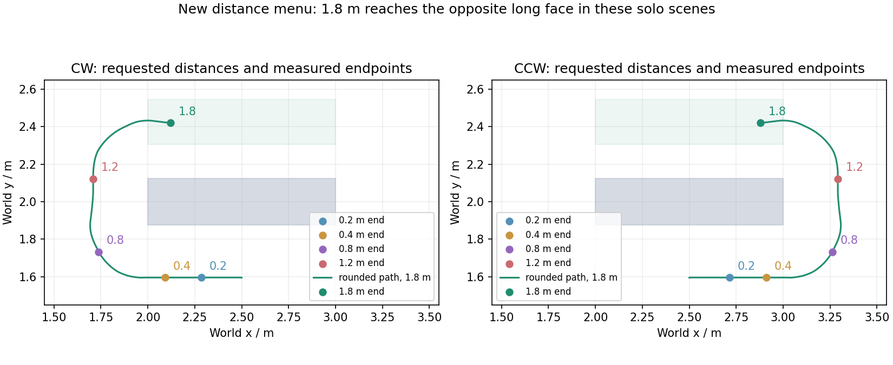

# REPOSITION：圆弧换面与新尺度菜单

日期：2026-10-28。控制候选 `rounded-scan-v1`；新菜单 `effect-options-v9-reposition-scales`。

已实现局部圆弧过渡，并按用户后续指示增加新尺度 **0.2、0.4、0.8、1.2、1.8 m**。
圆弧控制改善和增加行程覆盖是两项独立实验，不把增大预算当作控制改善。

## 入口

- [同一交互测台](../../outputs/option_testbench_v1/joint_contact_recovery_v1/round_002/index.html)：默认“新尺度 REPOSITION”，1.8 m 场景。另选“圆弧换面对照”可切换原控制/圆弧过渡。
- [合并便携包](../../outputs/option_testbench_v1/joint_contact_recovery_v1/round_002/viewer_bundle.zip)。
- [同预算控制对照审计](../../outputs/option_testbench_v1/reposition_arc_v1/round_002/ARC_AUDIT.md)、[新尺度覆盖审计](../../outputs/option_testbench_v1/reposition_scales_v2/round_002/SCALE_AUDIT.md)。
- [圆弧审计快照](20261028_reposition_arc_assets/arc_audit.json)、[新尺度快照](20261028_reposition_arc_assets/scale_audit.json)。完整原始日志及冻结配置位于各自输出目录。



## 原因：最近拟合直线不等于最近可见边界

旧执行器按拟合直线的垂直距离选择主 patch；REPOSITION 直接取该面的切向。
在角点附近，直线垂足可能已经落在实际可见线段外，但另一面延长线仍被认为更近。
主面来回跳转时，切向也会跳近 90°；间隙反馈随后又把机器人拉向/推出另一个面。
原控制中的法向滤波并没有参与 REPOSITION 的切向生成，因此未消除这类跳变。
这与截图中“靠近角点—离开—再折回来”的路径一致；不是物理引擎瞬移。

## 控制改动

新模式只使用本侧扫描、拟合线段、可观测端点和自身位置：

1. 查询**有限可见边界**上的最近点，而非只比较无限直线距离。
2. 真实相邻射线约束的轮廓端点，或两条观测面的交点，可作为局部角点；端点不确定性须不超过 4 cm。
   阴影、范围截断、内部拟合断点不当作角点。
3. 在直面上使用面外法向，在角点外侧使用“角点到机器人”的径向；经 0.10 s 滤波后，生成 CW/CCW 切向。
   因此控制方向随角度连续变化，在角点附近形成等距圆弧。
4. 端点不确定性计入保守间隙。证据不足时回退原局部控制，保留原失观、接触、碰撞与超时保护。

目标实体间隙仍为 0.10 m，速度上限仍为 0.18 m/s，15 N 施力与原加速度约束保持原值。
有符号行程仍沿**前一周期实际指令切向**累计；接触/缺观测区间不计、不补记，后退扣除。
实际物体位姿、矩形尺寸与真实角点仅在离线评测中使用，不传给该控制器。

## 实验 A：相同预算，仅切换边界控制

预检查 8 分支约 3.76 s；正式 30 场景 × 2 控制版本，共 60 分支约 25.19 s。
分支限时 10 s、批次限时 60 s，无运行预算缺项。包含原 24 个混合场景、转角 ±1 cm 微扰和队友遮挡阻挡。
原 24 个基线的逐步真值与施力序列完全复现此前输出。

典型 CW/CCW 靠角点出发的 **1 m 请求**结果对称：

| 指标 | 原控制 | 圆弧过渡 |
|---|---:|---:|
| 请求行程 | 1.000 m | 1.000 m |
| 实际本体路径（含准备/退出步） | 1.110 m | 1.017 m |
| 真实实体间隙 min–max | 0.039–0.156 m | 0.111–0.128 m |
| 单周期指令切向最大跳变 | 90.0° | 2.54° |
| MOVE 速度变异系数（0.5 s 后） | 0.112 | 0.0023 |
| 总时长 | 8.20 s | 7.10 s |

间隙收窄来自较均匀的边界跟随，没有通过缩小 0.10 m 参考间隙或降低请求距离取得结果。
两组各有 33 个 RP 请求，均为 29 个完成、3 个无进展、1 个不可见；未用完成数变化声称成功率提高。

**局部敏感性没有同步改善**：±1 cm 三点的终点最大两两间距，原控制约 1.46 cm，新控制约 1.81 cm。
这些样例仍处于厘米级变化，不能称为敏感性降低，更不能据此声称神经模型已更容易学。
队友挡路及同面迎面干扰依旧保留无进展/安全失败。

## 为什么最大尺度选 1.8，而非 1.6 m

当前物体为 1.0 × 0.25 m，机器人半径 0.18 m，间隙目标 0.10 m。
理想角点圆弧的中心轨迹半径约为 `0.18 + 0.10 = 0.28 m`。
从长面中部到反侧长面，理想路径约为：

```text
0.50（沿长面）+ 0.25（短面）+ π×0.28（两个四分之一圆）≈ 1.63 m
```

从距长面端点 5 cm 的近角点起点出发，也约需 `0.05 + 0.25 + π×0.28 ≈ 1.18 m`。
实际控制有间隙死区、估计误差和启停，因此 1.0 m 不足，1.6 m 从中部出发也可能差一点。
新菜单保留短程细分，中档 1.2 m 允许较大换位，1.8 m 给完整换面留余量。

## 实验 B：新尺度覆盖，固定圆弧控制



正式 26 分支约 14.51 s，只有一个执行配置，不是开/关对照。包含五尺度、CW/CCW、PUSH/FOLLOW/双 RP 组合、角色交换及 ±1 cm 微扰。

| 场景 | 行程/结果 | 反侧长面 |
|---|---|---|
| 长面中部出发，CW/CCW 1.8 m | 均约 1.801 m 完成，总时长 12.4 s | 两侧均到达 |
| 上述场景 x 偏移 ±1 cm | 六个基础/微扰样例均完成 | 六个均到达 |
| 近角点出发，CW/CCW 1.2 m | 均约 1.201 m 完成 | 仍靠近背面角点，垂足略未进入长面 |
| RP 1.8 m + 对面 PUSH 0.3 m | 两组在 24 s 处超时，行程约 1.603 m | 已到反侧，但距离契约未完成 |

“到反侧”用离线几何标签判断：本体在物体坐标系中位于反侧长面外，垂足落在该长面内。
它与距离完成分别报告。配合 PUSH 的超时不能改记为行程成功；本轮未逐段定位剩余停滞原因，也未延长原时间窗。
新面板共 28 个 RP 请求：24 完成、2 超时、1 无进展、1 不可见。原 FOLLOW 维持时长超额问题仍保留。

## 菜单版本与兼容

旧 66 动作表和旧 28 动作训练表保持原值。新 `ACTIONS_REPOSITION_V2` 有 68 个动作，使用显式 14-type / 最多 5-scale 映射；WAIT/FOLLOW 仍各四档。
PUSH 和旋转参数不变。新菜单 RP 增加一档，后面的 ID 会移动，例如旧 ID 58 是 WAIT，新 ID 58 是 CW 1.2 m。
因此版本名为 `effect-options-v9-reposition-scales`，不能直接重用旧数字 ID 或检查点。

测台会先校验每个来源的冻结菜单哈希，再用其请求参数回放；同页显示不同菜单不等于混合训练数据编码。
分支恢复拒绝不同版本/菜单，mask 与 type-scale lookup 需要显式传入新表。
新控制启用项为 `EffectPushConfig(reposition_boundary="rounded_scan")`；新环境同时传入 `ACTIONS_REPOSITION_V2` 和 `REPOSITION_V2_VERSION`。
精确复现实验应使用各自 manifest 的完整配置。旧调用仍默认原控制，当前页面默认展示新尺度圆弧样例。

## 验证与范围

- 实验 A：60 分支、7,473 周期，有符号行程独立复算最大差约 `2.2e-16 m`。
- 实验 B：26 分支、4,675 周期，独立复算最大差为 0。物体真值只用于真实间隙/反侧标签。
- 135 项相关定向测试通过，包括遮挡/范围边界不造角点、输入信息边界、同预算控制、旧菜单不变、新 mask、跨菜单恢复拒绝及 1.8 m 反侧到达。未跑全量 pytest。
- 真实 Chromium 检查同页 162 分支 × 两侧 × 首/中/末，共 972 个视图；验证旧/新 ID 58 的不同含义、菜单切换和窄屏布局，无页面错误。
- 原 52 分支的输入、指标、原始日志保持不变；原 24 个 RP 输出也保留。圆弧和新尺度各自有独立冻结输入及审计，合并仅发生在显示层。
- 没有改物理、奖励、任务成功条件、90 s 总时限或 24 s option 上限；没有启动 RL 或世界模型训练。
