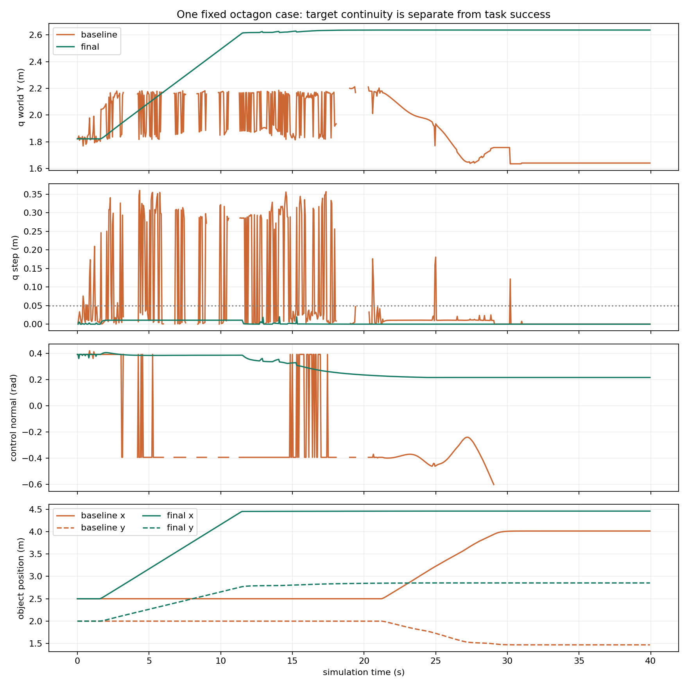
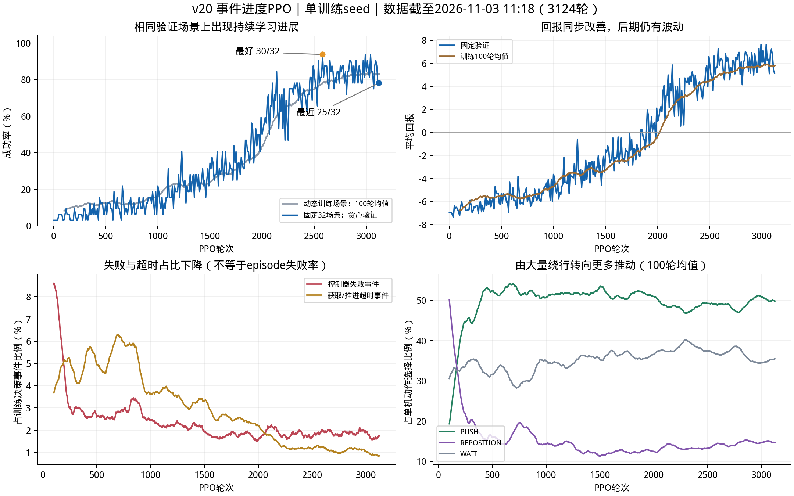

# 从技能执行失配到可学习的事件决策：Option与RL阶段汇报

**导师交流稿｜2026年11月3日**
**数据截点：11:18（Asia/Shanghai），训练完成3124轮，最近完整验证为第3120轮。** 本次12小时训练仍在运行，以下是冻结快照的中期结果。

> **后续交接更新（12:50）：** 训练已到3937轮；best@3500在固定validation为32/32，最近@3930为30/32，独立test仍仅核实旧best@2580的26/32。正文与曲线保留11:18截点，新增证据见[跨PC交接](agent_exchange/Cross_PC_Handoff_20261103.md)。此后讨论将“冻结LLM如何利用物理交互经验选择option”作为优先验证路线，神经世界模型不再是前置条件；完整动机、相关工作、对照及未实施事项见[研究讨论](research/LLM_Option_Experience_Research_Direction_20261103.md)。第7节保留当时的建议顺序。

## 1. 当前目标与阶段结论

我们当前要解决的问题是：**让高层策略选择的动作具有稳定、可解释的执行含义，并建立能够在随机初态上学习的协作推动基线。** 这一步为后续世界模型与规划提供行为数据、执行接口和比较对象；尚不将PPO、技能工程或事件触发本身视为已经确立的论文创新。

过去，策略失败可能同时来自选错动作、接触没有建立、参考点跳变、速度指令未生效和动作持续时间不合适。直接增加网络或训练时长，很难区分这些原因。最近工作的顺序因此是：**先用具体失败轨迹修正执行语义，再把高层决策从固定时间改为进度事件，最后检验这一整套系统是否可学。**

截至本次截点，有三项主要结果：

1. **明确修复了执行层问题。** 固定八边形实例的q跨段跳变从125次降为0；REPOSITION统一0.30m/s后，同一实例的绕行时间从19.35s缩短到8.15s；PUSH原本被固定0.30m/s覆盖的速度挡位已接入实际控制。
2. **当前系统已出现明确的学习进展。** 同一组32个固定验证场景，贪心成功率从第1轮的1/32提高到最近的25/32，历史最好为30/32；另一次best checkpoint的预留test检查为26/32。初始就在目标内的1例单列后，最近验证为24/31，最好为29/31。
3. **结论限于当前矩形任务分布上的集中式基线。** 训练只有一个seed，test仅做过一次中期检查，也没有固定时间决策的同条件对照。复核还发现RL几何mask保留了旧矩形尺寸先验，因此不能宣称完整系统已经实现无形状先验，更不能把收益单独归因于进度决策。

## 2. 我们发现了什么问题，为什么先优化Option

### 2.1 “策略选了PUSH”不等于双方已经在推

早期冻结策略诊断发现：两个双推场景中，联合头随机策略选择同推动作累计约31–33s，但双方同时处于push阶段只有0.6s和4.0s。成功轨迹也可能主要依赖单机推等其他组合。因此，低成功率不能直接归因于网络“不理解协同”；必须先区分**动作选择、接触建立和实际推进**。[D001诊断](agent_exchange/results/D001_Dual_Push_Credit_Diagnostic.md)

我们也检查过“是否只要坚持更久”：在12个固定状态上，将原同推动作持续3.2s，只有3/12达到至少1cm的改善，中位改善仅2.46mm，另有3/12明显退化。这不足以支持立即添加切换惩罚。后续转向检查接触和几何链路；切换惩罚仍是未验证候选，而非已被证明无效。[D002复核](agent_exchange/reviews/D002_Switch_Cost_and_Persistence.md)

这两次诊断改变了工作重点：先让一个具体实例中的option行为成立，而不是每提出一个增益就修改后跑全体任务。逐tick测台用于查看观测面、q/q′、控制法向、参考速度和执行阶段，帮助定位首个失配环节。

### 2.2 q需要跟踪同一个接触参考，不能每拍重新挑“看起来合适”的点

q表示当前选定的接触参考点；q′是在其基础上的小幅切向补偿。它们都不应被当成物体中心。

八边形实例中，旧代码虽然读取了“锁定q”，后续selector却再次覆盖它；控制器又独立挑选最近拟合面，导致**q可能在一条边上，控制法向却来自另一条边**。可见支持区间随扫描变化时，反复取中点还会把观测边界变化误当成接触点运动。

修复采取了减法：每个实际skill生命周期只提交一次q，随后以运动估计预测，并与当前可见的有限边段关联；q与控制法向绑定同一段，失配时等待而不自动换到相邻面。这里的“段身份”是观测关联，不是真实多边形edge ID。

| 同一八边形实例 | 修复前 | 修复后 |
|---|---:|---:|
| 全800 tick中q跳变超过5cm | 125次 | 0次 |
| 最大q步长 | 0.360m | 0.020m |
| q到控制拟合线的最大距离 | 0.142m | 约2×10⁻¹⁵m |
| task success | false | false |

**修复解决了参考点连续性，没有解决该任务的推动方向。** 机器人随后能持续沿初始斜面推，但物体偏向东北，最终距目标反而从0.643m增至1.175m。这说明执行稳定性和任务完成必须分别评价。该修复已进入当前执行链；其他遮挡、形状下的段关联仍需验证，不能写成全场景解决。[修复证据](agent_exchange/reviews/D013_Q_Jump_Fix_20261103.md)

*图1：固定实例上修复前后的中间量。q连续性改善是直接证据，task仍失败同样保留。*

### 2.3 简化几何依赖，但保留必要的运动状态

我们希望以后能研究“当前可见表面相同、背面形态不同”的物体，因而不能默认知道物体中心、完整尺寸或背面。当前q初选只使用对应机器人此刻可见的局部支持；删除了跨时刻维护和注入历史轮廓的SupportMemory，保留运动估计历史与已提交q状态。

这样做的动机是减少旧支持、可见区间变化对q的干扰，不是否定所有轮廓地图。六个典型实例对照中，五例物理状态逐tick完全一致，另一例差异约7×10⁻¹⁵，支持在这组实例上保留简化版；尚不证明严重遮挡时也足够。[无轮廓memory对照](agent_exchange/reviews/No_Contour_Memory_20261103.md)

运动估计仍然必要。例如N＋E协推时，北向推动的机器人要跟随物体向东移动，否则会沿表面漂移。现有共享估计器融合局部拟合线变化与接近接触状态下的法向速度约束，估计刚体平移和旋转趋势；不将“可见支持中点”解释成物体中心。所有速度比较必须先统一参考点，单个实例上的估计误差不作为全场景精度承诺。

## 3. 动作与计算接口：让一次选择确实产生相应效果

### 3.1 速度挡位必须在控制中生效

REPOSITION底层已有0.30m/s目标，但旧factory按所选挡位再次缩放。用户观察的绕行实例使用0.12m/s挡，因此切向参考只有底层的40%。现在每个方向只保留0.30m/s，减少高层不必要的速度选择。

PUSH则相反：菜单虽有四挡，主接触分支使用固定位置偏移与0.30m/s限幅，忽略了挡位。我们保留原接触位置反馈，用所选速度设置参考偏移与限幅，兑现0.10/0.20/0.30/0.40m/s四挡；不同方向的速度组合仍可用于产生不同合力方向。

| 检查 | 改动效果 |
|---|---|
| 同一绕行后南推实例 | 绕行19.35→8.15s；完整仿真26.90→16.15s |
| 绕行参考／实际速度中位数 | 0.12／0.10→0.30／约0.25m/s |
| 同一PUSH实例四挡实际速度中位数 | 约0.069／0.140／0.214／0.286m/s，挡位有明确差别 |
| 保留0.30挡的四个典型回归 | 接近东推、N＋E、双北推、八边形的完整回放与原版一致 |

试过直接使用恒定法向速度，但N＋E偏转增大，因此没有保留该候选。这也是当前采用“保留原接触反馈、校准挡位”的原因。实际速度低于参考值，由现有阻力、力限和纠偏共同决定。[速度改动与对照](agent_exchange/reviews/Option_Speeds_20261103.md)

### 3.2 把仿真慢与测台等待分开

用户最初看到“4.55s仿真却等待10s以上”，其中一个主要原因是刷新历史列表时反复解析约2.37GB旧轨迹。修复索引后，再针对真正的感知热点优化同刻扫描复用、交点归约和拟合分组，保持20Hz、72根body-fixed射线及5m量程。

最终一轮等价优化中，固定负载的扫描＋边段拟合耗时减少16.4%，含真实观测向量与mask消费的环境基准耗时减少8.9%；新旧观测、控制力和轨迹一致。这些是微基准收益，不能相加或直接当作完整PPO加速倍数。实际长训吞吐另行测量。[感知提速证据](agent_exchange/reviews/Observation_Kernel_Speed_20261103.md)

## 4. 为什么改为进度事件决策

固定0.8s决策时，同一个PUSH可能仍在接近，也可能已经推动很远；不同机器人速度还会使一次动作覆盖不同距离。策略需要同时学习接触准备过程和“速度×时间”的尺度变化。

我们改为：**底层持续闭环执行，高层在有明确意义的状态变化处重新选择。** 预期是让动作与空间效果更容易关联；这目前是设计动机，尚未被固定时间对照单独验证。

| 触发条件 | 高层何时得到下一次决策机会 |
|---|---|
| PUSH接触0点 | 执行PUSH的机器人同时具有接触反馈，连续0.15s；单机推只要求该机 |
| PUSH推进 | 接触后，自身里程计沿请求世界方向的有符号进度达到0.20m |
| REPOSITION绕行 | skill沿边界的有符号进度达到0.20m |
| 两机进度不同 | 任一参与者先到达本区间0.20m，即触发联合决策 |
| 无进展或异常 | 获取接触超时12s、推进／绕行超时8s、接触丢失0.25s、控制器新失败或任务终止 |
| WAIT＋WAIT | 每1s给出决策机会，供停止和稳定 |

同一动作继续时不重建skill或q，不在每个0.20m边界自动刹车。PUSH进度使用接触前后两拍的自身位移投影，REPOSITION扣除逆向移动；**机器人进度不等于物体有效位移，实际任务效果仍另行评价。**

首版仅允许PUSH＋PUSH、PUSH＋WAIT、REPOSITION＋REPOSITION、REPOSITION＋WAIT及WAIT＋WAIT，允许角色互换。暂时排除边推边绕行，简化了策略空间，也承认可能牺牲部分任务的效率。共有35个有效单机动作、1097个合法有序联合组合；策略分布和环境入口共同执行约束。

接入检查覆盖接触→两次进度事件、双机接触、绕行、超时、分离和概率重算等，47项聚焦测试通过。固定动作按20Hz单tick推进与原0.2s批量推进的物理状态／奖励一致到10⁻¹²。PPO使用实际持续时间累计奖励和GAE，gamma=1；不新增推进奖励或切换惩罚。[事件接口证据](agent_exchange/reviews/Event_RL_Integration_20261103.md)

## 5. 最新训练结果：已看到学习，但还不能完成归因

### 5.1 实验到底在验证什么

本轮检验的是：**当前技能执行、观测与事件接口组成的系统，能否在随机初态上学习推动到达并停止。** 它不是“事件决策优于固定时间”的消融，也不是未知形状或去中心化实验。

- 任务：4×3m空场地、固定尺寸矩形物体，物体姿态、机器人初态和目标随机；episode物理上限90s。
- 成功：物体中心距目标≤0.20m，线速≤0.02m/s、角速≤0.05rad/s，并连续保持0.50s。训练成功统计因此包含到达后的稳定停止要求。
- 策略：集中共享双方观测，958维输入，双256层MLP、分离critic；当前未使用额外联合type残差头。
- 数据：训练场景动态生成；固定32个validation和32个test，内容hash检查互不重合，训练根也检查不与固定面板重复。本次另纳入best checkpoint的一次预留test检查。
- PPO：单训练seed 20261103，每轮最多4 epochs（带KL提前停止），学习率3×10⁻⁴，entropy系数0.02，gamma=1，GAE时间尺度10s。
- 并行：16个常驻worker，每轮冻结同一policy／normalizer，收集32个有效episode到一个buffer后更新；下一轮再发布新快照。异常attempt保留统计并隔离出PPO，本截点尚未出现物理异常。

### 5.2 固定验证场景上的进展

截至11:18，完成3124轮、99,968个训练episode、约424万个事件transition，累计物理异常0。固定验证每10轮一次，共完成313次，每次仍是同一组32场景，不能将重复验证当作10016个独立场景。

| PPO轮次 | 固定验证贪心成功 | 平均相对距离改善率 | 平均回报 |
|---:|---:|---:|---:|
| 1 | 1/32（3.1%） | −0.001 | −6.94 |
| 500 | 4/32（12.5%） | 0.016 | −5.29 |
| 1000 | 7/32（21.9%） | 0.099 | −3.63 |
| 1500 | 11/32（34.4%） | 0.414 | −1.51 |
| 2000 | 16/32（50.0%） | 0.582 | +0.99 |
| **2580：历史最好** | **30/32（93.8%）** | **0.790** | **+7.27** |
| **3120：最近完整验证** | **25/32（78.1%）** | **0.732** | **+5.15** |

相对距离改善率为`(初始距离−结束距离)/初始距离`，允许负值，不与0.20m的机器人进度混用。32例中1例初始就在目标内：排除此例，起始验证0/31，最好29/31，最近24/31，改善并非仅来自初始成功。

*图2：蓝线为固定32场景上的贪心验证；训练曲线使用100轮均值。失败／超时和动作比例按决策事件统计，不是物理时间占比。图由冻结history生成，不随后台运行改变。*

动态训练场景上的前100轮与最近100轮也有一致趋势：

| 训练统计：100轮均值 | 前100轮 | 最近100轮 |
|---|---:|---:|
| 随机执行成功率 | 8.25% | 82.97% |
| 平均回报 | −6.77 | ＋5.80 |
| 控制器失败事件占比 | 8.60% | 1.75% |
| 获取／推进超时事件占比 | 3.68% | 0.85% |
| PUSH／REPOSITION动作比例 | 19.3%／50.1% | 49.8%／14.7% |

这支持“系统不再只是接线正常，而是已经学到有用行为”。但训练场景不断变化，主证据仍应是固定验证；动作比例本身也不能证明协同质量。

### 5.3 预留test上的一次中期检查

DS在训练期间，将按validation选择的`best@2580`在预留32个test场景上做了一次贪心检查；本次报告读取其原始episode记录，没有重新评测。结果为**26/32（81.25%）成功、0异常**，排除初始目标内1例后为25/31；平均回报+5.82。

30/32个场景的最终距离小于初始距离，绝对距离减少中位数0.880m。6个失败中，有一例停在距目标约0.225m处，另一例只从1.844m改善到1.741m，也有一例被推远。该结果为“在同分布新初态上可学”提供了比训练曲线更直接的支持，但只有一个训练seed和32例，且不是训练结束的最终策略结果。

可以在测台查看已发布的实际RL回放：[远距离成功例](http://127.0.0.1:8765/?run=20261103_111051_rl06)、[差约2.5cm未进目标例](http://127.0.0.1:8765/?run=20261103_111051_rl00)、[停滞／绕行例](http://127.0.0.1:8765/?run=20261103_111051_rl24)。这些链接用于查看精确20Hz轨迹；当前回放的编辑序列做过0.2s量化，不能把直接重跑当作精确复现。来源见[DS早晨复核记录](agent_exchange/reviews/Event_RL_Morning_20261103.md)。

### 5.4 仍有成功保留与行为退化

最近10次验证在24/32至30/32之间波动，平均84.1%。按根逐项比较，历史最好与最近checkpoint共有25个成功，5个原成功回退，没有新增成功；不能只报告93.8%的峰值。

最近7个失败中，6例物体到目标的距离有所减少，但仍未达到稳定成功；其中一例结束距离已是0.144m，仍因未满足完整成功条件而失败，说明“进区域”不能替代停止／判稳。一例几乎无净改善，且出现5次接触获取超时。再往前的第3020轮，还出现过89次WAIT不行动和60次控制器失败的轨迹。这些是后续逐实例诊断对象，而不是直接要求继续调奖励。

最近25条成功轨迹中24条至少请求过PUSH＋PUSH，说明双推选项确实进入了行为序列；**请求过双推不证明双方持续有效接触，也不证明任务必须双机完成**。后续仍需要实际双侧执行统计与单机／双机对照。

### 5.5 并行采样使这轮验证可承担

DS的固定采样负载测量：单进程8 episode约20.9s；8 worker×24约9.4–9.9s；16 worker×32约8.5–9.6s，约3.6 episode/s。每轮包含多条完整episode后再更新，可减少不同回合长度造成的等待，并保持每批来自同一冻结策略。

训练进展后，成功回合可以提前结束，因此每episode实际时长并不始终接近90s。最近100轮包含周期验证和更新的平均轮时约7.90s，不能与上述固定采样负载直接当作同条件加速对照。

12小时运行从04:13:48开始，计划约16:13结束；冻结截点时supervisor和trainer均存活，36项受保护源码hash无漂移，验证未记录物理异常。实时入口：[dashboard](http://127.0.0.1:8771/event_12h_20261103_v2/dashboard.html)。

## 6. 本次复核纠正的信息边界与结论范围

**第一，当前RL并非纯雷达接触估计。** PUSH执行器主要用`patch_gap≤0.02m`判断接近接触状态，但事件环境的接触0点、接触丢失和PUSH进度读取`SkillObservation.contacting_object`；该布尔反馈在仿真中来自碰撞接触。它是当前采用的接触传感抽象。原稿“没有真实接触反馈、全部只由gap估计”的表述不符合当前训练代码，应撤回。物体真实位姿用于奖励、终止与离线评价，不作为策略的直接输入。

**第二，完整RL链路尚未完成形状先验剥离。** 执行器的q选取和跟踪已不需要物体真实中心／完整尺寸，但当前mask调用链仍是`v19 spec.mask → C.action_mask → estimate_face`，其配置`endpoint_tracking=True`、`rectangle_size=(1.0, 0.25)`，用已知尺寸筛选可用面，可查[实现](../src/coimagine/random_start/effect_push.py)。这不是当前随机矩形分布中的隐藏随机参数泄漏，但它确实是形状先验，与“未知尺寸／背面形态”的最终目标不一致。此次仅报告和保全运行，没有中途修改mask；去先验版必须新版本对照。

**第三，当前学习收益不能归因到某一个改动。** 控制器、q维护、速度语义、合法组合、事件决策和训练规模均不同于历史失败版本；缺少同控制器、同数据分布和可比预算的固定时间对照。旧版4/8等数值不能与本轮32场景结果直接排名。

**第四，评估边界仍然有限。** 只有一个训练seed；32个validation被反复用于监控和选择best，32个test只报告过一次best的中期结果；当前空场地矩形分布不覆盖复杂遮挡、多边形、未知动力学或有限通信。T形、三角形、八边形已有物理／观测／渲染通路，但已有固定脚本仍存在task失败，本轮训练不验证这些任务。

## 7. 下一步如何回到研究主线

近期目标已经从“RL是否能学到任何有效行为”推进到：**固定一个可信基线，检查成功能否保留、哪些失败仍来自执行接口，以及接口变化是否确实降低了学习难度。** 建议按以下顺序收敛：

1. **结束当前有界运行并冻结结果。** 同时保留best与latest；按预先固定规则报告best与latest在test上的贪心／随机策略、成功分子分母、异常和逐根结果；结合本次回退根分析停止、反复失败与不行动。当前test已被检查，后续不能再称完全未见，也不应用来挑checkpoint；后续接口改版另留新的test集合。
2. **完成必要的接口对照。** 先按既定目标剥离RL mask中的矩形尺寸先验，再以版本固定的执行器比较进度事件和固定时间决策。训练场景与seed、奖励、模型容量及采样／计算预算明确匹配，并报告真实秒数、episode数和策略决策数；有稳定信号后补训练seed。
3. **建立行为与长序列数据基线后，再研究预测和规划。** 在相同合法信息边界下，检验局部接触／几何证据如何改变对联合动作后果的预测；进一步比较多步模型、观测反馈与有限搜索，分析物理乐观和信息乐观，而非只扩大PPO。

对未知形状，可逐步构造“当前可见面相同、背面不同”的实例，研究何时值得付出真实绕行成本获取信息；但必须先排除尺寸mask替策略预先回答几何问题的可能。对多机器人协作，也要区分“策略会调用双推”和“在相同预算下双机确有收益”。这些才是基线稳定后要回答的研究问题。

### 证据与复现入口

- 本轮冻结复核数据：[analysis.json](../outputs/agent_exchange/mentor_report_review_20261103/refresh_1118/analysis.json)、[11:18完整history](../outputs/agent_exchange/mentor_report_review_20261103/refresh_1118/history.json)、[最近逐根验证](../outputs/agent_exchange/mentor_report_review_20261103/refresh_1118/latest_evaluation.json)、[中期test原始记录](../outputs/agent_exchange/mentor_report_review_20261103/refresh_1118/test_best_0002580.json)。原稿和11:06中间快照保留在上级目录。
- 训练原始目录：[event_12h_20261103_v2](../outputs/option_rl_v20/event_12h_20261103_v2/)；[manifest](../outputs/option_rl_v20/event_12h_20261103_v2/run/manifest.json)含场景面板、配置和源码快照。[DS启动与吞吐记录](agent_exchange/reviews/Event_RL_12h_Launch_20261103.md)。
- 方法实现：[事件环境](../experiments/option_rl_v20/event_env.py)、[当前动作与mask](../experiments/option_rl_v19/spec.py)、[长训入口](../experiments/option_rl_v20/long_run.py)。本次仅改汇报与图表，没有改受保护源码或启动新评测；中期test由DS另行执行，本次只复核其已有记录。
