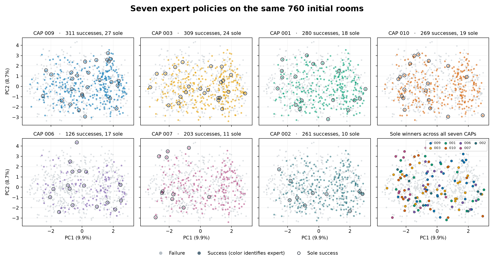
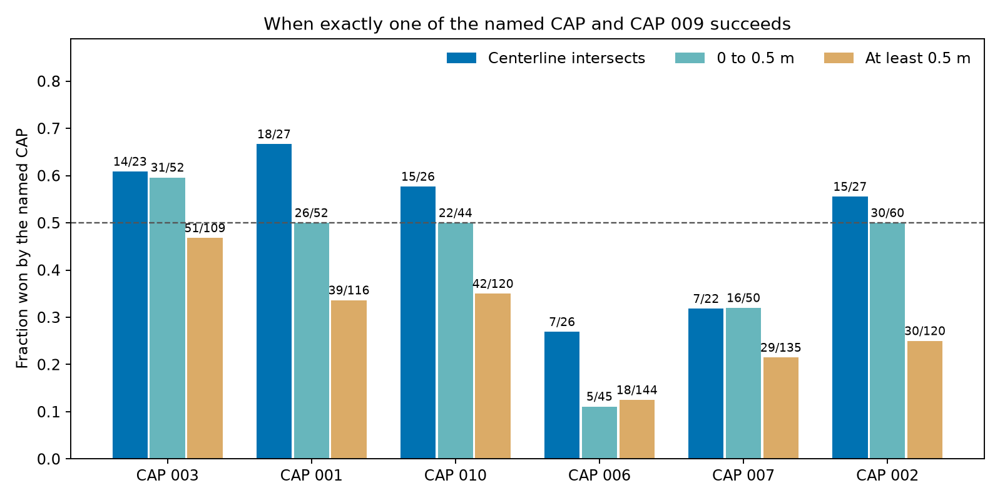
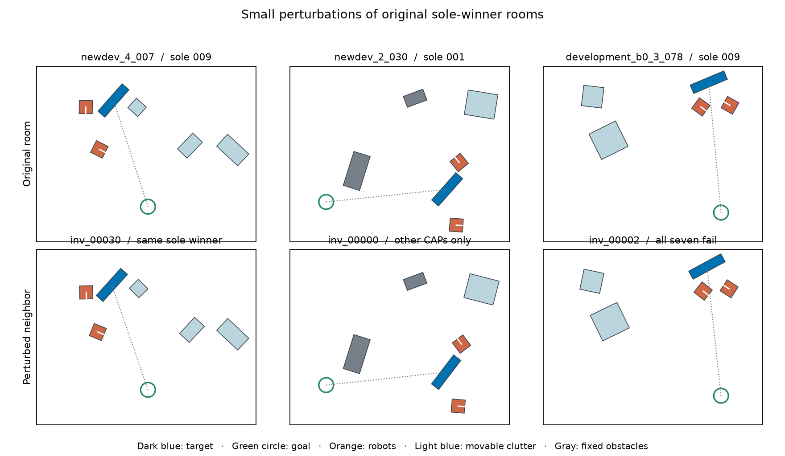

# 初态几何能区分七个 CAP 的成功区域吗？

760 个开发初态中，七个专家的成功并集为 560，独胜初态为 126。PCA 上各专家的成功点和独胜点大量重叠。全维几何能识别一部分各专家共有的难度，也能揭示个别专家的相对优势；用一个通用近邻规则从初态选定专家，在 600 个不同房间中仅达到始终选 009 的成功数。

[交互地图：切换专家、点选房间查看布局与每家真实成败](explore.html)

每个点是一个房间，七个面板的坐标完全相同。灰色为该专家失败，彩色为成功，黑圈为七家中只有这一家成功。右下图把各家的独胜点叠在一起。28 个标准化几何量取自初态 fixture，包括任务物体和终点的位置及墙距、目标方向、物体轴向、两台机器人的相对位置和朝向、沿目标直线路径的固定和可动障碍物净距。净距用线段上 41 个点到有向矩形的最小有符号距离近似，上限 2 米。归一化和 PCA 在原始 760 个房间上拟合；不含增广邻居、成败标签、CAP 动作或后续观测。这些几何真值用于离线解释。PC1 主要反映固定障碍物数量及路径净距，PC2 与目标方向、可动障碍物净距有关。两轴解释方差 9.94% 和 8.66%，仅凭投影不能排除其他维度上存在分区。[主成分载荷](loadings.csv) · [坐标、特征、成败及面板身份](scenes.csv)

### 共同难度与相对优势

在另外 600 个内容不重合、结果此前看过的房间里，使用 28 维标准化欧氏距离，从 760 个开发场景中取最近 15 个，为每个 CAP 预测其成功率。七家的成功对失败 AUC 为 0.594–0.682，0.5 对应排序与随机等效。但若专门问“这个 CAP 和 009 恰好一胜一负时，谁赢”，只用开发集中该对一胜一负的房间作邻居，六个 AUC 在 0.436–0.581。开局用七路近邻成功率的最大值选一个专家，等分按既有 CAP 顺序，在 600 例中完成 259 例；固定开发集成功数最高的 009 也完成 259 例。独胜子集分别为 26/92 和 20/92。此处指选定后全程执行同一 CAP，直接查该 CAP 的完整已存结局。[逐专家读数](held_geometry_scores.csv)

几何中仍有可复现的专家差异。单独在开发集为每对专家从 28 个特征中挑选排序 AUC 距离 0.5 最远的一维，固定方向后在 600 个房间中复查。002、001、003 相对 009 都选中了同一特征，即目标物体中心至终点的直线与其他可动物体的最小净距，净距较小更偏向前三者。留出 AUC 分别为 0.660、0.612、0.592。010 与 007 的开发集单特征规则在留出房间接近 0.5。图中分箱为事后解释，仅统计两家确实一胜一负的房间。分母不包括同胜和同败，结果不能解释成部署时的成功概率。[单特征选择与留出复查](one_feature_transfer.csv) · [分箱计数](corridor.csv)

### 同一个初态稍微改变会发生什么

最高增广剂量的既有采集中，411 个近邻源自 97 个独胜父场景。扰动时目标、可动物体和机器人各坐标独立改变最多 6.5 厘米，角度最多改变 0.10 弧度，保持终点、固定障碍物和合法性约束。原赢家仍成功 141/411，其中保持独胜 40、变为共同成功 101。另有 150 个变成只有其他专家成功，120 个七家全败。采集偏向原本成功专家少的父场景，同一父场景可有多个邻居；这些是按所采近邻计的比例。此处能观测到厘米级扰动下的成败变化，不能推断无限小扰动或任意初态的稳定性。[所有近邻对应关系](nearby_singletons.csv)

图例按已有采集顺序从三种结局各取第一个父子对，展示扰动尺度。整理数据与制图的入口为仓库根目录下的 `python -m tools.cap_initial_geometry`。[机器可读汇总](summary.json)
