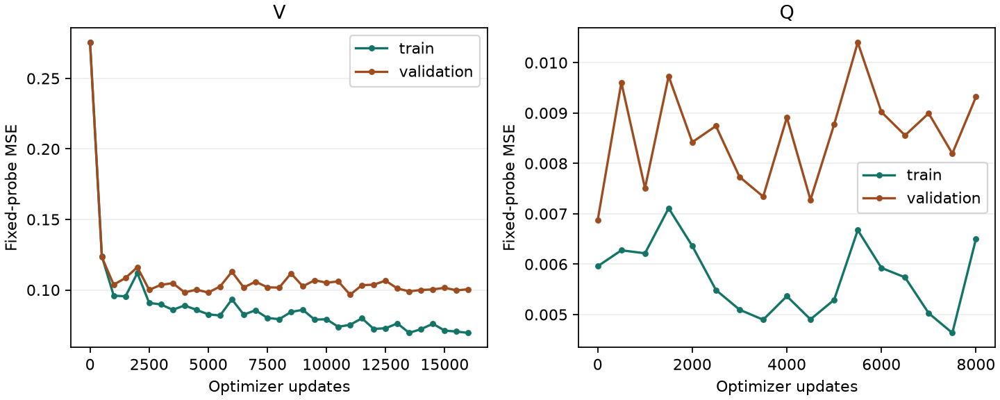

# 最高剂量 GLOBAL attention 与 GA-Q 的闭环对照

同一组完整训练轨迹、归一化、候选动作及训练预算。两组均使用 seed17，在同一组 600 个初态上贪心执行。正差值代表 attention 成功率更高。

| 场景 | 初态数 | GA-Q 成功 | Attention 成功 | 新增 / 丢失 | 差值（百分点，95% 区间） |
|---|---:|---:|---:|---:|---:|
| 全部 | 600 | 323 | 314 | 69 / 78 | -1.50 [-5.50, +2.50] |
| 恰一个 CAP 成功 | 92 | 43 | 47 | 17 / 13 | +4.35 [-7.14, +16.09] |
| 七 CAP 成功并集 | 449 | 307 | 299 | 61 / 69 | -1.78 [-6.77, +3.24] |
| 并集以外 | 151 | 16 | 15 | 8 / 9 | -0.66 [-6.00, +4.69] |

区间按场景配对、按可动物体数分层重抽 10,000 次，条件于这一训练种子。差异同时包含时间窗口内七专家 trace 和注意力架构的影响。

[逐场景配对](per_scene.csv) · [训练和评估设定](protocol.json) · [冻结权重摘要](frozen.json)
