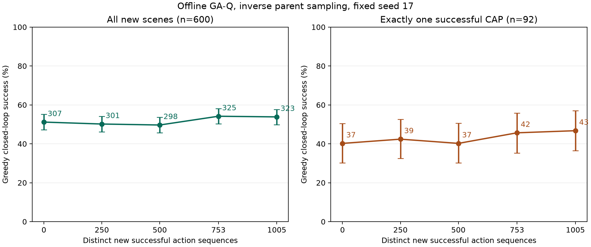

# 原场景成功数反比采样的数据规模曲线

从同一批 200 个可解训练初态中有放回抽取基础族。原场景有 k 个成功 CAP 时，抽取权重为 1/k。原先零成功的场景不生成邻居，其既有失败轨迹随全量原训练集保留。每个受扰动初态完整执行七个 CAP。

| 不同成功序列 | 新邻居 | 来源基础族 | 新增成功 / 失败 | 总训练轨迹 | 总训练决策边界 |
|---:|---:|---:|---:|---:|---:|
| 0 | 0 | 0 | 0 / 0 | 4256 | 294285 |
| 250 | 131 | 92 | 251 / 666 | 5173 | 358844 |
| 500 | 257 | 131 | 513 / 1286 | 6055 | 421498 |
| 753 | 387 | 152 | 774 / 1935 | 6965 | 490234 |
| 1005 | 546 | 169 | 1038 / 2784 | 8078 | 573536 |

各剂量按预定的初态生成顺序嵌套。阈值只对完整成功轨迹的动作序列去重计数；训练保留截至该邻居的所有真实运行。各模型共用原始归一化和训练 seed17，从头训练 16,000 次 V 与 8,000 次 Q；零剂量复用冻结的原离线 Q。各剂量的更新数相同，单条样本的平均训练曝光随数据量改变。

| 不同成功序列 | 全面板成功 | 相对零剂量（百分点，95% 区间） | 独有场景成功 | 相对零剂量（百分点，95% 区间） |
|---:|---:|---:|---:|---:|
| 0 | 307/600 | +0.00 [+0.00, +0.00] | 37/92 | +0.00 [+0.00, +0.00] |
| 250 | 301/600 | -1.00 [-5.00, +3.00] | 39/92 | +2.17 [-9.68, +14.15] |
| 500 | 298/600 | -1.50 [-5.50, +2.50] | 37/92 | +0.00 [-12.50, +12.36] |
| 753 | 325/600 | +3.00 [-0.83, +6.67] | 42/92 | +5.43 [-6.59, +17.39] |
| 1005 | 323/600 | +2.67 [-1.00, +6.33] | 43/92 | +6.52 [-5.83, +18.60] |

在固定的 600 个新初态上执行七个单 CAP 与五个冻结模型，共 7,200 次完整闭环。主比较为最高剂量相对零剂量在恰一个 CAP 成功场景中的保留率差。对初态按物体数分层、配对重抽 10,000 次。区间条件于本采集序列、单训练种子；中间点和相邻剂量差用于描述曲线形状。该曲线衡量反比采样整套方法在固定训练预算下的表现；本轮没有同规模均匀增广臂。

[逐场景结果](per_scene.csv) · [各档统计及相邻点差值](results.csv) · [采集明细](collection.csv) · [冻结协议](protocol.json)
