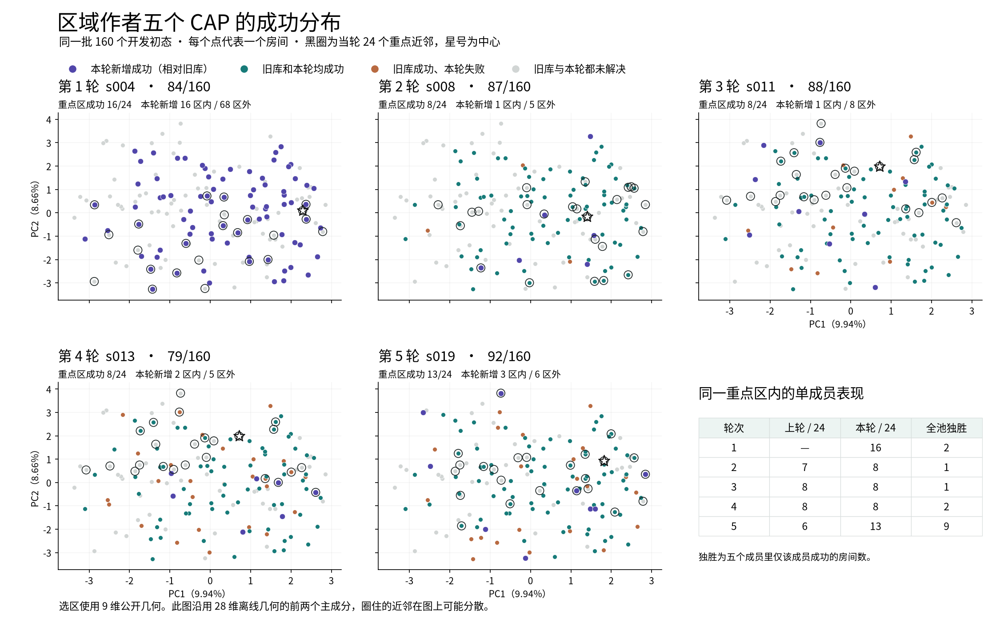
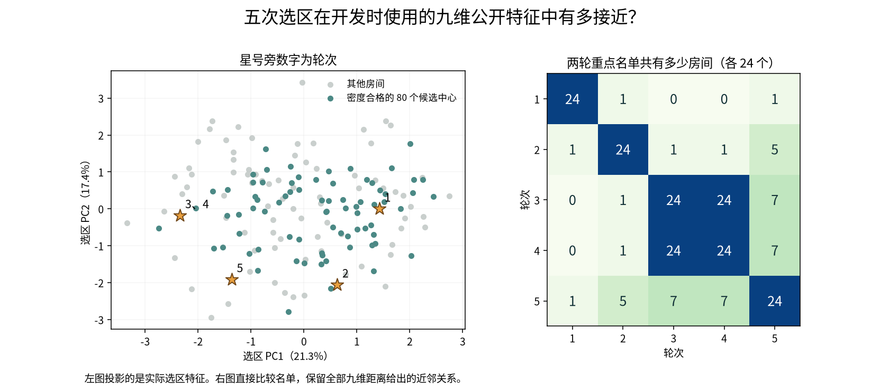

# 五轮 CAP 作者对照

三位独立的 GPT-6.1 Sol High 作者从头开发，使用相同 160 个开发房间和公共动作接口。常规组和区域组均可读取本组所有旧版本。通用组在一次连续开发会话内修订一个程序，可以用相同的五次全池反馈，部署时只保留开发成功数最多的版本。

在 200 个预先封存的新房间，区域库五个成员的独立执行并集为 139/200，常规库为 115/200。按公开初态选择一个成员并全程执行时，两组分别成功 113 和 86 例，通用单程序成功 80 例。开发集选择的区域库最强单成员成功 119 例。

| 组别 | 五次全池单版本成功 / 160 | 最终开发覆盖 / 160 | 选择的通用或最强成员 |
|---|---|---:|---|
| 通用单策略 | 33、29、40、51、62 | 62 | s009 |
| 常规增量覆盖 | 0、19、41、67、31 | 92 | s009 |
| 区域精化 | 84、87、88、79、92 | 115 | s019 |

### 自然分布的新房间与开发场景近邻

各库同时报告按开发成绩选定的最佳单个成员、用公开初态几何的 15 近邻选择一个成员后全程执行，以及全库各成员独立执行的实测成功并集。后者在同一房间用到了各个成员的实际结局。通用组只有一个可部署程序。

| 面板 | 组别 | 开发选定单程序 | 初态选择一次 | 各成员成功并集 |
|---|---|---:|---:|---:|
| 独立新房间（200） | 通用单策略 | 80 | 80 | 80 |
| 独立新房间（200） | 常规增量覆盖 | 91 | 86 | 115 |
| 独立新房间（200） | 区域精化 | 119 | 113 | 139 |
| 原房间微扰（160） | 通用单策略 | 65 | 65 | 65 |
| 原房间微扰（160） | 常规增量覆盖 | 79 | 76 | 98 |
| 原房间微扰（160） | 区域精化 | 93 | 84 | 120 |

### 配对差值

下表给出后者减前者，按物体数分层、按房间配对重抽 10,000 次。区间只反映场景差异。本轮每条路线只有一个作者会话，无法估计重新生成一套库的方差。

| 新房间比较 | 分母 | 救回 / 丢失 | 净变化（百分点；95% 区间） |
|---|---:|---:|---:|
| 常规 → 区域：专家并集 | 200 | 42 / 18 | +12.0 [+4.5, +19.5] |
| 常规 → 区域：初态选择 | 200 | 49 / 22 | +13.5 [+5.5, +21.5] |
| 常规 → 区域：两库共同可解区的初态选择 | 97 | 18 / 11 | +7.2 [-4.1, +17.5] |
| 通用 → 常规初态选择 | 200 | 35 / 29 | +3.0 [-5.0, +11.0] |
| 通用 → 区域初态选择 | 200 | 48 / 15 | +16.5 [+9.0, +24.0] |

### 区域作者生成的最佳单程序

在开发池上选定每组的最佳单成员，再对同一批新房间逐例比较。第一行衡量两种开发流程最终各交付一个程序的差异。后两行衡量保留多个成员并在开局选一次的额外部署收益。这三项是观察到开发成绩差异后补充的对照。

| 新房间配对（各 200 例） | 首者成功 | 后者成功 | 后者救回 / 丢失 | 净变化（百分点，95% 区间） |
|---|---:|---:|---:|---:|
| 通用单程序 → 区域最佳单程序 | 80 | 119 | 53 / 14 | +19.5 [+12.0, +27.0] |
| 区域最佳单程序 → 区域开局路由 | 119 | 113 | 9 / 15 | -3.0 [-8.0, +1.5] |
| 常规最佳单程序 → 常规开局路由 | 91 | 86 | 0 / 5 | -2.5 [-5.0, -0.5] |

[两套面板的单程序配对](fixed_member_pairs.json)

### 区域内是否稳定

区域由开发时可见的初始观测确定。以下每格为同一批场景上“本轮区域成员 / 同轮常规成员 / 通用最终版本”的成功数。每轮检查开发重点区域 24 个房间的未展示扰动，以及在 200 个独立新房间中按公开特征离本轮中心最近的 30 个。不同轮次的区域允许重合。

| 轮次 | 中心 | 开发区域扰动 / 24 | 独立新房间近邻 / 30 |
|---|---|---:|---:|
| 1 | dev_5_36 | 16 / 0 / 8 | 21 / 0 / 15 |
| 2 | dev_5_15 | 9 / 4 / 7 | 16 / 0 / 9 |
| 3 | dev_2_16 | 12 / 10 / 6 | 11 / 6 / 10 |
| 4 | dev_2_16 | 10 / 9 / 6 | 10 / 8 / 10 |
| 5 | dev_3_09 | 11 / 4 / 9 | 15 / 1 / 8 |

### 开发投入

每组最多 960 次开发运行、1,728,000 个物理 ticks、240 分钟作者宿主窗口。库每轮最多 32 个探索运行、一次全池；通用组可在会话内分配 160 个探索运行。每次物理执行最多 1,800 ticks、300 次决策。各作者 token 来自独立会话的累计 token_count 遥测。输入含上下文重读，含缓存的输入会重复计数；推理已计入输出。未设置 token 硬上限，等预算仅指相同的实验资源上限。

| 作者 | 试跑 | 全部开发运行 | 物理 ticks | 输入 token（其中缓存） | 输出 token（其中推理） |
|---|---:|---:|---:|---:|---:|
| 通用单策略 | 160 | 960 | 1,494,484 | 11,269,206（11,114,880） | 48,563（26,945） |
| 常规增量覆盖 | 144 | 944 | 1,565,260 | 14,301,244（14,050,688） | 48,273（23,902） |
| 区域精化 | 160 | 960 | 1,354,656 | 22,228,546（22,064,512） | 49,130（24,786） |

### 证据边界

初态轻量路由只在开局选择一次。当前记录衡量作者生成的覆盖、局部稳定性以及能否从公开初态识别合适成员。逐决策 directQ 的整合成效需要另外拟合并评价。作者从同一公共接口和空白策略独立起步，初版质量差异会沿后续源码复用积累。开发中向三组同步补充了公共终止判据（距终点 0.20 米、线速 0.02 米/秒、角速 0.05 弧度/秒、连续 0.5 秒）并增加了自有状态查看；消息发出时三组轮次进度不同。

[逐场景、逐 CAP 和选定成员](per_scene.csv) · [逐轮分母与完整配对统计](summary.json) · [开发约定](protocol.json) · [作者封存和评估源码哈希](frozen.json) · [LLM 用量](author_usage.json)

### 后期未覆盖点的事后诊断

第四轮后仍有 54/160 个开发房间未覆盖。第五轮从密度合格的候选中选择未解数最多的 24 近邻，内有 13 个未解。32 次探索都在该区，20 次用于原未解房间，涉及 5 个不同未解初态，另 12 次回测已解房间。第五个成员新增 9 个开发成功，其中 3 个在重点邻域、6 个在其外。作者指令没有转为全局扫散点的阶段。

在相同的公开特征、相同的备选邻域和最大值选择规则下，将这 54 个失败标签置换 5,000 次。全局置换的最大未解数平均为 12.99，64.3% 的置换达到或超过实测值 13。按可动物体数分层置换时均值为 13.09，达到或超过者占 67.6%。新成员覆盖了区内 3/13 和区外 6/41 个原未解房间。这项回看仅检验当前距离与邻域尺度的集中程度，无法估计换用全局修复策略的因果收益。[逐轮选区与探索预算](focus_audit.json)

### 五个正式区域成员的覆盖分布

后四轮新增的 31 例中有 7 例在各轮重点区。以每轮开始时旧库未解的房间数作为分母，区内补上 7/61（11.5%），区外补上 24/200（12.0%）。同一未解初态可在后面轮次再度进入分母，这里按场景和轮次累计，供描述使用。第五轮在指定的 24 例上成功 13 例，前一个成员成功 6 例，前四个成员中最高为 11 例。当前数据支持少数局部修复，尚未显示连续多轮在指定区域内优先获得覆盖增量。

[逐轮逐点明细](regional_member_scenes.csv) · [五成员独有及新增成功数](regional_member_counts.json)

前两轮重点名单仅重合 1/24，第一和第三轮交集为空。第三、四轮均以 dev_2_16 为中心，名单重合 24/24。第四轮该中心有 15 个未解房间，其他合格中心最多 14 个。上一轮中心距离仅用来打破未解数量相同的平局。五轮首次进入重点名单的房间分别为 24、23、23、0、13，合计 83 个。第二轮和第五轮中心本身都已被旧库解决。

[中心、同分候选数与各轮重点名单交集](regional_selection_geometry.json)
