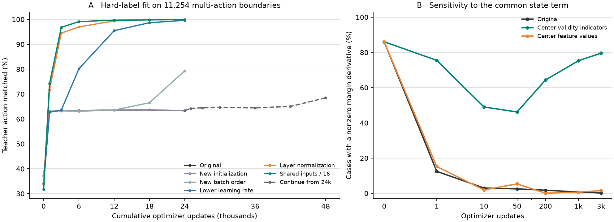

# 五 CAP 的 GA actor 为什么卡在 63% 训练命中率

五个冻结 CAP 提出候选动作，64×64 GA actor 对去重后的合法候选逐一评分。保持最快成功教师、采样、网络宽度和更新预算相同，改变共享状态与动作进入评分器时的相对尺度，就能使硬标签训练命中率超过 99%。原实现很早就几乎失去了用状态改变动作排序的能力。

## 比较口径

800 个固定开发房间含 330 个原开发房间、228 个新自然房间、242 个困难扰动房间。五个 CAP 中有成功运行的 491 个房间各选一条最快成功轨迹，得到 15,601 个边界，11,254 个有多个不同合法动作。留出诊断面板的 200 个房间中，144 个有成功教师，共 4,420 个边界，其中 3,162 个有多个不同合法动作。

每批先均匀抽房间，再均匀抽该房间的决策边界，batch 为 64。训练采用硬标签交叉熵与 Adam，默认学习率 0.0003，seed 17。原实现前 3,000 步在 0、1,000、3,000 步的全训练集损失、命中数和全轨迹匹配数均精确复现。在本轮诊断中，单项改动分别从头训练；续训组从原第 24,000 步权重和对应后续抽样位置起步，原实验只保存了模型权重，因此重新初始化 Adam。

| 设置 | 累计更新 | 训练动作命中 | 留出动作命中 | 逐步完全跟随教师的轨迹（训练 / 留出） |
|---|---:|---:|---:|---:|
| 原最快教师硬标签 | 24,000 | 7,128/11,254（63.34%） | 1,866/3,162（59.01%） | 53/491 · 13/144 |
| 只换权重初始化（29） | 24,000 | 7,120/11,254（63.27%） | 1,884/3,162（59.58%） | 66/491 · 18/144 |
| 只换抽样顺序（29） | 24,000 | 8,924/11,254（79.30%） | 2,012/3,162（63.63%） | 72/491 · 6/144 |
| 学习率降至 0.0001 | 24,000 | 11,210/11,254（99.61%） | 2,216/3,162（70.08%） | 456/491 · 17/144 |
| 融合后做 LayerNorm | 24,000 | 11,247/11,254（99.94%） | 2,302/3,162（72.80%） | 485/491 · 12/144 |
| 共享输入除以 16 | 24,000 | 11,239/11,254（99.87%） | 2,257/3,162（71.38%） | 477/491 · 9/144 |
| 旧权重再训 24,000 步 | 48,000 | 7,708/11,254（68.49%） | 1,888/3,162（59.71%） | 70/491 · 13/144 |

以训练多动作命中数选择并留存的模型为 **融合后做 LayerNorm**。统计的是沿教师轨迹输入真实观测时的动作选择，完全跟随按整条轨迹的每一个边界检查。留出面板未参与训练模型的选择。

## 原模型实际学到了什么

在训练边界上枚举五个 CAP 的 120 种固定优先级，按命中数择优。最优顺序为 s025 → s027 → s041 → s045 → s066，有相同动作的提议合并后评分。这个完全忽略状态的规则就能命中 7,051/11,254 个训练边界、1,861/3,162 个留出边界。原 actor 与它在训练上有 10,375/11,254 次选择相同，留出上有 2,934/3,162 次相同。

原评分器把共享状态与候选动作分别线性投影并相加，再经过两层 ReLU。如果同一状态的不同候选在两层中激活了完全相同的单元，这个局部区域里，改变共享状态会给所有候选加上同一个分数增量，前两名分差对共享状态项的导数为零。原模型在训练的 11,204/11,254 个多候选边界满足这个相同激活条件。给几何部分换入另一房间的观测、保留原候选和预算，只有 483/11,254 次改变选择。这个替换是模型敏感度探针，不能作为实际物理状态解释。

## 哪些输入导致了这个现象

固定抽查 1,024 个多候选训练边界。原模型前两名分差对共享项的导数在初始化时有 143 个为零，第 1 步增到 896 个，第 10 步 993 个，第 3,000 步 1,022 个。第一层共享项的均方根幅度从初始化的 0.54 在第 10 步增到 12.11，同一状态内不同候选动作项的跨度均方根此时仅 0.051。

共享输入含 11,736 个标准化数值及其 11,736 个有效性标记。第 10 步，相对初始化，标记权重更新对共享项的贡献均方根为 11.93，数值权重更新的对应量为 0.74。二者是同一批输入分块统计，不能直接相加当作方差分解。

两项小对照都把减去的训练均值乘以初始权重补入偏置，让初始函数在浮点误差内保持一致。三组初始全训练集均命中 3,851 个多动作边界。到第 3,000 步，仅中心化有效性标记达到 10,469/11,254，另有 209/1,024 个边界分差导数为零。仅中心化数值时命中 7,112/11,254，有 1,008/1,024 个分差导数为零。相同数据、同维度下的差异将有效性标记的尺度与训练时早期的排序退化联系起来。

## 对研究结论的影响

逐条检查归一化输入、可行动作、动作特征与提议来源。15,601 个边界均有不同的输入，没有发现相同输入对应冲突教师，或教师动作与同一边界的其他候选在编码后完全相同。这项检查只排除了精确碰撞，相近状态的最优动作仍可能随微小变化而改变。

前次集合监督在同一训练集上命中最快教师 11,039/11,254 次，而原硬标签只命中 7,128 次。现在同样的硬标签也足以实现接近完全拟合，前次的训练差距不支持“必须保留多解才拟合得动”。前次两个已运行的闭环分别是硬标签 88/200、集合监督 76/200。训练命中数选出的 LayerNorm 模型随后在同一面板完成闭环。后续若比较监督目标，应让两组共用相同的输入处理、采样与预算，再配对比较相同房间里的成功、救回和丢失。

[完整对照数据](../../../../outputs/semantic_rl/cap_general_specialists_62_20261120_01/action_actor_800_fit_diagnostic_s17/FINISHED.json) · [逐轨迹匹配与分差导数统计](../../../../outputs/semantic_rl/cap_general_specialists_62_20261120_01/action_actor_800_fit_diagnostic_s17/margin_comparison.json) · [固定优先级](../../../../outputs/semantic_rl/cap_general_specialists_62_20261120_01/action_actor_800_fit_diagnostic_s17/priority_reference.json) · [诊断入口](../../../../tools/cap_general_actor_fit_diagnostic.py) · [中心化对照](../../../../tools/cap_general_actor_fit_centering.py)

训练数据按需从已有确定性轨迹重放后暂存内存文件系统。部署校验或后续测试用诊断模块的 `load_best()` 加载保留的权重和对应输入处理。

## LayerNorm 的 200 房间配对闭环

冻结 seed17 的训练选定检查点，每个边界由 actor 在五个 CAP 的合法提议中贪心选动作，沿用原 PUSH 和每房间最多 1,800 ticks、300 次决策的限制。200 个留出诊断房间全部完成。

| 对照策略 | 对照成功 | LayerNorm 成功 | LayerNorm 救回 / 丢失 | 成功率净差及配对 95% 区间（百分点） |
|---|---:|---:|---:|---|
| 原硬标签 actor | 88/200 | 85/200 | 29 / 32 | −1.5 [−9.0, +6.5] |
| 原集合监督 actor | 76/200 | 85/200 | 27 / 18 | +4.5 [−2.0, +11.0] |
| 开发集选出的单 CAP s027 | 87/200 | 85/200 | 24 / 26 | −1.0 [−8.0, +6.0] |
| 同库 directQ | 85/200 | 85/200 | 37 / 37 | 0.0 [−8.5, +8.5] |

置信区间按物体数分层，对房间配对重采样 10,000 次。五 CAP 成功并集中的 144 个房间，原硬标签与 LayerNorm 分别解出 83 和 77 个；并集外的 56 个房间分别解出 5 和 8 个。留出教师动作拟合从 59.01% 升至 72.80%，但此次闭环未见净收益。结果限于一个训练种子和这个已查看的留出诊断面板。

[逐房间结果](../../../../outputs/semantic_rl/cap_general_specialists_62_20261120_01/action_actor_800_fit_diagnostic_s17/closed_loop/per_scene.csv) · [配对统计](../../../../outputs/semantic_rl/cap_general_specialists_62_20261120_01/action_actor_800_fit_diagnostic_s17/closed_loop/FINISHED.json)

[首次分歧、教师动作修正与 1 tick 扰动诊断](forks.md)覆盖同一面板的 200 个房间，含逐房间干预结果和三个真实分叉的轨迹。
