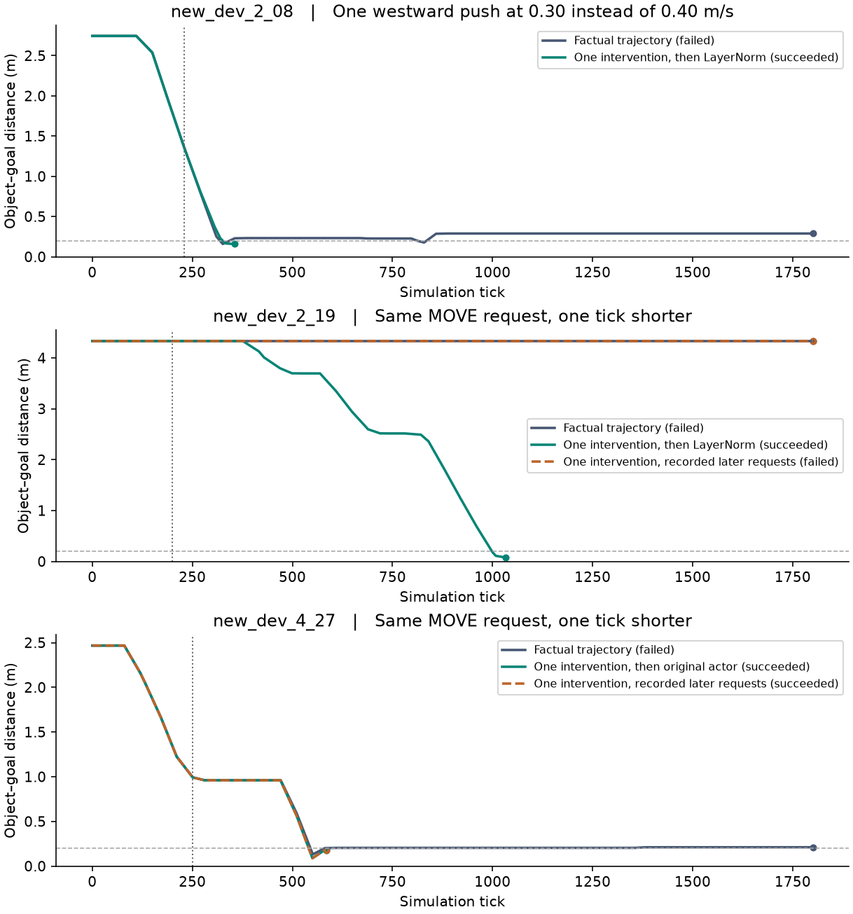

# 哪些动作改变了闭环成败

同一留出诊断面板、同一 seed17。原硬标签 actor 成功 88/200，加 LayerNorm 后成功 85/200，丢失 32 个、救回 29 个。配对净差 −1.5 个百分点的 95% 区间为 [−9.0, +6.5]。这里研究房间内结局改变的原因。两种模型在 200 个房间的原始闭环均已复现，400 次成败与完整公开历史哈希逐一相符。

## 换掉首次分歧动作，保留原来的后续决策器

189 个房间出现不同的动作，另 11 个的完整历史相同。对每个分歧从原初态重放，核对共同前缀哈希，用对方的一条命令替换当前决策。下一边界起由当前 actor 继续读取自己实际到达的状态。两条原闭环加两条交换闭环形成四个结果。

| 两个动作 × 两种后续 actor 的结果 | 原成功、LayerNorm 失败 | 原失败、LayerNorm 成功 |
|---|---:|---:|
| 两种后续 actor 均只有选赢家首个分歧动作才成功 | 12 | 8 |
| 两个交换组合都成功 | 12 | 9 |
| 两个交换组合都失败 | 5 | 9 |
| 无论首个分歧选哪个动作，跟着赢家 actor 续跑都成功，跟着输家都失败 | 3 | 3 |
| 房间数 | 32 | 29 |

32 个丢失房间里，LayerNorm 只改这一条命令，就能救回 24 个。24 个中，旧动作等于同前缀最快教师动作的有 7 个，LayerNorm 自己的动作等于最快教师的有 2 个，两者都不同于最快教师的有 4 个。此外有 10 个在此以前已偏离最快教师，还有 1 个房间五个 CAP 全部失败。

对 61 个成败不同的房间，另在失败 actor 自己走出的轨迹上，抽查首次分歧之后的不同提案。每房间最多选四个，按后续分歧的序号等距抽取，每次独立替换一条命令并交回原 actor。234 个单步替换有 48 个救回，分布在 34 个房间。合并首次与后续检查，有 48/61 个房间至少找到一个能救回的单步替换，包括 26/32 个 LayerNorm 丢失房间。后续 48 个有效动作中有 38 个发生在最快教师前缀以外、6 个房间没有成功教师、2 个等于最快教师、2 个换掉的原动作反而等于最快教师。选择哪个位置替换用了事后结果，这些数字是干预诊断。

## 教师命中率多出的 436 次是否都有相同价值

在 144 个有成功教师的房间完整重放最快教师。3,162 个多动作边界中，LayerNorm 独对 661 次，原 actor 独对 225 次。对每类分歧，每房间取该类第一次发生的位置，强制走相同教师前缀后分别执行两种选择，其后一律由 LayerNorm 续跑，覆盖 191 对干预。

| 分歧位置的教师匹配情况 | 抽查位置 | 仅原动作成功 | 仅 LayerNorm 动作成功 | 两者都成功 | 两者都失败 |
|---|---:|---:|---:|---:|---:|
| 仅 LayerNorm 匹配最快教师 | 106 | 16 | 25 | 49 | 16 |
| 仅原 actor 匹配最快教师 | 85 | 26 | 7 | 35 | 17 |

在 106 个抽查的新增正确位置中，原 LayerNorm 闭环在 26 个位置自行到达了完全相同的教师前缀。其余位置的分类收益是在教师替它走过此前决策的条件下测得。两个方向的抽样次数与可达性不同，不能将上表的成功差相加解释成面板上的净收益。

32 个丢失房间中，有 28 个存在成功教师。即使只看这些房间，LayerNorm 仍把教师边界命中从 453/677 提高到了 491/677。对这 28 个失败逐个只纠正 LayerNorm 自身首次偏离最快教师的动作，14 个能救回。放宽到所有有成功教师的房间，LayerNorm 原本失败 67 个，纠正首错能救回 34 个；在原本成功的 77 个房间中同样干预，则丢掉 16 个。这里的教师是承诺由该 CAP 执行到底的最快教师，其动作交还给混合 actor 后，续跑策略已经改变。

## 1 tick 的执行上限变化

在全部 189 个自然发生的首次分歧处，分别保留两个 actor 各自选定的目标、两台机器人动作、方向及速度，只将时长上限减 1 tick（若已在下界则加 1 tick），其后继续用原 actor。共 378 次诊断，涉及同一批 189 个房间。实际执行少 1 tick 的有 358 次，另 20 次因为提前结束等原因，实际执行时长相同。

92/378 次翻转了最终成败，涉及 78 个房间，46 次救回、46 次丢失。92 次都实际少执行了 0.05 秒。在发生翻转的分支中，分歧动作结束时，目标物中心位置差的中位数为 0，两台机器人中位置变化较大者的中位数为 1.67 厘米。测量的是各自下一决策边界，边界之间相差 1 tick。含 MOVE 的联合动作翻转 80/282，含 PUSH 的翻转 12/95。动作家族可重叠，发生场景也不同，不构成控制器对比。

对 92 次翻转再次执行相同扰动，此后依次重放原闭环记录的高层命令，并检查每条命令在新边界的合法性。

| 固定后续命令的结果 | 次数 |
|---|---:|
| 合法执行至终局，仍然翻转 | 2 |
| 合法执行至终局，恢复为原结果 | 9 |
| 某条后续命令在新观测上不再合法 | 71 |
| 原记录用完，扰动分支尚未终止 | 10 |

有 2 例证明相同的后续高层指令也能产生不同终局。9 例表明后续选动作参与了原先的翻转。71 例显示同一串命令沿途的可执行性会变化，但这些样本不提供固定完整后缀后的成败；另外 10 例同样保留未判定。现有结果支持整个闭环对时长敏感，将原因进一步定位到某个低层控制器，还需隔离传感、合法动作变化与控制执行。

## 真实分叉实例

- **new_dev_2_08**。第 7 次决策，tick 230，目标、第一台机器人的向南推、第二台的向西推和 40 ticks 上限都相同。唯一差别是第二台向西推的指令速度。0.30 m/s 是最快教师和原 actor 的选择，0.40 m/s 是 LayerNorm 的选择。前者交给任一 actor 续跑都成功，后者交给任一 actor 都失败。
- **new_dev_2_19**。tick 200，LayerNorm 的 MOVE 从 24 改成 23 ticks，目标物在动作末端的位置差为 0，机器人最大位置差 1.25 厘米。让 LayerNorm 重新决策就救回，固定随后原命令直至终局仍失败。
- **new_dev_4_27**。tick 251，把原 actor 的 MOVE 从 30 改成 29 ticks，机器人最大位置差 1.67 厘米，目标物中心位置差约 0.47 毫米。即使继续执行原来记录的后续命令，结果也由失败变为成功。

图中纵轴是目标物中心到目标中心的距离，按实际决策边界连接。竖虚线为干预时刻，横虚线为目标半径，成败使用模拟器终止记录。

[逐房间索引](forks_per_room.csv) · [汇总数据](../../../../outputs/semantic_rl/cap_general_specialists_62_20261120_01/action_actor_800_fit_diagnostic_s17/closed_loop/forks/FINISHED.json) · [逐房间动作与干预](../../../../outputs/semantic_rl/cap_general_specialists_62_20261120_01/action_actor_800_fit_diagnostic_s17/closed_loop/forks) · [闭环基线](README.md)

[追查 71 条受阻后缀的首次提案变化、目标可见性与控制器合法性](availability.md)，包含不翻转分支的对照与两种放回 actor 的实测。
