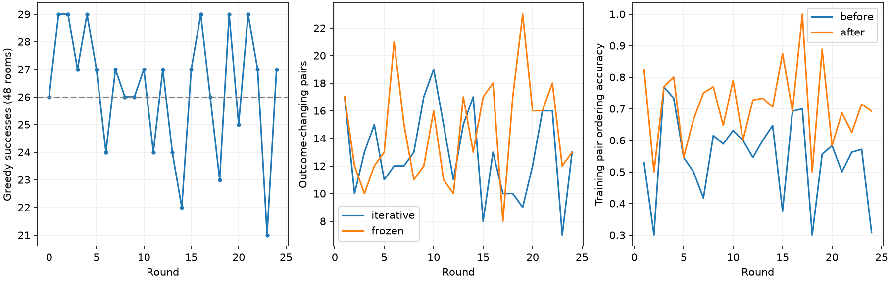

# 分叉动作排序直接更新十维 actor

预定第 24 轮的迭代模型在 200 个新房间成功 109 次，冻结策略采样后集中拟合成功 112 次，初始监督模型成功 117 次。

| 参照 → 候选 | 救回 / 丢失 | 净差（百分点） | 配对 95% 区间 |
|---|---:|---:|---:|
| 监督起点 → 迭代 | 19 / 27 | -4.0 | [-10.5, +2.5] |
| 监督起点 → 集中拟合 | 22 / 27 | -2.5 | [-9.5, +4.5] |
| 集中拟合 → 迭代（主对照） | 24 / 27 | -1.5 | [-8.5, +5.5] |

两组从同一 seed17 十维监督模型开始，每轮 48 个同批随机房间。各组每房间执行基线和两个分叉名额。第一轮采样完全相同，共用轨迹。决策边界从实际走过的多动作边界的前、后两半各抽一个，随机分配优先替代与探索替代。有低排名动作时探索名额在它们中均匀抽取，无可用的不重复分叉时重跑原策略校验。后缀均由各组的采样 actor 接手。训练房间按独立轮次种子生成，不做历史几何去重。

成败不同的动作对用于排序，给出同一个物理动作的 CAP 取最高合法 logit。全部 actor 权重可学，保留初始策略的 KL 约束。迭代组仅用当轮新样本更新，冻结采样组在最后集中训练，两组各 576 次 Adam 更新，batch 32。主对照同时涵盖后续采样分布、后缀与更新日程三者的差异。

每轮监测使用固定 48 个诊断房间，最终 200 个同场景配对房间采用单独种子。最终评测使用预定末轮，两组均为 seed17。配对区间在物体数分层内按场景重抽 10,000 次，只反映场景差异。

[每轮数据](rounds.csv) · [最终逐房间配对](final_rooms.csv) · [配置和统计](results.json)
