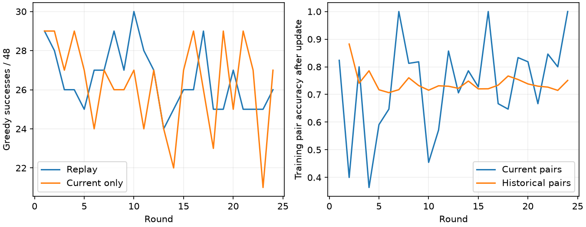

# 当前 actor 采样与历史动作对回放

固定第 24 轮 actor 在 200 个房间中成功 105 次。仅当轮更新为 109 次，监督起点为 117 次，冻结采样集中训练为 112 次。

| 参照 | 回放救回 / 丢失 | 净差（百分点） | 场景配对 95% 区间 |
|---|---:|---:|---:|
| 仅当轮（主对照） | 18 / 22 | -2.0 | [-8.0, +4.0] |
| 监督起点 | 17 / 29 | -6.0 | [-12.5, +0.5] |
| 集中拟合 | 24 / 31 | -3.5 | [-10.5, +3.5] |

24 轮，每轮 48 个随机房间，每个房间两个分叉名额。所有标签是实测的终局成败差，按采样 actor 的 SHA256 记录后缀版本。第一轮相同，直接复用采集、模型和优化器；第二轮复用相同 parent 在同批房间上的采集。从第二轮起每步抽 16 条当轮和 16 条历史有效偏好，历史部分先等概率抽有有效偏好的房间，再抽该房间内的偏好。KL 约束继续取当轮 32 条边界。两组各更新 576 步，batch 32。

固定房间相同，随着模型更新，真实走到的状态和实际成败标签可以不同。第 24 轮预先确定。最终 200 个面板房间此前已查看，按物体数分层、场景配对 bootstrap 10,000 次，区间只描述同一训练种子的场景差异。

另在第 3–24 轮共同的新房间分叉上，用进入当轮前的两个模型排序，后缀固定为初始 actor；在 319 个实测成败不同的动作对中，回放排对 167，仅当轮排对 164。

每个新训练房间在当轮更新前已有完整基线执行。第 3–24 轮累计 1056 个这样的房间上，回放成功 566，仅当轮成功 560；这里汇总的是一系列检查点。

| 复查各自前 23 轮实测偏好 | 各批刚学完 | 第 24 轮重测 |
|---|---:|---:|
| 仅当轮 | 212/298 | 196/298 |
| 回放 | 215/301 | 226/301 |

复查沿用采集时的旧标签。两组从各自到达的状态采样，此表用于跟踪各组自身的保留情况。

[后缀诊断](suffix.md) · [逐房间结果](final_rooms.csv) · [逐轮统计](rounds.csv) · [协议与配对统计](results.json)

## 同一旧前缀更换 actor 后缀

另取第一轮事先选入后缀诊断的 48 个分叉点。固定原历史和两个首步，从下一步开始改由第 24 轮回放 actor 执行。原来 8 对有明确偏好，其中 1 对排序严格反转、2 对变成同结局；原先同结局的动作对中 0 对出现新偏好。这部分只检验标签随接手策略变化的程度。
