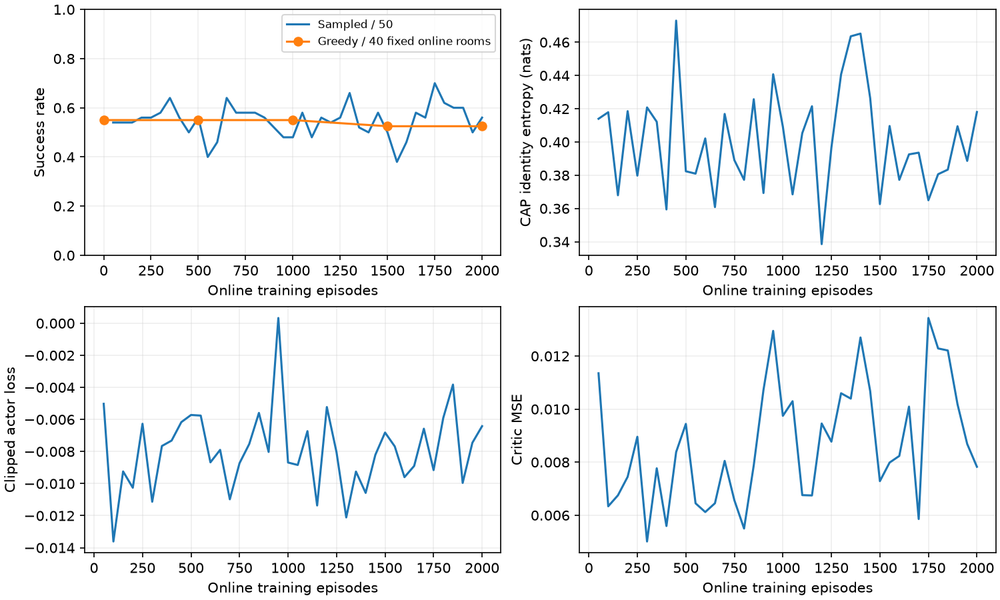

# 十维 CAP 编号 actor 的 PPO 微调

固定最终模型在 200 个自然留出房间成功 120 例，监督起点成功 113 例。配对净差 +3.5 个百分点，95% 区间 [-1.5, +8.5]。开发集选定的最强单 CAP 成功 117 例，PPO 相对它救回 17 例、丢失 14 例，区间 [-4.0, +7.0]。

| 面板 | 监督起点 | PPO 最终 | 救回 / 丢失 | 专家并集内保留（前 → 后） | 独胜保留（前 → 后） | 并集外成功（前 → 后） |
|---|---:|---:|---:|---:|---:|---:|
| 原始开发 | 137/160 | 137/160 | 1 / 1 | 134 → 134 / 134 | 10 → 10 / 10 | 3 → 3 / 26 |
| 开发扰动 | 28/55 | 28/55 | 1 / 1 | 27 → 27 / 27 | 6 → 6 / 6 | 1 → 1 / 28 |
| 自然留出 | 113/200 | 120/200 | 16 / 9 | 111 → 117 / 160 | 4 → 2 / 18 | 2 → 3 / 40 |
| 困难族扰动 | 30/90 | 30/90 | 5 / 5 | 29 → 26 / 55 | 1 → 0 / 13 | 1 → 4 / 35 |

## 开局选择与后续切换

按同一房间的单 CAP 实测结果，计算如果始终跟随 actor 首选的 CAP 会成功几次。每步重选另统计相对该参照救回及丢失的场景。

| 面板 | 模型 | 固定首选 | 每步重选 | 救回 / 丢失 | 发生过不同动作切换的房间 |
|---|---|---:|---:|---:|---:|
| 自然留出 | 监督起点 | 112/200 | 113/200 | 15 / 14 | 122/200 |
| 自然留出 | PPO | 116/200 | 120/200 | 14 / 10 | 120/200 |
| 困难族扰动 | 监督起点 | 26/90 | 30/90 | 7 / 3 | 48/90 |
| 困难族扰动 | PPO | 28/90 | 30/90 | 7 / 5 | 51/90 |

200 个自然房间中，两模型有 162 个首选同一 CAP，72 个完整公开历史哈希相同。困难族扰动中对应为 80/90、42/90。历史哈希覆盖实际执行的动作和观测。

## 训练与采样

从 seed 17、24,000 次监督更新的固定模型起步，保持 64×64 十维 actor 和动作掩码。使用与监督和评估均按内容去重的 200 个在线训练房间，每轮均匀无放回抽 50 个，共 40 轮。保留单独的 critic，成功时末端奖励 1，其余为 0，预算截断按终止处理。γ=1、GAE λ=0.95、clip=0.2、batch 128，actor/critic 学习率分别为 3×10⁻⁵、3×10⁻⁴。无熵奖励。按预定第 40 轮评测。

监督 logits 很尖锐。在训练池 153 个至少有两种实际动作的初态上，固定温度 2.555 把采样到与贪心不同的物理动作的平均概率从 6.4% 调至 15.0%，PPO 新旧概率均用此温度。实际采样共有 128,279 个边界，存在多种动作的边界中 4,944/94,656 次采到了其他动作。

固定 40 个在线训练房间的贪心成功数（每 500 个 episode）依次为 22、22、22、21、21。主结果来自此前已查看的自然留出面板。场景配对 bootstrap 按物体数量分层，困难扰动以 45 个父房间重抽。单训练种子的区间只刻画场景抽样差异。

## C++ 后端

第 5 轮后核对十个策略的 C++ 转写。32 个在线房间的 2,147 个边界逐项比较十路动作、合法候选、几何特征及策略记忆。另做 64 对同模型同种子的完整随机 PPO 采样，核对状态张量、选择、概率、优势、回报与最终历史。使用 16 个工作进程，以 Cython→C++、C++→Cython 两种顺序计时，包含进程池、仿真、网络推理与分片写入。

十个 CAP 共做 6,500 次合成边界更新，对原始程序逐项检查完整记忆和上下文，数值完全一致。真实边界核对要求动作、候选和输入张量完全一致，内部浮点记忆容差为绝对 2×10⁻¹²、相对 10⁻¹²。每轮计时前已完成原 Cython 和新 C++ 模块的编译。每种后端累计计时 64 个 episode，来自 32 个房间和两组采样种子。

| 顺序组 | 后端 | episode | 墙钟秒数 | episode/s |
|---|---|---:|---:|---:|
| 1 | cython | 32 | 20.68 | 1.55 |
| 1 | cpp | 32 | 11.42 | 2.80 |
| 2 | cpp | 32 | 12.96 | 2.47 |
| 2 | cython | 32 | 26.19 | 1.22 |

总时长比为 1.92×。后 35 轮使用 C++ 后端。

[逐场景结果](per_scene.csv) · [逐轮训练](training.csv) · [协议、配对统计和吞吐](results.json)
