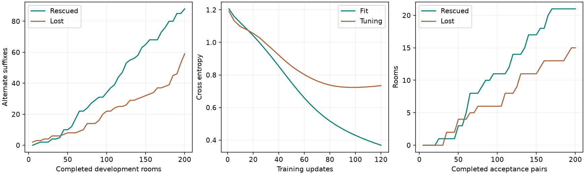

# 十维监督 actor 的单次改选实验

冻结的改选候选在 200 个独立新房间中成功 107 次，原 actor 成功 101 次。实际触发 166 次，救回 21 局，丢失 15 局。成功率净差 +3.0 个百分点，单侧 95% 保守下界 -4.61 个百分点。按事先冻结的规则，保留原监督 actor。

## 分叉机会

从 seed17、24,000 步的原监督 actor 采集前缀。每个房间在第 0–5、6–23、24–79 步各取第一个存在不同合法动作的边界（从 0 编号）。按 actor 的 CAP 排名取最多两个不同于首选的物理动作。重放相同前缀并比对公开历史哈希，在该处改一步，再由原 actor 贪心执行到底。未触发分叉的房间保留在分母中。

| 用途 | 房间 | 含分叉 | 后缀 | 救回 / 破坏 / 同结局后缀 | 可救回的原失败房间 | 可破坏的原成功房间 |
|---|---:|---:|---:|---:|---:|---:|
| 训练 | 160 | 160 | 598 | 70 / 47 / 481 | 37/73 | 29/87 |
| 选阈值 | 40 | 39 | 130 | 18 / 12 / 100 | 8/16 | 8/24 |
| 合计 | 200 | 199 | 728 | 88 / 59 / 581 | 45/89 | 37/111 |

在测过的分叉中，事后知道结局再决定是否改选，可把开发池成功数从 111/200 提高到 156/200。这个数刻画本次采样发现的机会，部署时无法读取分叉终局。

## 如何选出一次改选

十个 C++ CAP 与原 actor 全部冻结。小网络读取公开历史经原 actor 编码后的隐藏向量、原动作与替代动作的显式参数和几何特征、提案来源、logit 差及决策步数。三分类标签为破坏、同结局、救回。每个有分叉的训练房间权重相同。训练 120 步，用预测救回概率减去预测破坏概率作为分数。在每个符合条件的边界取最高分，超过阈值即执行一次，之后全部交回原 actor。

| 阈值 | 调参房间触发 | 救回 | 丢失 | 净增 |
|---:|---:|---:|---:|---:|
| 0.00 | 35 | 6 | 3 | +3 |
| 0.03 | 28 | 4 | 3 | +1 |
| 0.07 | 22 | 3 | 2 | +1 |
| 0.12 | 15 | 3 | 2 | +1 |

在 40 个调参房间中，取净增最多者，平局优先改选次数少、阈值高者。选定 0.00。同一前缀已经枚举部署规则允许的替代动作，调参按最先触发的实测后缀结算。验收使用候选与原 actor 各自的完整物理闭环。

末次训练交叉熵与调参交叉熵为 0.368 和 0.735。在同一批调参后缀上，总是输出训练房间的类别频率会得到 0.658 的交叉熵。损失按房间等权。

## 验收范围

训练、调参、验收按房间内容去重。单独抽取的验收房间按 2 至 5 个物体等概率混合生成，未用结局筛选。一次验收一个冻结候选。以结局不同的概率乘以其中救回相对于丢失的净比例计算净差；对前者构造精确二项 97.5% 双侧区间，对条件救回率构造精确 97.5% 单侧下界，使用 Bonferroni 合并。只在净差下界严格为正时采用候选。这个界限针对同分布的平均成功率。

[逐分叉记录](per_branch.csv) · [开发房间](development_rooms.csv) · [验收逐场景](acceptance_pairs.csv) · [统计与冻结协议](results.json)
