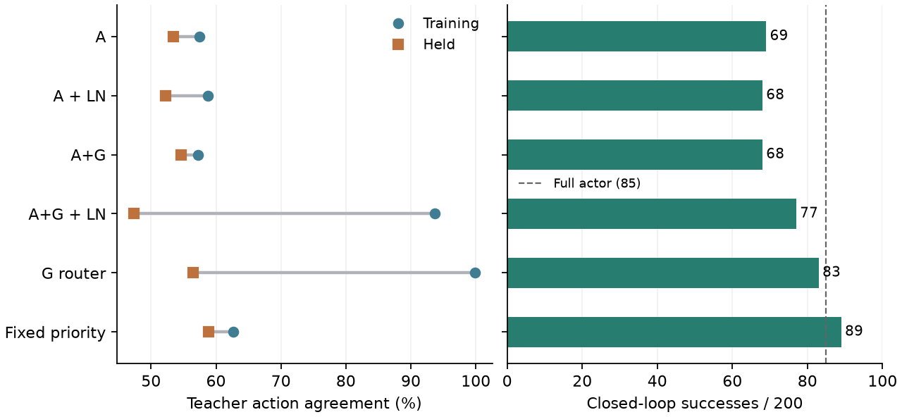

# 显式动作、公开几何与 CAP 优先级的配对消融

**主要结果。** 在复用的 200 房间诊断面板，固定优先级成功 89 次，全部 10,211 个决策实际都选择 s025。几何路由成功 83 次，四组不看提案来源的动作评分器成功 68–77 次。几何结合 LayerNorm 显著扩大了训练和留出教师拟合之间的落差；本面板的实际闭环没有出现同方向的劣化。

## 设计

五个固定 CAP 在每个 option 边界提出动作，沿用原合法性检查和重复动作合并。四个候选评分器构成 2×2 对照：输入为仅动作 A 或动作加几何 A+G，第一层融合后分别启用或关闭无可学习参数的 LayerNorm。四组对应的动作权重、后层权重、偏置使用相同初值。A+G 增加了几何输入的可训练权重；网络均为两层 64 单元 ReLU。评分器只输出当前候选的分数。

- **A** 使用两台机器人的原始命令类型、世界坐标方向、速度、目标角色和时长。方向按原命令编码（固定旋转角为 0），不借用房间的目标方位。去重后的合法候选逐个评分，评分器看不到 CAP 编号、投票数或其他候选。相同参数但不同非目标物体在此编码中可能相同。平局按固定的命令参数与目标 ID 顺序打破。
- **A+G** 除相同的 A 外，加入当前候选所指实体的几何特征，以及初始帧和最近八个边界的公开历史。历史保留雷达、实体、位姿、接触、执行反馈和时间；显式移除每帧中的上一条命令字段。几何沿用冻结的数值归一化和有效性标记。共享输入不含整组 CAP 的提案或固定顺序槽位。
- **几何选 CAP** 单列为五输出的路由器，输入只有上述共享历史。五个通道按最快教师的 CAP 编号用硬标签训练，屏蔽无合法提案的 CAP。执行最高分 CAP 的命令，教师动作命中按去重后的实际命令计算。该对照同时改变输出头与训练标签，不计入 2×2 的几何效应。
- **固定优先级** 复用之前仅按训练边界命中选定的 s025、s027、s041、s045、s066 顺序，执行首个有合法提案者的动作。即便评分器不读额外几何，各 CAP 的提案及合法集合仍随局面改变。

从 800 个训练房间的 491 条最快成功轨迹重建 15,601 个边界。所有学习组固定 seed 17，按房间均匀抽样，再在房间内均匀抽边界；各组使用相同的批次顺序、batch 64、Adam、学习率 0.0003、梯度范数上限 1，训练 24,000 次，统一评估末步权重。原留出面板 144 条成功教师轨迹提供 4,420 个留出边界。逐项重放并核对实际动作、结束 tick、终局成败与历史哈希。教师命中主指标只计存在多个不同合法候选的边界，训练 11,254、留出 3,162。轨迹完全匹配另按全轨迹所有边界计算。

闭环复用最近的 200 房间面板（2–5 个可移动物体，每档 50 例），各方法从头贪心执行，单局最多 1,800 ticks / 300 次决策。全部六种方法都执行 200 局。原完整输入的 800 房间模型（原网络 85/200，LayerNorm 73/200）来自该面板的已有逐房间记录。房间为统计单位，各配对差值及 2×2 交互量的区间按物体数分层重抽房间 10,000 次，未做多重比较校正。面板曾用于多个诊断，且只有一个训练种子。

[冻结协议](../../../../outputs/semantic_rl/cap_general_specialists_62_20261120_01/actor_inputs_20261121_s17/protocol.json) · [数据与输入](../../../../tools/cap_actor_inputs.py) · [训练](../../../../tools/cap_actor_inputs_fit.py) · [闭环评测](../../../../tools/cap_actor_inputs_eval.py)

## 教师拟合与闭环结果

| 方法 | 训练多候选动作命中 | 留出多候选动作命中 | 留出整条动作完全匹配 | 闭环成功 / 200 | 相对完整原网络救回 / 丢失 |
|---|---:|---:|---:|---:|---:|
| 仅显式动作 | 6,468（57.5%） | 1,688（53.4%） | 2/144 | 69 | 17 / 33 |
| 仅显式动作 + LN | 6,611（58.7%） | 1,653（52.3%） | 3/144 | 68 | 21 / 38 |
| 动作 + 几何 | 6,435（57.2%） | 1,728（54.6%） | 3/144 | 68 | 17 / 34 |
| 动作 + 几何 + LN | 10,542（93.7%） | 1,498（47.4%） | 2/144 | 77 | 29 / 37 |
| 几何选五个 CAP | 11,244（99.9%） | 1,784（56.4%） | 18/144 | 83 | 29 / 31 |
| 固定 CAP 优先级 | 7,051（62.7%） | 1,861（58.9%） | 33/144 | 89 | 21 / 17 |

完整原网络的训练及留出教师动作命中率为 63.34%、59.01%，本轮面板闭环 85/200。完整 LayerNorm 的对应结果为 99.94%、72.80%、73/200。完整网络另有按 CAP 身份排列的建议、候选来源、历史命令、相对方向编码和预算等输入，和本轮简化网络的差值不能单独归因于 CAP 身份。

## 配对差值

| 固定对照（后者相对前者） | 救回 / 丢失 | 成功率净差，百分点（95% 区间） |
|---|---:|---:|
| 仅显式动作 → 动作 + 几何 | 24 / 25 | -0.5 [-7.0, +6.5] |
| 仅显式动作 + LN → 动作 + 几何 + LN | 36 / 27 | +4.5 [-3.0, +12.0] |
| 仅显式动作 → 仅显式动作 + LN | 24 / 25 | -0.5 [-7.0, +6.5] |
| 动作 + 几何 → 动作 + 几何 + LN | 35 / 26 | +4.5 [-3.0, +12.0] |
| 固定 CAP 优先级 → 几何选五个 CAP | 20 / 26 | -3.0 [-9.5, +3.5] |

几何带来的成功率变化在有 LN 和无 LN 两组之间相差 +5.0 个百分点，房间配对 95% 区间 [-5.0, +14.5]。该交互量的计算为（A+G+LN − A+LN）−（A+G − A）。

## 固定优先级在实际执行中选了谁

沿固定优先级自身的 200 条轨迹，8,335 个多候选边界中，完整原网络与固定优先级有 7,847 次选择一致（94.1%）。五个 CAP 依次作为第一可用成员的边界数为 10211、0、0、0、0，没有成员提案而回退的边界有 0 个。
沿完整原网络自身的 200 条轨迹，8,392 个多候选边界中，完整原网络与固定优先级有 7,671 次选择一致（91.4%）。五个 CAP 依次作为第一可用成员的边界数为 10273、0、0、0、0，没有成员提案而回退的边界有 0 个。

[逐房间数据](per_room.csv) · [完整对比与交互量](../../../../outputs/semantic_rl/cap_general_specialists_62_20261120_01/actor_inputs_20261121_s17/FINISHED.json) · [优先级执行核对](../../../../outputs/semantic_rl/cap_general_specialists_62_20261120_01/actor_inputs_20261121_s17/priority_audit.json)

## 对几何过拟合假设的判断

仅动作时加入 LayerNorm，训练命中提高约 1 个百分点；已有几何时加入 LayerNorm，训练命中从 57.2% 跃升到 93.7%，留出反而从 54.6% 降到 47.4%。按 144 个留出教师房间重抽、仍按多候选边界数计算总体命中率，加入几何的留出效应在无 LN 时为 +1.27 个百分点，有 LN 时为 −4.90 个百分点。两者之差 −6.17 个百分点，95% 区间 [−9.57, −2.74]。这是针对教师动作模仿的过拟合信号，适用于这里定义的几何历史、目标绑定特征和训练设置。它无法定位到某个扫描维度或证明模型记住了房间身份。[留出教师配对统计](../../../../outputs/semantic_rl/cap_general_specialists_62_20261120_01/actor_inputs_20261121_s17/held_teacher_contrasts.json)

闭环上，加入几何的效应在有 LN 时为 +4.5 个百分点，在无 LN 时为 −0.5 个百分点，交互区间跨零。沿用前次的初态几何近、远各 100 例分组，两组里的交互量分别为 +3 和 +7 个百分点，远减近 +4 个百分点，探索性区间 [−16, +23]。此实验不支持把先前完整 LayerNorm 权重 73/200 的闭环表现归因为几何过拟合。

完整无 LN actor 在自己的多候选边界有 91.4% 选择 s025 建议，相对 s025 能救回 17 局，也丢失 21 局。单局早期的少量偏离可以改变后续整条轨迹，动作一致率需要与真实终局一起读。从研究决策上，固定 s025 应纳入本库的基线；如果要学习何时偏离它，应直接检验偏离的配对终局收益。
