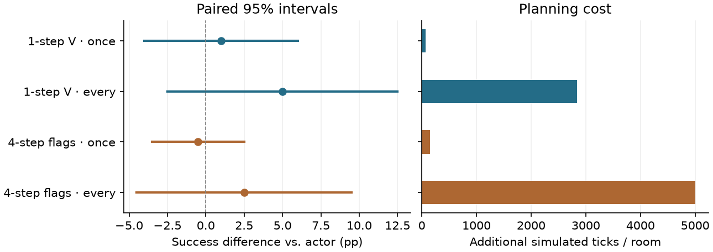

# 短程规划的独立复验与逐步改选

在 200 个新房间中，原 actor 成功 73 个，每个多候选边界做一步 V 规划成功 83 个，四步受阻规则成功 78 个。一步 V 相对原 actor 净增 5.0 个百分点，配对 95% 区间 [−2.5, +12.5]。

## 固定的五个闭环策略

使用同一份五 CAP 动作评分 actor（LayerNorm，seed 17）及同一份由该 actor 自身轨迹训练的 V。V 来自上一轮 512 个训练房间和 96 个选模房间。使用新种子 66221015，在 2、3、4、5 个可移动物体的房间各冻结 50 例，按初态内容哈希核对与上一轮三个面板及已有开发数据的交集。所有权重、规则和房间在取得本轮成败前固定。

| 策略 | 何时预测 | 如何选动作 |
|---|---|---|
| 原 actor | 直接执行 | 在五个 CAP 提出的去重合法候选中贪心选一个 |
| 一步 V，单次 / 每步 | 指定边界一次 / 每个多候选边界 | 对每个候选模拟一个 option，终止用实际成败；未终止取冻结 V，选最高分 |
| 四步受阻，单次 / 每步 | 指定边界一次 / 每个多候选边界 | 先试候选动作，其后按冻结 actor 最多推进三步，选累计受阻边界最少的候选 |

单次组按房间序号预分配 0、5、12、25 四种起始决策，在此之后的首个多候选边界规划一次；每步组从开局就开始，执行选中候选的一步后按实际新历史再次规划。两种部署方式同时改变了干预次数和首次干预时机。所有平局优先保留原 actor，之后按原候选顺序。四步组把提前终止之前实际遇到的受阻次数作为分数，与上一轮探索规则一致。受阻指事件报告 blocked，或任一机器人公开反馈为方向不可用、blocked、move_blocked、yield_blocked。先模拟原动作，当受阻数达到下界 0 时可提前结束候选枚举，选择与穷举相同。

每局物理预算为 1,800 ticks、最多 300 次 option 决策，额外模拟单独计数。所有候选均从真实模拟器的当前完整状态和 CAP 记忆通过 Linux 写时复制分叉。actor、V 和受阻判据只读各自分支的公开信息；真实机器人若要获得相同的前看，还需要从观测重建或估计物理状态。每次实际执行后验证其第一步公开历史哈希与所选预演相同。无改选的整局也与原 actor 核对终局历史哈希。

[前次单次干预诊断](../2026-11-21_actor_value_rollout/README.md) · [冻结协议](../../../../outputs/semantic_rl/cap_general_specialists_62_20261120_01/actor_replan_20261121_s17/protocol.json) · [评测实现](../../../../tools/cap_actor_replan.py)

## 200 个房间的配对结果

| 策略 | 成功 | 成功率 | 救回 / 丢失（相对原 actor） | 差值与 95% 区间（百分点） |
|---|---:|---:|---:|---:|
| 原 actor | 73/200 | 36.5% | 0 / 0 | +0.0 [+0.0, +0.0] |
| 一步 V，单次 | 75/200 | 37.5% | 15 / 13 | +1.0 [-4.0, +6.0] |
| 一步 V，每步 | 83/200 | 41.5% | 34 / 24 | +5.0 [-2.5, +12.5] |
| 四步受阻，单次 | 72/200 | 36.0% | 4 / 5 | -0.5 [-3.5, +2.5] |
| 四步受阻，每步 | 78/200 | 39.0% | 28 / 23 | +2.5 [-4.5, +9.5] |

区间按房间配对、按物体数分层做 10,000 次 bootstrap，反映本批房间的抽样不确定性，未校正多重比较。所有运行共享一份模型权重。

一步 V 在同一房间从单次改成每步，救回 28、丢失 20，净差 +4.0 个百分点 [-3.0, +11.0]。只看预分配起始序号为 0 的 52 个房间，两组首次规划时机一致，单次 / 每步为 17 / 15 个成功。
四步受阻在同一房间从单次改成每步，救回 25、丢失 19，净差 +3.0 个百分点 [-3.5, +9.5]。只看预分配起始序号为 0 的 52 个房间，两组首次规划时机一致，单次 / 每步为 18 / 21 个成功。

## 两组都从首个多候选边界开始

五组主对照完成后，补做同起点比较。对两条规则各补跑 148 局，另各复用 52 局原本就从首个多候选边界开始的单次组。从同一前缀、同一候选和同一规则选出首步，唯一处理差异是之后交还原 actor，还是继续逐步规划。补充比较使用同一批房间，区间按同一配对方法计算，属于事后诊断。

| 规则 | 仅首次规划 | 每步规划 | 每步相对仅首次，救回 / 丢失 | 净差（百分点，95% 区间） |
|---|---:|---:|---:|---:|
| 一步 V | 66/200 | 83/200 | 34 / 17 | +8.5 [+1.5, +15.5] |
| 四步受阻 | 73/200 | 78/200 | 24 / 19 | +2.5 [−4.0, +9.0] |

仅在首个多候选边界使用 V，比原 actor 少成功 7 个（救回 15、丢失 22）；每步使用 V 比原 actor 多成功 10 个（救回 34、丢失 24）。后续连续改选在这批房间取得了增益，但两个参照的起点成绩分别为 66 和 73。四步受阻单次触发的净增在新面板未复现。优先级可给逐步一步 V 的独立复验，保留原 actor 为当前默认。现有数据尚不能确定收益具体来自纠正早期误选还是后段独立的选择机会。

[同起点逐房间结果](matched_start.csv) · [补充比较汇总](../../../../outputs/semantic_rl/cap_general_specialists_62_20261120_01/actor_replan_20261121_s17/matched_start/FINISHED.json)

## 干预频率与代价

| 策略 | 规划边界 | 改选次数 | 至少改选一次的房间 | 每局平均额外模拟 ticks | 每局平均规划秒数 | 每局平均总秒数 |
|---|---:|---:|---:|---:|---:|---:|
| 原 actor | 0 | 0 | 0 | 0.0 | 0.00 | 4.53 |
| 一步 V，单次 | 197 | 115 | 115 | 67.7 | 0.26 | 4.72 |
| 一步 V，每步 | 8,280 | 4,946 | 199 | 2,835.3 | 11.17 | 15.52 |
| 四步受阻，单次 | 197 | 33 | 33 | 146.1 | 0.45 | 5.00 |
| 四步受阻，每步 | 8,380 | 549 | 169 | 4,998.6 | 15.70 | 20.17 |

秒数取本机并行运行时各房间的实际计时，包含分叉开销。额外模拟 ticks 来自所有实际预演的候选，未计入真实轨迹的任务预算。

[逐房间结果](per_room.csv) · [配对与成本汇总](../../../../outputs/semantic_rl/cap_general_specialists_62_20261120_01/actor_replan_20261121_s17/FINISHED.json) · [与前次求解方式的逐例核对](../../../../outputs/semantic_rl/cap_general_specialists_62_20261120_01/actor_replan_20261121_s17/historical_check.json)

[同一面板上的非 LayerNorm 原网络复验与几何距离分层](norm_comparison.md)
