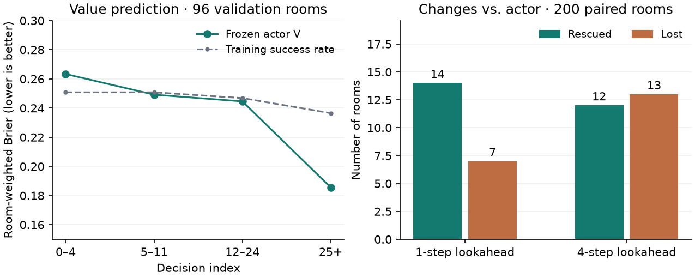

# 用混合 actor 自身的价值筛选 CAP 候选动作

在同一批 200 个新房间，每局至多改选一次，原 actor 成功 77 个，1 步前看成功 84 个，4 步前看成功 76 个。1 步的净增值得复验，当前证据不足以替换原 actor 或增加规划深度。

## 对照设计

五个程序 s025、s027、s041、s045、s066 提出动作。沿用 800 房间硬标签实验中按训练拟合度选定的 LayerNorm actor。实验开始前固定 actor 权重、三批新房间、规划深度和选择 critic 的规则。三批房间各自均衡覆盖 2–5 个可移动物体，与本实验使用的历史面板按初态内容哈希排重。

冻结 actor 在 512 个开发房间自主运行，得到 199 条成功、313 条失败轨迹，共 26,631 个边界。每个边界的标签都是这条轨迹的终局成败，折扣为 1，耗尽任务预算记 0。V 使用与 actor 相同的公开几何历史、专家提案和剩余预算。两层 64 单元网络以均方误差拟合，先均匀抽房间，再在房间内均匀抽边界。用另外 96 个房间（43 个成功，5,123 个边界）的房间等权 Brier 分数选权重。

200 个新诊断房间独立于 V 的训练和选模。每个房间预先分配决策序号 0、5、12、25 之一；从该序号开始遇到的首个多候选边界进行一次干预。保留原 actor 选择，作为同一房间的基线。其余两组对同一组去重后的合法提案分别前看 1 或 4 次 option 决策：先执行候选动作，剩余至多 3 步由冻结 actor 贪心执行。若提前终止，使用实际成败；否则在叶节点使用同一个冻结 V。同分优先保留 actor 原动作。仅执行评分最高候选的首步，随后交还原 actor，直至终局。

另外将**每一个**候选都执行到终局用于审计。同一房间的所有分支校验前缀、CAP 提案及其顺序；原动作分支须逐项复现基线的终局和历史哈希。分叉仿真从原房间和真实前缀重建物理状态，V 和 actor 只读公开历史。前看成本按同一分叉所有候选加总；另计重放前缀的时间。模拟器提供的前看比仅凭传感历史预测未来更有利。

## V 在何时有预测力

用训练集成功率 199/512 作为常数参照。7 个检查点中，全程验证 Brier 在第 250 次更新最低，为 0.2099；到第 8,000 次为 0.3254。以下均为第 250 次的权重和同一批验证房间。每个区间只统计实际走到该区间的房间，各房间等权，数值越小越好。

| 决策边界（从 0 起） | 房间 | 边界 | V 的 Brier | 常数 Brier |
|---|---:|---:|---:|---:|
| 0–4 | 96 | 480 | 0.2633 | 0.2508 |
| 5–11 | 96 | 664 | 0.2492 | 0.2508 |
| 12–24 | 93 | 1,159 | 0.2446 | 0.2468 |
| 25 及以后 | 86 | 2,820 | 0.1856 | 0.2365 |

在后段，公开历史中已经包含实际执行的接触、运动和剩余预算，这些信息可以帮助预测终局。哪项输入起主要作用尚未分解。V 的监督来自 actor 在每个边界选中的动作；同一前缀换一个候选后的两条轨迹没有成对参与 V 的拟合。

## 终局成败与动作排序

| 方法 | 成功 / 200 | 相对原 actor 救回 / 丢失 | 成功率差，百分点（配对 95% 区间） |
|---|---:|---:|---:|
| 原 actor | 77 | — | — |
| 真实前看 1 步 + V | 84 | 14 / 7 | +3.5 [−1.0, +8.0] |
| 真实前看 4 步 + V | 76 | 12 / 13 | −0.5 [−5.5, +4.5] |

4 步相对 1 步救回 8 个、丢失 16 个，净差 −4.0 个百分点 [−9.0, +0.5]。区间按物体数分层、以房间为单位进行 10,000 次配对 bootstrap。这里只有一个训练种子。

197 个房间触发分叉，共 500 个候选，其余三个房间的原 actor 均成功。48 个分叉的所有候选都成功，89 个全失败，60 个候选成败不同。事后按完整终局挑选，这一处干预最多可成功 111/200。真正取决于动作选择的 60 个房间内，原 actor、1 步、4 步分别选对 26、33、25 个。进一步只看所有候选走完 4 步都还没有结束的 58 个房间，三组为 25、31、23。

把 500 条分支放在一起对终局算 Brier，1 步为 0.2484，4 步为 0.2214。仅在 4 步仍未终止的同一批 476 条分支上也从 0.2553 降到 0.2325。相反，在 60 个候选成败不同的房间，将成功与失败候选两两比较，同分计半，每个房间等权，成功候选得分更高的比例从 57.5% 降到 44.4%。这些数据将全体分支的价值误差和同一前缀内的动作排序区分开来。无法仅凭这组数字确定排序误差来自训练分布偏移、特征不足还是终局对微小扰动敏感。

例如，test_2_004 在第 0 个边界有两个候选，4 步评分分别为 0.550、0.612，原 actor 选第一个而失败，改选第二个后成功。test_2_008 同样在第 0 个边界，4 步评分为 0.487、0.502、0.427；只有第一个能成功，规划器改选第二个后失败。

## 前看的代价与可见执行反馈

每个触发边界的候选合计，1 步和 4 步平均分别推进 71.1 和 286.4 个物理 ticks，前看计算分别约 177 和 698 毫秒。原 actor 在共享动作面板建立后打分平均 0.87 毫秒，共享面板平均 16.7 毫秒。各候选重放前缀与初始化平均合计另需 2.33 秒。上述前看计算排除了重建前缀和为审计继续跑到终局的部分，来自 12 个并发房间的计时。

对每个模拟 option 边界检查两台机器人的公开反馈。事件为 blocked、报告 direction_unavailable，或阶段为 blocked、move_blocked、yield_blocked，均将该步计为一次可见受阻。4 步 V 改选相对原动作使受阻步数在 19 个房间减少、20 个增加、158 个持平。事后考察一个单独的规则：选受阻步数最少的候选，同数优先保留原动作。4 步内有 73 个房间候选受阻数不同，该规则在全体房间得到 82/200（救回 6、丢失 1）。这是同批分支上的探索性读数；option 边界上的标记也无法囊括整个执行期间的所有停滞。若要检验受阻信号，应先固定规则，再换新房间。

**研究决策。** 保留冻结 actor 作为默认。优先检验一步后继能否在独立房间稳定提升同前缀排序；若再训练排序器，可以用开发房间的同前缀分支终局直接监督成功候选排在失败候选之前，保留 actor 原动作能成功的分支。每局只干预一次，当前结果不能外推为每步重规划的闭环成绩。

[逐房间数据](per_room.csv) · [冻结协议](../../../../outputs/semantic_rl/cap_general_specialists_62_20261120_01/actor_value_rollout_20261121_s17/protocol.json) · [验证曲线](../../../../outputs/semantic_rl/cap_general_specialists_62_20261120_01/actor_value_rollout_20261121_s17/validation.json) · [闭环汇总](../../../../outputs/semantic_rl/cap_general_specialists_62_20261120_01/actor_value_rollout_20261121_s17/FINISHED.json) · [每个候选的两档评分和实际终局](../../../../outputs/semantic_rl/cap_general_specialists_62_20261120_01/actor_value_rollout_20261121_s17/evaluation) · [分叉实现](../../../../tools/cap_actor_rollout_eval.py)
