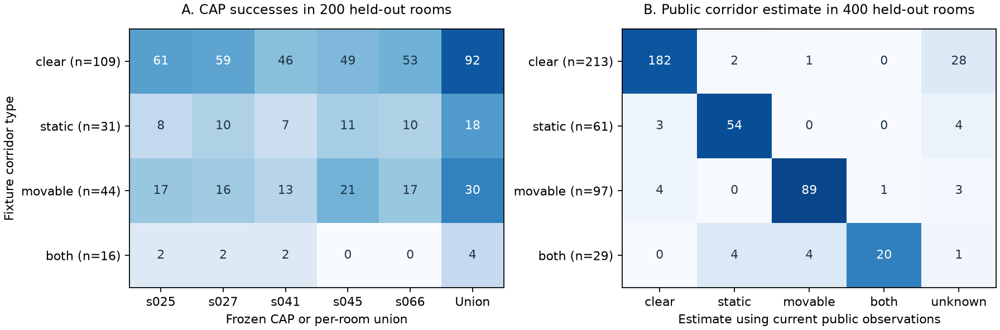

# 直达通道能描述房间难度，能否判断哪个 CAP 更合适？

在原 200 个诊断房间中，目标直达通道无障碍时，五个 CAP 至少有一个能完成任务的房间有 92/109；静态与可动障碍同时挡路时只有 4/16。这一区别能从公开观测近似识别。按这个亚型从开局固定选择专家，成功 86/200，基准 s025 为 88/200。把通道证据作为六个附加观测量，同一逻辑回归对 s025 成功的留出预测 AUC 从 .666 升至 .688，配对区间仍包含零。

## 按真实通道类型看专家互补

在初始角度保持不变、目标物体中心直线移到目的地的假设下，用物体整个矩形的扫过区域与室内障碍求交。静态障碍与非目标可动物体分别计数，场地边墙与机器人不计。这种定义允许间接推运、转动物体或先清障仍能成功。用 fixture 计算的分类仅用于离线审计。

| 原留出面板亚型 | 房间 | s025 | s027 | s041 | s045 | s066 | 逐房间五 CAP 并集 |
|---|---:|---:|---:|---:|---:|---:|---:|
| 无阻挡 | 109 | 61 | 59 | 46 | 49 | 53 | 92 |
| 仅静态 | 31 | 8 | 10 | 7 | 11 | 10 | 18 |
| 仅可动 | 44 | 17 | 16 | 13 | 21 | 17 | 30 |
| 两者都有 | 16 | 2 | 2 | 2 | 0 | 0 | 4 |
| 全部 | 200 | 88 | 87 | 68 | 81 | 80 | 144 |

用 388 个自然开发房间分别选出各类成功最多的专家。同分时按固定成员顺序，少于 12 例或观测未知时回退到 s025。开发集选出无阻挡和双重阻挡用 s027，其余用 s025。每个房间从初态执行选定专家到底，逐房间读取已完成的对应闭环。开发成功数从 159 到 162；原留出面板从 88 到 86（救回 7、丢失 9，按物体数分层的房间配对差 −1.0 个百分点，95% 区间 [−5.0, 3.0]）。按公开观测独立选规则也为 86/200。加入 412 个困难开发变体重新定规则，按真实亚型和公开亚型分别为 85、86/200。只按目标距墙是否在 1 米内分组为 89/200，只按其他可动物体是否至少有三个分组为 87/200。

即使事后用留出答案给每类挑最好的固定成员，这四类也只能得到 61+11+21+2 = 95/200。与 144/200 的逐房间并集之间有 49 个房间的差距。单在真实无阻挡的 109 个房间里，s027 相对 s025 救回 7 个，又丢失 9 个。类内仍有双向互补。这个 95 是当前五成员、四类、每类固定一位且整局执行的回顾性上限。若重新定向开发专家或按决策边界改选，结论需要重新检验。

## 从当前公开观测计算

函数每次读取两个机器人的本次扫描、当前 tick 观测到的目标表面点，以及公开目的地与场地尺寸。在拟合目标矩形后，检查扫过区域内是否有静态或其他可动物体的扫描回波，再用 180 个探针估计该区域有多少被扫描覆盖。检测到阻挡则报告相应证据。没有阻挡回波且覆盖比例至少 80% 时报告通畅；目标拟合不足或缺少足够通道覆盖时报告未知。单面扫描采用已有估计器的名义深度；射线间可见度近似、部分外形和遮挡都会产生误差。“仅静态”“仅可动”在公开版本中指本次只看到相应一类阻挡。实现提供这些标志和连续覆盖度，目标可见量、可见其他物体数和目的地离墙距离也可直接读取。[语义函数](../../../../experiments/planar_tasks/semantic_rl/corridor_semantics.py)

两张已查看的留出面板共 400 个自然初态。公开函数给出明确类型 364 个，其中 345 个与几何审计完全一致（94.8%），另有 36 个未知。双重阻挡实际有 29 个，只在 20 个同时看见了两类。核对预选的 8 条 s025 真实轨迹，按原命令重放并核对末尾公开历史哈希，共 474 个决策边界；7 条轨迹中公开类别至少变化过一次。变化可能来自物体或机器人运动，也可能来自遮挡。逐边界记录证明函数可以在线重算，尚无逐边界几何准确率或闭环策略收益结论。

## 语义作为观测输入的初步价值

在同一 800 个开发初态训练开局 s025 成败逻辑回归。使用上轮按开发折外选定的 40 epoch、seed17、优化器与预处理。基准逐房间预测在 1e−7 内复现。新输入只追加六个量，即当前目标是否可估计、静态和可动阻挡证据、扫区可见比例、已观测通畅、未知。每个房间仍然只贡献一个预测目标。

| s025 成败预测 | 原 200 AUC | 近期 200 AUC | 合计 400 AUC | 合计 Brier（低为好） |
|---|---:|---:|---:|---:|
| 原九维公开几何 | .688 | .642 | .666 | .2277 |
| 加六个公开通道量 | .704 | .671 | .688 | .2246 |

按面板及物体数分层对房间配对重抽 4,000 次，AUC 差 +.0213，95% 区间 [−.0029, .0466]；Brier 差 −.0031，区间 [−.0078, .0016]。两张面板上的方向一致，但目前精度不足以确认稳定增益。近期面板只有已核对的 s025 成败，五 CAP 路由和覆盖表只用原面板。两张面板均已用于此前诊断。此处只预测一个策略开局后的整局成败，对候选相对优势的判断仍需同前缀分叉证据。

后续可在已有同前缀、同一后续控制器的实测分叉中，测量候选推动方向与阻挡方向、接触位置、最近一次执行反馈的关系。按父房间留出，仅在两个候选结局确有差异时比较动作排序，并报告可区分分叉数以及救回和误伤。这样才能判断这些语义量能否用于动作选择。

[逐房间几何、观测与 CAP 成败](rooms.csv) · [逐决策边界](boundaries.csv) · [全部开发及留出分组结果](subtypes.json) · [特征对照数值](feature_probe.json) · [亚型分析脚本](../../../../tools/cap_corridor_subtypes.py) · [特征探针及绘图](../../../../tools/cap_corridor_feature_probe.py) · [原九维基准](../2026-11-22_s025_initial_binary/README.md)
