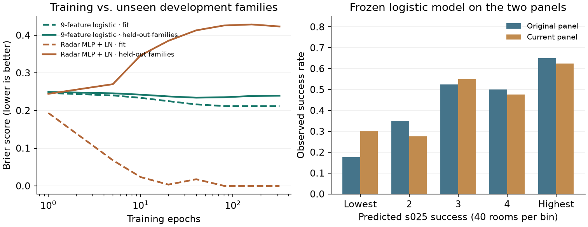

# 开局能否判断 s025 会成功

400 个留出房间中，开局九维公开几何的逻辑回归取得 AUROC 0.666，按面板和物体数分层重抽房间的 95% 区间为 [0.613, 0.717]。按预测分数在每张面板各分五等份，最高组真实成功 51/80，最低组 19/80。两端仍有较多相反结局。高容量网络可以完全拟合训练成败，但留出表现随训练加深而退化。

## 标签和数据划分

每个初态一条二元标签。成功指冻结 s025 从开局连续执行到达任务成功，完整预算耗尽记失败。800 个开发房间一共 271 成功、529 失败，包含 388 个自然初态及 412 个困难父房间的合法邻域扰动。自然开发房间有 159/388 成功。使用两个各含 200 个自然房间的已查看诊断面板，原面板成功 88 次，近期重规划面板成功 89 次。训练与两张面板之间的初态内容哈希无重合。训练和原面板来自已有 s025 运行；近期面板来自先前核对过的固定优先级运行，每一局所有决策均有 s025 提案且实际选中，没有回退。新计算只读取 tick 0 的公开观测，无需推进物理时间。

紧凑输入为九维已用公开几何描述，含观测目标中心至目的地的距离、通道净空、其他可见实体数、目标可见性、两个机器人相对目标的纵横向位置和目标中心离墙的距离。训练折内去除常量，最终线性模型有八个有效特征。较大的输入取目标相对坐标系中的初始公开帧，含机器人位姿、扫描距离与类别、可见实体几何等，共 1,187 个原始数值；此前动作字段已移除。模型没有读真实 fixture 几何、后续观测、CAP 决策或最终轨迹。房间身份与父房间身份只用于划分和审计。

以 388 个自然父初态为单位、按物体数分层分五折，父房间与所有变体始终同折；五折的验证指标只在该折自然初态计算，与目标自然房间分布相匹配。比较紧凑逻辑回归、紧凑 64×64 MLP、完整观测 64×64 MLP（有/无 LayerNorm）和仅用自然训练房间的完整观测 MLP。训练种子 17，Adam，学习率 0.001，权重衰减 0.0001，按初态抽样。每个模型在 1、5、10、20、40、80、160、320 epoch 中按折外 Brier 最小选轮数，再按该指标选主模型。分类阈值按折外平衡准确率选定。随后用全开发数据重拟合并冻结。两个外部面板均不参与选择。AUC 衡量正例排在负例之前的概率，同分计半。Brier 是预测成功概率与实际 0/1 之差的均方，越低越好。

## 拟合与留出

| 模型 | 选定 epoch | 训练 AUC | 原 200 AUC | 近期 200 AUC | 合计留出 AUC | 跑满 320 epoch 的训练 / 留出 AUC |
|---|---:|---:|---:|---:|---:|---:|
| 九维逻辑回归 | 40 | .641 | .688 | .642 | .666 | .645 / .665 |
| 九维 MLP | 5 | .670 | .687 | .636 | .663 | .984 / .564 |
| 完整观测 MLP | 1 | .802 | .626 | .595 | .611 | 1.000 / .544 |
| 完整观测 MLP + LayerNorm | 1 | .841 | .648 | .589 | .620 | 1.000 / .559 |
| 只用 388 个自然房间的完整观测 MLP | 1 | .865 | .564 | .524 | .543 | 1.000 / .533 |

主模型按五折折外 Brier 选为九维逻辑回归（折外 .2341）。在外部 400 房间的 Brier 为 .2277，始终预测自然开发集成功率 159/388 的参照为 .2478，配对差 −.0201，95% 区间 [−.0295, −.0103]。区间只反映房间抽样变化。按物体数分别在同档 100 个留出房间内计算 AUC，2、3、4、5 档依次为 .694、.664、.648、.695。模型在同一物体数的房间内部也有区分度。

## 作为初态判据的实际误差

| 冻结阈值 0.395 | 实际成功 | 实际失败 | 实际成功率 |
|---|---:|---:|---:|
| 预测可用 | 130 | 104 | 130/234（55.6%） |
| 预测不可用 | 47 | 119 | 47/166（28.3%） |

合计实际成功 177/400（44.3%）。阈值判断正确 249/400（62.3%），平衡准确率 63.4%；总判失败正确 223/400（55.8%），平衡准确率 50%。选定阈值着眼两类识别率，实际切换收益还取决于替代 CAP 的配对成败和误切成本。不同分数区间的成功几率更适合用来解释当前读数。原面板从低分到高分，每组 40 例，成功数为 7、14、21、20、26；近期面板为 12、11、22、19、25。五等份用于面板内排序展示。

## 同一困难父房间的扰动

已有 412 个变体对应 229 个父房间，这些父房间在 s025 下全部失败。机器人和物体的位置每轴扰动不超过 6.5 厘米、朝向不超过 0.10 弧度，重新检查初始化合法性。变体中 **112/412** 变为成功，300 个仍失败；**90/229** 个父房间至少有一个变体成功。这是失败父样本定向采集的条件统计，同父变体有关联。数据没有测量成功父房间的对称翻转率，也没有证明更丰富的初态表示无法预测这种局部变化。

**解释。** 开局几何存在可迁移的粗粒度信号，复杂网络强拟合训练标签会损害泛化；在当前数据量与两张诊断面板上，证据支持概率分层，还不足以把 s025 的成功初态视为可可靠硬切换的区域。本次仅评估固定 CAP 的开局二分类，未运行新的任务亚型、option 修改或混合闭环。

[逐房间标签、家族、折号与各模型分数](rooms.csv) · [汇总和训练曲线数据](../../../../outputs/semantic_rl/cap_general_specialists_62_20261120_01/s025_initial_binary_20261122/FINISHED.json) · [冻结分类器](../../../../outputs/semantic_rl/cap_general_specialists_62_20261120_01/s025_initial_binary_20261122/selected.pt) · [复现实验](../../../../tools/cap_s025_initial.py)
