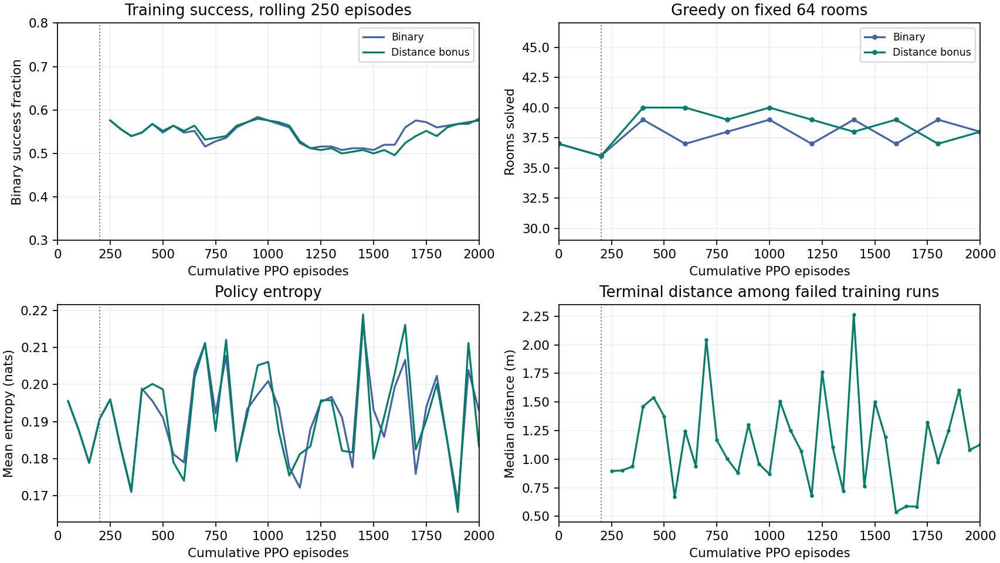

# A/B/C PPO 的终端距离奖励对照

共同的 200 局父模型成功 105/200。两个 2,000 局末轮分别为二元奖励 **100**、距离奖励 **99**。距离组相对二元组的闭环差为 **-0.50 [-4.50, +3.50] 个百分点**。

| 累计在线局 | 二元奖励贪心成功 /64 | 距离奖励贪心成功 /64 |
|---:|---:|---:|
| 0 | 37 | 37 |
| 200 | 36 | 36 |
| 400 | 39 | 40 |
| 600 | 37 | 40 |
| 800 | 38 | 39 |
| 1,000 | 39 | 40 |
| 1,200 | 37 | 39 |
| 1,400 | 39 | 38 |
| 1,600 | 37 | 39 |
| 1,800 | 39 | 37 |
| 2,000 | 38 | 38 |

| 末轮距离奖励组相对 | 救回 | 丢失 | 成功率差与 95% 区间（百分点） |
|---|---:|---:|---:|
| 二元奖励末轮 | 8 | 9 | -0.50 [-4.50, +3.50] |
| 共同 200 局父模型 | 6 | 12 | -3.00 [-7.00, +1.00] |

| 终距比较 | 房间 | 二元奖励中位数（m） | 距离奖励中位数（m） | 平均配对差与 95% 区间（m） |
|---|---:|---:|---:|---:|
| 全部房间 | 200 | 0.195 | 0.207 | +0.059 [+0.008, +0.119] |
| 两组均失败 | 92 | 1.502 | 1.658 | +0.076 [-0.005, +0.180] |

两个末轮为同一 seed 17。均使用同一评测房间列表，房间此前已查看。区间按房间配对重抽，以这一次训练为条件。
父模型、执行器、感知、采样温度、房间次序和 PPO 预算相同。训练中成功仍得 1，失败奖励为 0.25 × exp(−终距 / 1 m)，只有末端给奖励。
用距离组首轮的同一批轨迹计算二元更新，所得 actor 和 critic 与二元基线的对应检查点逐值一致。二元末轮重跑的全部 200 间也核对了成功、ticks 和历史哈希。

[实验协议](plan.md) · [逐房间配对](rooms.csv) · [成功与终距统计](results.json)
