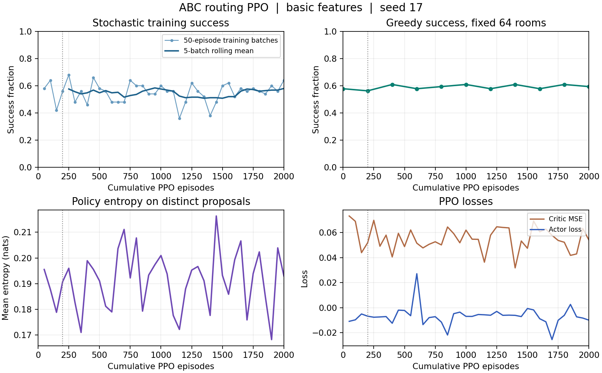

# A/B/C 路由的长程 PPO 续训

预先固定 seed 17 和第 40 轮。在新 200 间中，监督起点、200 局和 2,000 局分别成功 **101、105、100 间**。追加 1,800 局相对父模型差为 **-2.50 [-6.50, +1.50] 个百分点**。
A/B/C 同房间纯执行为 87 / 97 / 97，三者事后覆盖并集 128/200。

## 固定 64 间上的学习曲线

| 累计 PPO 采样 | 成功 / 64 | 相对监督起点的救回 / 丢失 |
|---:|---:|---:|
| 0 | 37 | 0 / 0 |
| 200 | 36 | 0 / 1 |
| 400 | 39 | 3 / 1 |
| 600 | 37 | 1 / 1 |
| 800 | 38 | 3 / 2 |
| 1,000 | 39 | 4 / 2 |
| 1,200 | 37 | 2 / 2 |
| 1,400 | 39 | 3 / 1 |
| 1,600 | 37 | 2 / 2 |
| 1,800 | 39 | 4 / 2 |
| 2,000 | 38 | 3 / 2 |

首五批与末五批训练采样成功率分别为 57.6%、58.0%。这两段访问不同房间。相同固定诊断房间的起点、200 局和末轮分别为 37、36、38/64。
曲线上的检查点均预登记。64 间子集此前已查看，确认结论来自下表的新房间。

## 新 200 间的配对闭环

| 2,000 局末轮相对 | 救回 | 丢失 | 成功率差（百分点，配对 95% 区间） |
|---|---:|---:|---:|
| 200 局父模型 | 7 | 12 | -2.50 [-6.50, +1.50] |
| 监督起点 | 10 | 11 | -0.50 [-5.00, +4.00] |
| 纯 A | 29 | 16 | +6.50 [+0.00, +13.00] |
| 纯 B | 25 | 22 | +1.50 [-5.50, +8.01] |
| 纯 C | 24 | 21 | +1.50 [-5.00, +8.00] |

| 纯专家成败分层 | 房间 | 监督起点 | 200 局 | 2,000 局 |
|---|---:|---:|---:|---:|
| 仅 A 成功 | 12 | 6 | 6 | 5 |
| 仅 B 成功 | 11 | 5 | 4 | 4 |
| 仅 C 成功 | 13 | 3 | 3 | 2 |
| 三位专家均失败 | 72 | 13 | 14 | 13 |

恢复父模型的 actor、critic 与 Adam 状态，走同样的公开提案评分、终局奖励和温度 1。追加阶段每轮加入 50 个新房间。配对区间按房间重抽，适用于这一训练种子的成品策略。本次变化同时包括在线局数与不同训练房间数。

[协议](plan.md) · [逐房间成败](rooms.csv) · [逐轮训练](training.csv) · [配对区间](results.json)
