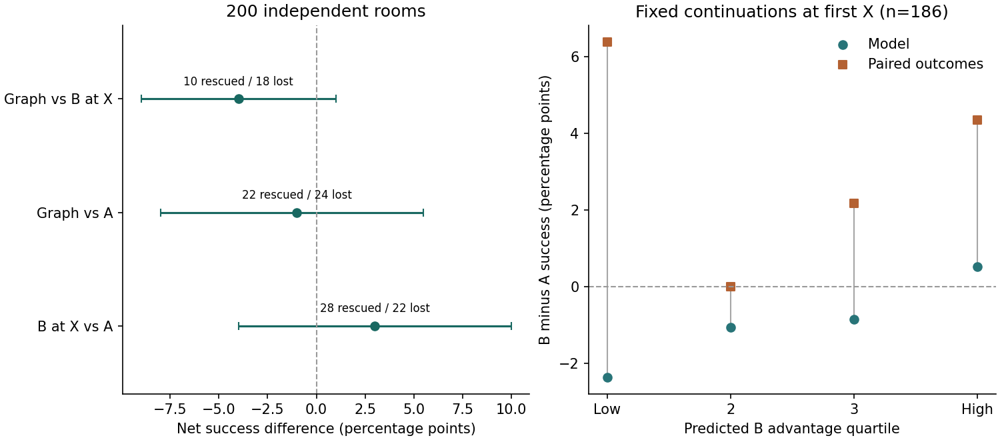

# 专家 B 能否从 A 的停滞前缀接手，图能否进一步改善选择

**A 98/200，B 106/200，lock 104/200，graph 96/200。** 冻结条件下接手 B 相对 A的配对区间包含零；图相对简单触发的配对区间包含零。 本轮为一个通用母本、一个定向作者和一套冻结图的配对实验。

## 作者和交接点

冻结通用 A（usual s003），gpt-6.2-sol 以 A 代码为母本独立开发 B。沿旧开发面板 A 的真实轨迹在至少五条命令、180 至 1150 tick 时检查，目标可见且最近四条命令估计终距减少不足 3.5 cm 时触发停滞。开发面板中 184/200 个房间出现该条件。作者可用 16 个 A 最终失败和 8 个实际自行恢复的前缀。每个 B 在整个 A 前缀上同步从公开事件恢复记忆；接手时没有重置时间、决策数或物理状态。作者冻结第 2 版，作者案例救回 6/16、丢失 2/8。

全新面板有 186/200 个房间首次触发，触发 tick 中位数 268。从这些相同前缀让 B 继续至终止，与 A 原后缀配对为 **90/186 对 84/186，救回 28、丢失 22，差 +3.2 个百分点 [-4.3, +10.8]**。所有未触发房间在两种路由中沿用 A。若事后逐房间从首次 X 的两条实测后缀中选胜者，成功可到 126/200。它仅说明这个接手点有多少可利用的互补机会。

## 独立配对确认

| 全部 200 房间 | 成功数、胜负差及 95% 房间重抽区间 |
|---|---|
| 首次 X 后 B 执行到底，相对全 A | 104/200 对 98/200，救回 28、丢失 22，差 +3.0 个百分点 [-4.0, +10.0] |
| 图相对首次 X 后保持 B | 96/200 对 104/200，救回 10、丢失 18，差 -4.0 个百分点 [-9.0, +1.0] |
| 图相对全 A | 96/200 对 98/200，救回 22、丢失 24，差 -1.0 个百分点 [-8.0, +5.5] |
| 图相对全 B | 96/200 对 106/200，救回 8、丢失 18，差 -5.0 个百分点 [-10.0, +0.0] |
| 全 B 相对全 A | 106/200 对 98/200，救回 29、丢失 21，差 +4.0 个百分点 [-3.0, +11.0] |
| A 准备后交 B，相对全程 B | 104/200 对 106/200，救回 1、丢失 3，差 -1.0 个百分点 [-3.0, +1.0] |

A、B 各自从头运行的成功并集为 127/200。余下 73 个两位单专家均失败的房间，简单触发实际救回 1 个，图救回 4 个。并集只作为事后可比读数。另有 168/200 个房间，首次 X 后换 B 与全程 B 的完整历史哈希相同。图与全 A 的完整历史相同 36 个，与简单触发完全相同 35 个。配对区间来自冻结策略在独立房间中的重抽（4000 次）；每房间只有一个独立样本。

## 在同一个接手点，图能分辨继续 A 与继续 B 吗

补充诊断在图上分别强制两个专家保持到终止，给同一个首次 X 估计两次成功可达概率，直接与该前缀两条真实后缀对照。A 和 B 真实一胜一负的前缀共 50 个，预测严格排序正确 24 个，持平 0 个。在所有房间只允许按这个估计在 X 选择一次，选 B 共 44 次，整局相对 A 是 100/200 对 98/200，救回 9、丢失 7，差 +1.0 个百分点 [-3.0, +5.0]。此处与主图反复重规划共享训练数据、转移表和确认房间。

### 首次 X 中的公开局面

| 起点 | 房间数 | 换 B 相对 A 救回 / 丢失 | 图相对简单触发救回 / 丢失 |
|---|---:|---:|---:|
| 近目标（公开估计 ≤1 m） | 23 | 4 / 2 | 2 / 4 |
| 较远（>1 m） | 163 | 24 / 20 | 8 / 14 |
| 触发时有目标接触 | 19 | 2 / 0 | 0 / 1 |
| 触发时无目标接触 | 167 | 26 / 22 | 10 / 17 |

这些组只描述同一面板，接触组与距离组交叉。小分母的方向变化不能单独确立可部署的细分条件。

## 图如何决定选谁

从作者未看过的另外 176 个开发房间采集全 A、全 B、首次 X 后保持 B 和随机交替路径。按真实历史哈希和专家编号合并重复边，得到 19662 条局部转移。48 个公开节点按目标距离/可见性、接触、四命令推进、静态接触划分，26 个节点为两个专家均积累了至少 20 次实测转移。在每种节点、每位专家下，后继及执行时间/决策数取联合经验分布，并以该节点两位专家的混合分布提供 16 个平滑样本。图对成功吸收概率做有限预算动态规划，每个候选的所有后继按概率求和。实际耗时向上取整到 5 tick、决策次数按真实整数计，运行仍按实际预算结算。低支持节点保持 A。首次 X 之前路由都执行 A；之后图每个上层 option 边界可重选，简单触发一直保持 B。

图在 182 个房间调用过 B，在 164 个房间实际执行过不同于当时 A 提案的动作，179 个房间有第二次专家切换。具体终局及每房间调用/动作差异见配对表。图的局限包括节点内来路混合，以及开发分布和图自身执行分布可能不同；失败/预算耗尽均进入失败吸收端。两种方案都沿用原物理和成功定义。

[实验设计](plan.md) · [作者与 3 个候选槽](author.md) · [逐房间结果](routes.csv) · [配对统计](metrics.json)

## 研究判断

停滞条件覆盖了 A 的 102/102 个终局失败，也覆盖了 84 个原本会成功的房间。简单触发与全程 B 有 168 个房间历史完全相同。因此，应将 B 作为独立策略的恢复能力，与需要 A 准备后才能获得的接手增益分别评价。

图救回了 4 个两位单专家都失败的房间；相对简单触发又救回 10、丢失 18。固定后缀的真实分歧排序为 24/50。能组合出成功路线与稳定识别合适的路线，是两个分别可测的能力。

[成败翻转案例](examples.md) · [实际公开距离曲线](examples.png)
