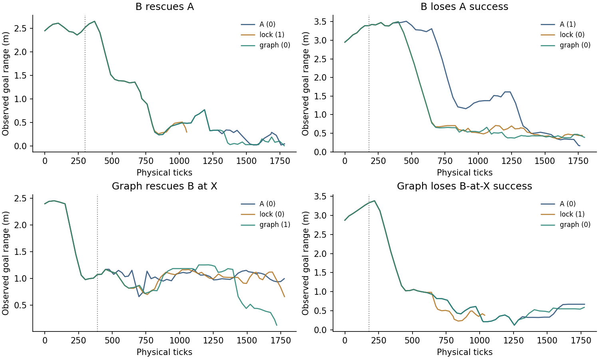

# 三种路线从相同初态执行的实际公开观测

从四类相反的成败结果各按预定字符串哈希顺序取一个不同房间，用同一冻结版本重新执行，并核对完整历史哈希。曲线为当时可见的目标扫描中心到终点的距离，目标不可见时留空。竖线为三种方案共享的第一次触发点。单例不估计频率。

- recovery_662316119_dev_4_11，首次 X 在第 300 tick，整局成功标记和终止时刻为 A 0（1800 tick）、graph 0（1800 tick）、lock 1（1081 tick）。
- recovery_662316119_dev_2_16，首次 X 在第 180 tick，整局成功标记和终止时刻为 A 1（1783 tick）、graph 0（1800 tick）、lock 0（1800 tick）。
- recovery_662316119_dev_2_03，首次 X 在第 390 tick，整局成功标记和终止时刻为 A 0（1800 tick）、graph 1（1746 tick）、lock 0（1800 tick）。
- recovery_662316119_dev_4_33，首次 X 在第 180 tick，整局成功标记和终止时刻为 A 0（1800 tick）、graph 0（1800 tick）、lock 1（1062 tick）。

