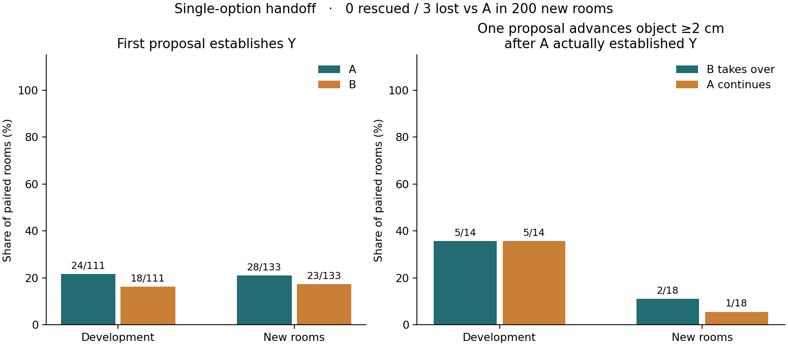

# CAP 的一条准备命令能否与另一位专家的一条接手命令组合

**这次独立检验没有确认一条可提高整局成功率的两步链。** 从所有起点开始，A 新建立「公开拓扑簇 4」后交给 B 一次。这条是探索规则，正式策略保留 A。开发阶段 1 个条件组合达到最低房间数，0 个同时满足三个正向差值。用 200 个开发房间冻结规则，在另 200 个不同内容的新房间作一次确认。

| 配对比较 | 开发 | 独立确认 |
|---|---|---|
| 同一 X 中 A 与 B 各执行一条而建立 Y | 24/111 对 18/111，差 +5.4 个百分点 [-1.8, +12.6] | 28/133 对 23/133，差 +3.8 个百分点 [-2.3, +9.8] |
| A 送到 Y 后 B 与 A 各执行一条而推进 ≥2 cm | 5/14 对 5/14，差 +0.0 个百分点 [+0.0, +0.0] | 2/18 对 1/18，差 +5.6 个百分点 [+0.0, +16.7] |
| 条件交接与整局 A 的成功 | 108/200 对 107/200，差 +0.5 个百分点 [-1.5, +3.0] | 99/200 对 102/200，差 -1.5 个百分点 [-3.5, +0.0] |
| 条件交接与同条件改用 B 准备的成功 | 108/200 对 114/200，差 -3.0 个百分点 [-8.0, +2.0] | 99/200 对 98/200，差 +0.5 个百分点 [-4.0, +5.0] |
| 条件交接与整局 B 的成功 | 108/200 对 101/200，差 +3.5 个百分点 [-4.5, +11.5] | 99/200 对 90/200，差 +4.5 个百分点 [-2.5, +11.5] |

每一列的比较顺序与左栏一致，区间为房间配对重抽 95% 百分位区间。每房间只有一个预定分叉机会。dev 面板 200 个房间中有 177 个到达首次分歧，A 首步后 177 个仍可行动，101 个两位专家再次给出不同合法提案。 fresh 面板 200 个房间中有 188 个到达首次分歧，A 首步后 188 个仍可行动，115 个两位专家再次给出不同合法提案。 成功、超时和无分歧均保留在整局分母。局部推进使用目标物体到目标点的实际距离变化，记录的 option 时长为实际值。路由只读取当时公开信号。因两条提案的动作和时长可不同，局部效应描述整条提案的效果。

## 真实接手与整局成败

新房间中该条件实际触发 18 次；在这些相同历史上，交 B 与留 A 的整局成功为 5 与 8，救回 0、丢失 3。从初态全 A 成功 102/200，全 B 成功 90/200；两个原专家从初态都失败的 79 个房间中，该组合救回 0 个。相同触发逻辑下在合资格起点先用 B 准备得 98/200。未选出正式切换规则，保留 A 得 102/200。

完全不看触发条件，从同前缀固定执行 AA、AB、BA、BB 两条命令再还给 A，各有 102, 96, 92, 97/200 成功。逐房间事后在四条分支任取成功者为 120/200。BB 后还给 A，与全程 B 的数据单列。

## 同一个 Y 的来路

经 A 到达后 B 的单命令推进达标 2/18，平均实际执行 27.1 tick，平均终距减少 1.77 cm。 经 B 到达后 B 的单命令推进达标 1/13，平均实际执行 28.2 tick，平均终距减少 1.73 cm。 同一房间可贡献两种来路，这两组的成员并不完全相同。仅凭组均值无法把差异归因于来路本身。针对 A 真正送到的相同前缀，上表的 B 对 A 才是配对的接手效应。近期公开推进无／有时，B 分别为 0/4、2/14；公开目标接触无／有时，B 分别为 1/12、1/6，这些分组只作描述，小分母不支持新的路由规则。

[设计与成功判据](plan.md) · [开发候选](dev_candidates.json) · [各节点实际准备与接手机会数](support.csv) · [新旧面板统计](metrics.json) · [逐房间配对](rooms.csv) · [单 option 边](edges.csv) · [接手前缀](handoffs.csv)

本次验证限定为 A 和 B、公开节点条件、一个预定分叉机会、同一后续专家 A。单条边对应一条上层 CAP 命令，原有 PUSH 接触与推进执行器可在其内部更新多个物理决策边界。稀有条件会被最低支持数排除。这轮没有估计任意深度重规划的成功率。

[具体分叉的公开输入、命令、实际推进与终局](examples.json)

## 对节点解释的离线复核

在冻结规则真正触发的交接点，公开识别器均判为簇 4，离线由八项物理关系计算的真实簇也为 4 的有开发 7/14、新房间 5/18。这限制了把该公开路由规则直接解释成某个物理站位机制的程度。

逐边描述另有一个可能值得单独复验的方向。对原来不在公开簇 2 的相同前缀，执行 A、B 各一条提案而进入簇 2 的次数分别为开发 18、25（150 个前缀），新房间 12、30（160 个前缀）；新面板 B 相对 A 的百分点差区间 [+5.6,+16.9]。这一条从多条边里事后挑出，区间未作多重比较修正，且进入该簇本身未必有利。它提示专家有时确实使下一状态朝不同方向走，而这仍需与下一位专家的实际接手效果连接。

在新房间 `dev_3_14`，接手前真实终距为 22.47 cm。A 的一条提案推进 1.65 cm（8 tick），B 推进 2.05 cm（15 tick）。这条 B 分支随后交回 A，最终结果为 task_budget_exhausted；一直留 A 在第 1265 tick 成功。两条提案均为真实自然时长。该例显示同一阈值两侧的局部推进可以与最终成败不一致。

[各条件的全部转移读数及接手点物理节点](edge_audit.json)

## 能力超出原专家并集的真实病例

在两个单专家从头执行都失败的 79 个新房间里，有 **10 个** 在预定分叉改用两条命令的某个组合、随后还给 A，最终获得真实成功。例如 `dev_2_10` 的成功分支为 AB。这证明重组已有命令有时能产生原库外成功；如何在执行前选出对应分支仍待验证。[逐房间成功分支](edge_audit.json)

新 200 房间中实际触发 109 次，B 接手整局 100/200，继续 A 为 102/200；救回 5、丢失 7。同一接手点只执行一条提案，B 达到 2 cm 推进的有 13/109，A 为 14/109。[逐边界补充验证](opportunities.md)
