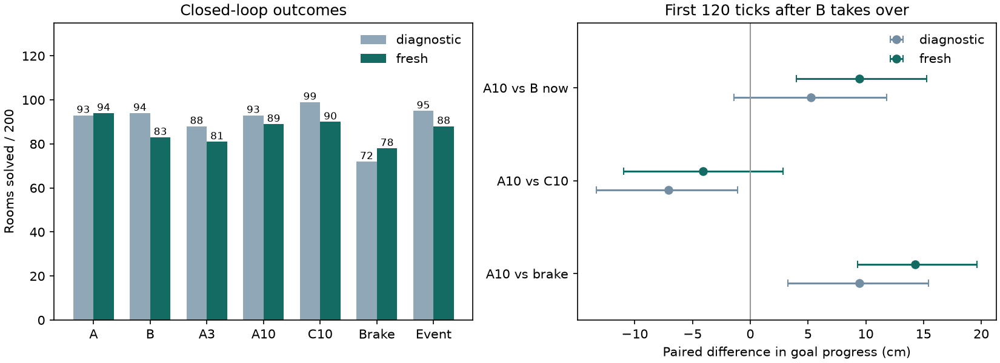
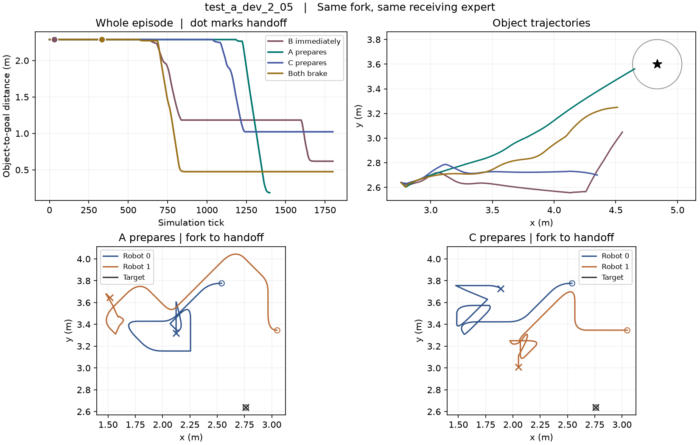

# 一个 CAP 能为另一个 CAP 准备什么

**同一位专家 B 接手后能否建立接触、推动物体，可以在交接前较好地预测。现有交接规则仍未把这种能力转换成超过固定专家的整局胜率。** 这个差别在新房间上可以直接检验，因为每次交接都有一个从同一公开历史继续执行 A 的配对分支。

## 闭环结果

A 为常规库 s003，B 为专精库 s002，C 为两库共用的母本。A 和 B 首次出现合法动作分歧时开始分支。两组面板各 200 个房间，每个房间比较七种条件，共 2,800 个房间与条件的组合。某些条件若尚未交接任务便已终止，会共用已有轨迹。旧面板固定四条路线的成败、最终历史哈希与 tick、决策计数均逐例复现。

| 路线 | 旧面板成功 / 200 | 新面板成功 / 200 | 新面板中 A、B 单独均失败而该路线成功 / 80 |
|---|---:|---:|---:|
| 固定 A | 93 | **94** | 0 |
| 固定 B | 94 | 83 | 0 |
| A 再走 3 条命令，交给 B | 88 | 81 | 12 |
| A 再走 10 条命令，交给 B | 93 | 89 | 11 |
| C 主动准备同等时长，交给 B | 99 | 90 | 6 |
| 两机器人制动同等时长，交给 B | 72 | 78 | 13 |
| 公开站位改善或 B 新提出 PUSH 时交接 | 95 | 88 | 13 |

新面板的事件规则触发 137 次。相对固定 A，救回 21 个、丢失 27 个，净差 −3.0 个百分点，房间配对 95% 区间 [−10.0, +4.0]。在触发于 B 新提出 PUSH 的 105 例中，救回 14、丢失 20；在站位条件触发的 32 例中各为 7。事件规则相对固定 10 步交接救回 21、丢失 22。A、B 单独成功的并集为 120/200；固定 3 步和 10 步两种交接合计解出了并集外 18 个不同房间，这个数要事后知道哪种交接成功才能取得。

等时制动也能解决 13 个原双失败房间，提醒我们“拼接后新增一例成功”有时仅说明轨迹对时序和历史敏感。更严格的观察是，A 准备 10 步解出的 11 个新房间中，有 6 个连 C 准备、等时制动也都失败；旧面板对应为 9/11。另一方面，新面板 A 准备相对 C 准备救回 30、丢失 31。当前证据支持逐房间准备内容有影响，整体互补能否被部署策略利用仍待验证。

## 准备怎样改变 B 的局部能力

新面板有 182 个房间可以同时比较 A 准备 10 条命令和等时制动后交给 B。在交接后的 120 个物理 tick 内，A 准备后有 **74/182** 同时达到“连续接触目标物至少 3 tick”和“到目标的距离缩短至少 2 cm”，制动后为 **31/182**。配对增加 23.6 个百分点 [14.8, 32.4]。B 在这段时间内的平均净推进量为 **17.7 对 3.4 cm**，差 14.3 cm [9.3, 19.6]。旧面板也出现同方向的差异，联合达成为 74/184 对 38/184。

A 准备期间本身已做了实质工作。与等时制动相比，交接时 A 路线上的物体平均已额外靠近目标 **63.1 cm**。在两条路线交接时物体余距均与分歧时相差不超过 2 cm 的 59 个房间，B 接手后的平均推进仍多 **5.3 cm**，但最终相对制动救回 5、丢失 7。这个子集按干预后的状态筛选，也没有控制物体姿态、机器人速度和专家记忆，因此只能用于描述。

换成主动准备的 C，两种准备均合法交接的 178 个新房间中，联合达成为 **73 对 77**，B 后续平均推进为 **17.8 对 21.9 cm**；A 减 C 为 −4.1 cm [−11.0, +2.8]。61 对整局结局相反的分支中，交接后 120 tick 推进较多的一支有 32 对最后成功，16 对最后失败，另 13 对短期推进差在 2 cm 以内。比较两条真实未来属于离线机制诊断，部署时只会实际经历其中一条。

## 交接之前能读出什么

在旧面板固定第 10 条命令后的合法交接上拟合，在新面板同一时点检验。四个输入是站位是否可测、机器人到估计站位距离、可见净空、B 是否提出目标 PUSH。表中“仅 PUSH”是直接按 B 的二元提案标记排序，Brier 常数参照取旧面板阳性率。各行分开拟合。

| 预测对象 | 新面板阳性 / 总数 | 四量 AUC | 仅 PUSH AUC | 四量 Brier / 常数 |
|---|---:|---:|---:|---:|
| B 在 120 tick 内稳定接触 | 88/182 | .867 | .816 | .145 / .250 |
| B 在 120 tick 内推进至少 2 cm | 74/182 | .856 | .836 | .148 / .241 |
| 交给 B 最终成功 | 72/182 | .743 | .584 | .208 / .240 |
| 交给 B 胜过继续 A，限一胜一负 | 15/35 | .353 | .417 | .262 / .250 |

局部信号相当一部分已经编码在 B 的动作建议里。能预测 B 成功的绝对概率，也仍可能只是在识别两位专家都容易完成的局面。最后一行只在 35 个确实需要选对的房间测量，旧面板训练分母仅 38，不能据此推断路线优势在信息上不可学。

在看完主比较后的探索性检查中，沿 A 执行 10 条命令，只有预测 B 接手后的推进概率至少 0.5 才交接。用相同前缀的两个已完成分支可精确重建这一单次决策的结果。新面板触发 77 次，成功 **90/200**，相对一直用 A 救回 6、丢失 10。该阈值检查使用本次面板，另行确认需要新房间。

## 一例成功的准备为何容易被短期进度误判

在原已知救回例 test_a_dev_2_05 中，A、B 单独均失败。第 30 tick 首次分歧。第 332 tick 交接时，A、C、制动三支的目标物都还在原地，两台机器人的站位却不同。A 准备后，B 花了 **869 tick** 才首次净接近目标 2 cm，最终进入目标区域；C 准备后花 **714 tick**，制动后花 **355 tick**，最终分别停在距目标 **1.02 m、0.48 m** 处。成功路线早期运动慢，后来的输运段能持续到达目标。这个例子显示值得建模的是推动能否持续、失去接触后能否恢复。仅凭这条重放还无法确定决定成败的具体接触面。

**后续最直接的检验**是在同一交接边界，让 A 和 B 各自执行一段闭环输运，分别标注两侧能否建立目标接触、持续沿请求方向输运，以及失去进展后能否恢复。对“B 能推进”和“B 能解决 A 正在遇到的具体困难”分别评分，并用同房间的新增成功与丢失成功验收。当前实验覆盖一个专家对和一种执行器。

[实验方法](method.md) · [完整统计](results.json) · [逐房间配对表](rooms.csv) · [正负案例](examples.json) · [实例轨迹数据](replay.csv) · [冻结配置](protocol.json)
