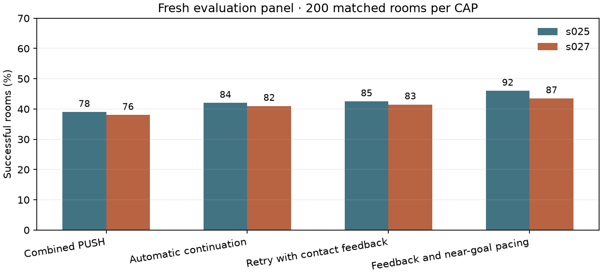
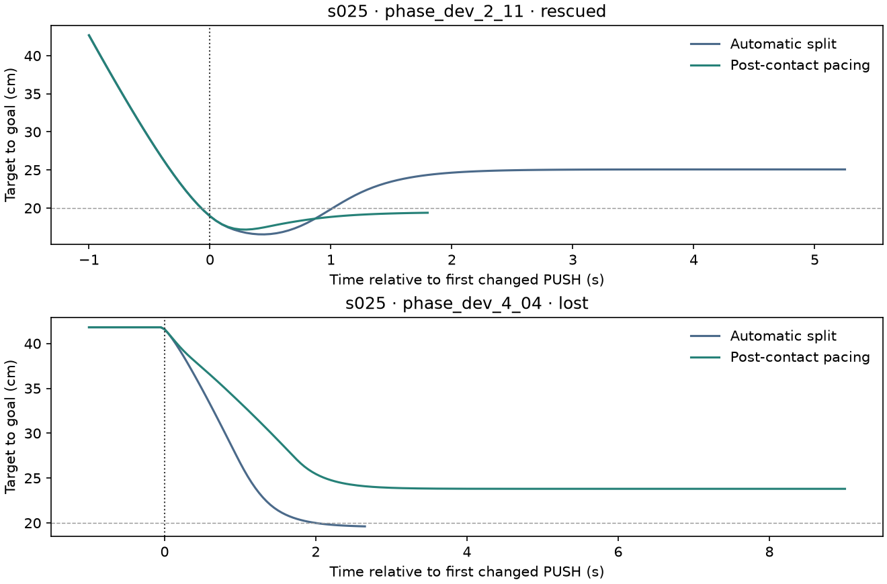

# CAP 会不会从显式接触阶段获益

在 200 个新房间，s025 和 s027 都在“拆分、接触失败后改选、就位后末端调速”组合中获得较高的成功数。相对自动拆分，两 CAP 平均 +3.25 个百分点，按房间配对的 95% 区间为 [+0.25, +6.50]。主对照只加入接触失败后的换手或换向，两 CAP 各净救回一局。三个改动分别分析，末端调速是次要对照。

| 在同一批 200 房间执行 | s025 | s027 | 两 CAP 等权成功率 |
|---|---:|---:|---:|
| 一体化 PUSH | 78 | 76 | 38.50% |
| 自动拆分和续推 | 84 | 82 | 41.50% |
| 拆分后读取失败结果，必要时改选 | 85 | 83 | 42.00% |
| 改选，加就位后末端调速 | 92 | 87 | 44.75% |

自动拆分相对原版平均 +3.0 个百分点，95% 区间 [−0.25, +6.25]。每个 CAP 都救回 10、丢失 4。仅加入接触失败反馈改选时，每个 CAP 各在 13 个房间实际换过推手或推向，各救回 1、丢失 0。加入末端调速后，两 CAP 都在 79 个房间至少改动过一次。相比自动拆分，s025 救回 11、丢失 3，s027 救回 8、丢失 3。这个调速版本相对只有改选的版本平均 +2.75 个百分点，区间 [0.0, +5.75]。两套规则叠加，其中任何一项在新的 CAP 上都需要复验。

在 64 个开发房间，四组 s025 为 34、34、34、32，s027 为 35、37、38、38。末端调速的留出增益在开发批次未同样出现。新执行入口的原版在两个 CAP 的 128 条开发轨迹上逐项复现原结局、ticks 与公开历史哈希。所有反馈组中没有实际改选或调速的轨迹与自动拆分的公开历史、总时长、决策数和成败逐项相同。两 CAP 使用共享的手写适配器，无额外训练。两者在同一批 200 房间上评估，400 个策略执行仍对应 200 个独立初态。

25 个终局翻转房间的首次改动是已就位的末段 PUSH。逐 tick 重放相同前缀，终局与全部原运行相符。有 19 局救回、6 局丢失。图中的救回案例在改动前已进入目标半径，原速随后又推出去，调整版留在目标内直至成功。丢失案例在改动前仍在目标外，减速后停在外边。图选取各方向一个例子，是解释性回放。

[逐分支重放索引](paired_pacing_examples.json) · [后续大样本交叉对照协议](../2026-11-23_option_semantic_factorial/protocol.md)

[试验协议](protocol.md) · [逐房间结果](held_rooms.csv) · [所有实际改选和调速](held_interventions.json) · [完整数值](results.json)
