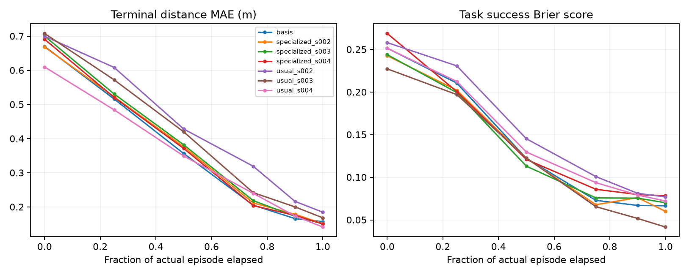
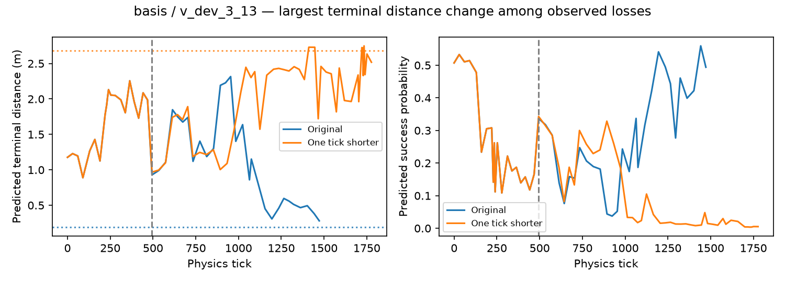

# 七位 CAP 的独立终局预测与单 tick 扰动

固定近目标调速的 PUSH。每位 CAP 有两个独立预测器，一个学习终局物体中心到目标点的剩余距离（连续收益取其负值），另一个学习环境实际任务成功概率。两者均用同一 CAP 执行到底的真实后缀监督，沿途只读取公开历史、当前状态与本 CAP 的动作参数。没有改任务奖励或对其他专家取 max。7 位 CAP × 400 个开发房间拟合；另外 7 × 200 = 1,400 条新轨迹评价。7 位专家共用同一批 200 个新房间，统计区间按房间配对。

## 当前任务进展有多可读

| 轨迹已用真实时间 | 开局 | 25% | 50% | 75% | 90% | 终止前最后一条命令 |
|---|---:|---:|---:|---:|---:|---:|
| 预测终距 MAE，米 | .678 | .536 | .383 | .234 | .183 | .158 |
| 最近公开余距直接当终距，MAE，米 | 1.967 | 1.470 | .995 | .574 | .338 | .153 |
| 仅按已用时间估计终距，MAE，米 | .773 | .775 | .793 | .833 | .865 | .883 |
| 二元成功概率 Brier，越小越好 | .249 | .208 | .125 | .080 | .073 | .067 |
| 对最终成功的区分 AUC | .675 | .759 | .908 | .969 | .984 | .988 |
| 最终失败轨迹的终距 MAE，米 | .947 | .712 | .503 | .286 | .222 | .204 |

每次都取事后时间切片以前最新的预测；最后一次预测距实际结束中位还有 16 ticks。终止时间没有输入网络。中点比开局的终距 MAE 减少 .295 m，房间重抽 95% 区间 [.232,.358] m。固定同一批实际活到第 1,200 tick 之后的 888 条轨迹，按真实 tick 0/300/600/900/1,200 读取，MAE 仍为 .876/.753/.600/.483/.341 m，对应成功概率 Brier 为 .322/.292/.228/.152/.094。中段预测已经优于简单地读取当前余距。临近终止时，直接读取公开余距也同样准确。开发曲线仅作拟合参考，主表全部来自新房间。

| CAP | 开局 MAE | 中点 MAE | 90% MAE | 最后一次 MAE | 动作缩短后翻转／有效分叉 |
|---|---:|---:|---:|---:|---:|
| 共同母本 | .670 | .356 | .166 | .157 | 4/49 |
| 专精 s002 | .668 | .376 | .179 | .151 | 4/49 |
| 专精 s003 | .700 | .382 | .173 | .151 | 3/49 |
| 专精 s004 | .691 | .371 | .175 | .150 | 3/49 |
| 常规 s002 | .700 | .428 | .216 | .185 | 6/52 |
| 常规 s003 | .708 | .420 | .200 | .168 | 3/45 |
| 常规 s004 | .610 | .349 | .174 | .141 | 8/50 |

单局曲线有波动。1,400 局中，1,131 局的最后一次终距预测比开局准，只有 58 局在上述六个切片上误差全程不增。每局相邻命令间最大的一次预测修正，中位数为 .50 m 和 .317 成功概率。中间 25%–75% 的轨迹段里，730 局至少一度预测成功概率 ≥.8，其中 214 局最终失败；这是逐局“曾经高估”统计，不能作为单次 .8 预测的校准误差。

## 一个很小的动作变化能改变什么

在预选的 56 个留出房间 × 7 CAP 共 392 个机会中，343 个遇到预设的中途单机目标 PUSH；来自 54 个不同房间。由同一个已校验历史前缀起，仅将这条命令时长上限减少 1 tick（0.05 s），之后交还同一个 CAP 闭环执行。49 个未触发的终局哈希与对照一致。343 个实际分叉中，280 个确实改变了执行时长和即时位置；这 280 个分支的两机及目标物位置差最大值均 ≤2 cm，目标物角差 ≤.05 rad。

- 343 个触发案例的终距差绝对值中位数 1.17 cm，90 分位 27.64 cm。31 个翻转（9.0%，房间重抽区间 4.3%–14.7%），覆盖 15 个不同房间；20 个由成功转失败，11 个由失败转成功。若只看实际位置有改变的分叉，则为 31/280。终局成败翻转的终距差中位数 26.2 cm、均值 49.0 cm。
- 在这 31 个翻转分支上，扰动后第一个新命令边界的两路终距预测平均只差 **1.99 cm**，成功概率平均只差 **0.63 个百分点**。各走 3 条、10 条命令后，翻转分支上的平均成功概率差才逐步扩大至 6.6、13.8 个百分点。即使到 10 条后，也仅在 31 个中有 20 个方向判对。
- 共同母本在 v_dev_3_13 的第 494 tick 分叉：本次命令结束时，最大可测位置差 1.23 cm，物体中心位置差为零。原轨迹成功、终距 .192 m，缩短版本失败、终距 2.681 m。操作结束后两路预测终距为 .991 与 .996 m。这是按成功转失败中最大终距差挑出的示例。在另一个常规 s003 的房间 v_dev_2_26，分叉后两路都给约 98.6% 成功概率，最终一个成功、另一个失败。

## 预测能否用来选专家

开局比较七个独立模型，在同一批 200 个房间中，按预测终距最小选 CAP 实际成功 **89** 次，按预测成功率最大为 **94** 次，开发集成功数最多的固定 A（常规 s003）为 **107** 次。事后按真实终距最小能选中 147 个成功房间，专家并集为 148。这说明在这张面板上真实终距很有选路信息，但独立估值还不能在开局可靠地区分专家。按开发平均终距最小固定选常规 s004，留出平均终距为 .804 m，成功 87 次；固定 A 平均 .893 m，成功 107 次。两个研究指标须分别报告。

再固定先走 A，只允许交接给 B（专精 s002）。每个时点在该时点以后第一个可达命令边界作决定，两种候选后缀均有真实整局测量，已提前结束或没有合法接手提案均计入 200 局。

| 换手时点 | 有效可选 | 固定 A | 选预测终距较小 | 选预测成功率较高 | 事后两路可覆盖 |
|---|---:|---:|---:|---:|---:|
| 600 ticks | 158 | 107 | 99（救回 3、丢失 11） | 108（救回 5、丢失 4） | 119 |
| 1,200 ticks | 111 | 107 | 109（救回 4、丢失 2） | 108（救回 2、丢失 1） | 111 |

600 tick 依终距换手的平均终距为 .859 m（相对固定 A 差 −.034 m，95% 区间 [−.094,+.011]）；成功率差 −4.0 个百分点 [−8.0,−.5]。1,200 tick 依终距换手的成功率差 +1.0 个百分点 [−1.5,+3.5]，平均终距差 −.029 m [−.051,−.009]。两种时点的成功概率选路均未显示稳定的闭环成功率增益。B 学习的是自身轨迹分布，接手时按 A 的实际历史重建程序记忆与特征；这里直接测到了这类分布变化下的后果。

连续终距 V 可监测已经走出的进展，并能在中段预报终局的大致余距。对相近动作后果的提前辨别明显更弱；粗粒度预报准确度、微扰翻转和同状态下的专家选择应分别评价。

[协议及采样口径](protocol.md) · [完整指标与区间](results.json) · [训练参考](training_profile.json) · [逐扰动对照](branches.csv) · [换手评估](handoff.json) · [原始结果和逐阶段预测](../../../../outputs/semantic_rl/cap_terminal_value_20261123_01/) · [采集](../../../../tools/cap_terminal_value_study.py) · [拟合](../../../../tools/cap_terminal_value_fit.py) · [曲线与配对分析](../../../../tools/cap_terminal_value_report.py) · [换手执行](../../../../tools/cap_terminal_value_handoff.py)
