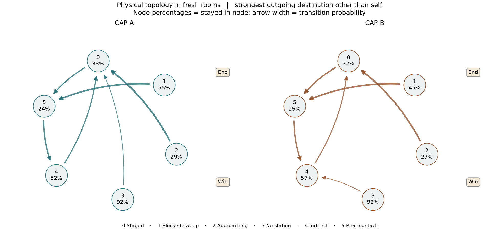

# 局面拓扑、专家转移与交接

**真实动作前置条件能解释眼前的 PUSH 能力。这六种局面仍不足以选择终局更好的接手专家。** 在 200 个新房间、每房间两个预定交接试验中，A 做准备后继续 A 成功 194/400。事后逐前缀在继续 A 和切到 B 之间选胜者，可达 223/400；即使知道真实物理簇，事后为每簇统一挑最好的专家也只能达到 195/400。

## 转移图怎样读

同一批开发房间上用真实几何关系形成六类局面，并训练只看公开短历史的模型识别它们。对每个可达前缀，在完全相同的历史上分别执行 A、B 各 120 个物理 tick。在两者实际产生的后继再分叉，让 A、B 分别接手并执行至任务结束。A 是常规 s003，B 是专精 s002。开发和新面板各有 200 个不同房间，分别有 936、946 个去重的配对出发点。窗末命令按时间上限截短，失败或提前成功均计入，统计按房间重抽。

| 节点 | 主要几何关系 | 新面板边界数 |
|---|---|---:|
| 0 | 后侧站位可直达且已就位，大多尚未接触 | 352 |
| 1 | 后侧站位可直达，目标朝终点平移时受静态障碍阻挡 | 106 |
| 2 | 站位可直达，机器人尚未就位 | 279 |
| 3 | 三个候选后侧站位均不空闲 | 425 |
| 4 | 有空闲站位，直线路径或所在侧不满足接近条件 | 479 |
| 5 | 已就位并接触目标导向的参考后侧面 | 283 |

**图上最清楚的共同瓶颈是簇 3。** 在 54 个新房间的 194 个这类同前缀中，各走 120 tick 后，A、B 都有 178/194 仍留在簇 3，其中 175 个前缀两者都没离开。仅 A 离开和仅 B 离开各 3 个。这里衡量的是所定义后侧站位持续不可用；不能直接推断这些房间最后必然失败。

上表包括出发与到达边界，共 1,924 个不同历史。下图只画每位 CAP 从每种物理簇出发最频繁的非自环边；圆内百分比为留在原簇的频率。逐边的全部分母、两位专家的目的节点及两个终止类见矩阵。重放可在每类两个不同房间中逐步查看同一起点的两条实际轨迹。

[配对回放](replays.html) · [含自环和终止的完整转移矩阵](transition_matrix.png) · [逐边计数](edges.csv)

## 哪些前置条件值得监督

开发集拟合的公开短历史模型在新面板对六个真实物理簇的识别准确率为 **54.4%**，平衡准确率 **52.7%**，固定猜最大簇为 **24.9%**。具体关系更易解释。识别后侧面接触的 AUC 为 **.982**，机器人已就位为 **.874**，直线可接近为 **.864**。识别静态、可动物体输运阻挡分别为 **.729、.724**。同伴成为唯一阻挡的正例只有 10/1,924。普通目标接触本身已作为公开反馈提供。

另在预选的 60 个新房间审计两位 CAP **实际发出的单机器人目标 PUSH**。50 个房间产生这类提案，207 次提案按同前缀、同动作去重，留下 145 条。按真实推手、所请求方向和接触点核对，预先接触所需侧面的动作有 **46/49（93.9%）** 达到物理推进标准，其余为 **31/96（32.3%）**，差 61.6 个百分点，房间重抽 95% 区间 [47.3, 73.8]。开发面板对应为 57/71 和 11/93。推进标准要求沿请求方向至少移动 2 cm 并约束横向误差。当前两位专家发出的这些合法提案中，「已触及目标」和「已触及正确侧面」标签完全重合，因此此处不能识别接触法向相对普通触觉的额外贡献。这些是被专家选中的动作，尚未随机干预其接触状态。

单次 PUSH 的前方 40 cm 净空在开发与新面板的达标率差异分别为 +24.1 和 −12.3 个百分点。不同窗口和不同专家选择的动作组成会影响这个分组。不能从直线净空直接推断一次命令会兑现多少推进。

## 图能否找出专家专长

用同一套物理后继类别评价预测质量。只按公开短历史聚类的多类 Brier 为 **.822**，用特权关系监督公开输入后为 **.800**，直接给真实物理起点簇时为 **.612**。前两种差值 .022 的房间配对区间为 [−.009, +.056]。在物理起点簇已知时，再区分 A、B 对整体预测的平均 Brier 改善为 −.0008 [−.0025,+.0009]。这组标签较能描述接下来会处在何种物理状态，较少分辨平均而言应由哪位专家完成转移。

有一条可继续验证的局部边。在开发集冻结的公开监督图中，从模型判为簇 1 的局面到模型判为簇 5，B 比 A 多 14.7 个百分点。新面板同向，B 为 **9/24**，A 为 **4/24**，涉及 16 个不同房间。保持这批起点，用真实几何重查目的节点，变成 B **6/24**、A **3/24**，差值区间 [0,+27.3] 个百分点。在这 24 个起点中只有 9 个的真实物理起点也属于簇 1。它是公开模型所选子集上的信号，把它解释为「遇到静态障碍时 B 普遍更会建立接触」超出了证据。物理图在开发集选出的两条最大差异边均为自环，在新面板的区间都跨零。[目的节点真值复核](edge_physical_check.json)

## 实际交接结果

开发集固定一条规则：A 准备后，某节点至少出现在 20 个不同开发房间，且切到 B 的整局净收益为正，才在这个节点交接。新面板的 400 个预定分叉中，363 个起点实际可达，348 个能走到 A 准备结束后的接手边界。未到交接点的试验保留真实结局。

| A 准备后的选择 | 新面板成功 / 400 个预定分叉 | 相对继续 A 救回 / 丢失 |
|---|---:|---:|
| 一直继续 A | 194 | — |
| 能接手就交 B | 185 | 29 / 38 |
| 用公开短历史聚类做交接 | 193 | 3 / 4 |
| 用公开模型预测的拓扑簇做交接 | 194 | 0 / 0 |
| 用真实物理簇做同一规则，离线参照 | 195 | 5 / 4 |

监督版本在开发集没有任何节点满足切换规则，因而保留 A。真值版本只在簇 2 切换，新面板 48 次，净增 1 个，配对区间 [−1.25,+1.75] 个百分点。在真实簇 0、1、2、3、4、5 内，AB 相对 AA 各自救回/丢失为 **8/13、0/1、5/4、1/3、7/8、8/9**。这解释了为何即使事后为每个真实簇挑赢家也只能取得 195。对那些两路在第 2 个窗口都仍未终止的对照，即使同处一个后继物理簇，仍有 **94/535** 次最终成败不同；落在不同簇时为 **38/134**。这两个数包含 A 和 B 准备后的交接。

进一步要求 A 更常把系统送进某个不同节点，且 B 在 **A 真正送达的那些状态** 上有正的终局优势，物理图和监督图均没有达到开发集预设支持数与效应门槛的路径。普通公开聚类筛出一条，在新房间 A 送达后 B 救回 3 次、丢失 3 次。现阶段可用这张图辨认局部能力、挑选回放和设计干预。用于选路，首先还需要能区分同簇中「后续持续输运」和「即将卡滞」的证据。结果限于这对专家、六种局面与固定的 120 tick 窗口。

[方法与边界](method.md) · [完整统计](results.json) · [同前缀数据](prefix_pairs.csv) · [逐房间双段交接](handoffs.csv) · [实际 PUSH 明细](actual_pushes.csv)
