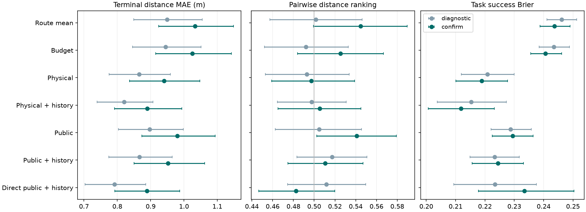
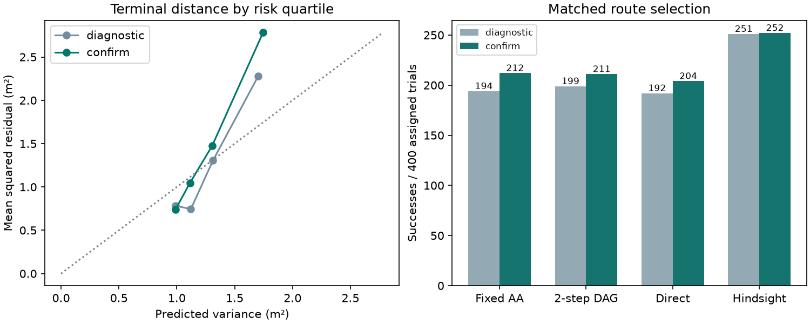

# 局面转移图能回传终局价值和风险吗

**能回传，也能区分一部分局面难度。在独立确认房间中，预测同一前缀各路线的终距排序正确率只有 51.0%，用图选择路线没有超过开发集固定的 AA。** 按时间展开保留自环是必要的：在新面板第二个窗口的 560 条同物理簇回访分支中，119 条仍净推进至少 2 cm，99 条后来成功，涉及 60 个不同房间。

## 实际做了哪些比较

- 在 200 个开发房间估计两步经验转移、冻结后缀估值和选路规则；在旧诊断面板 200 个房间复核，再在另 200 个全新房间独立确认。初态按内容哈希查重。相同 CAP 和执行器沿用上一轮冻结版本。
- A、B 各执行一个 120 tick 窗口，末位专家继续到底。AA、AB、BA、BB 四条实测路线共用同一前缀。每房间预定两个分叉时点，确认面板的 400 个时点有 351 个实际可达，产生 1,404 个根节点路线预测，其余 49 个在到达分叉前已结束。闭环成功数包含全部 400 个预定时点，区间按 200 个房间配对重抽。
- 回传目标为终距均值、终距平方均值和成功等事件的概率。末窗口之后使用该专家真实完整后缀估值，预算、来路、公开进展的定义和冻结判据见方法。这是“两次可选专家＋固定末段”的有限时域评估。

| 根节点表示及估计 | 终距 MAE（m） | 成功 Brier ↓ | 终距 >1 m Brier ↓ | 同前缀终距排序 | 按预测成功率选择，成功 / 400 |
|---|---:|---:|---:|---:|---:|
| 只用各路线的开发均值 | 1.033 | .244 | .241 | 54.5% | 212 |
| 仅预算，两步回传 | 1.025 | .241 | .240 | 52.5% | 212 |
| 真实物理簇，两步回传 | .940 | .219 | .210 | 49.7% | 204 |
| 真实簇＋来路与进展，两步回传 | .890 | .212 | .196 | 50.5% | 212 |
| 公开预测簇，两步回传 | .980 | .230 | .227 | 54.1% | 204 |
| **公开预测簇＋来路与进展，两步回传** | **.952** | **.224** | **.219** | **51.0%** | **211** |
| 相同公开细分，一步回传 | .929 | .224 | .214 | 52.5% | 210 |
| 相同公开细分，直接拟合终局 | .889 | .234 | .216 | 48.3% | 204 |

公开细分使两步回传 MAE 减少 **2.82 cm**（95% 区间 1.70–3.99 cm），但两步回传本身比同表示直接拟合多 **6.33 cm** 误差（2.70–10.21 cm）。两步回传在成功 Brier 上优于直接拟合。若只看同前缀、真实终距相差超过 2 cm 的配对，主要模型得分为 **51.0% [47.5%, 54.7%]**，共 1,144 对、165 个房间。在一胜一负的 393 对上，按预测成功率排序为 61.6%，固定路线开发均值为 63.9%。同时应留意由同一房间重复贡献的比较。

## 转移估计、后缀估计与风险

同一公开细分模型在起点预测的终距 MAE 为 **.952 m**，代入实际第一后继后变为 **.847 m**，代入实际第二后继后为 **.785 m**。这些对照使用了实际经历某条路线后才有的信息。从两步均未终止的 1,263 条路线看，第一后继使误差减少 **7.92 cm [4.76, 11.01]**，第二后继再减少 **3.51 cm [−0.18, 7.09]**。即使已看到第二后继，加入来路和进展也使公开后缀估值误差减少 3.22 cm [1.91, 4.49]。这同时指向后继预测困难和同簇内的历史差异；三个 MAE 的差值不能分解为互相独立的因果份额。

额外审计每个 120 tick 窗口实际到达的**物理后继类**（含成功/其他终止）。第一段公开基础、公开细分和物理细分的多类 Brier 分别为 .776、.812、.629；第二段为 .786、.823、.602。公开细分的最细估计单元在两段的开发样本数中位数分别仅 8、5。附加信息改善终局均值的同时，稀疏分箱仍会损害边概率的估计。这个对照以可观测信息诊断采样支持，不能单独证明加数据一定能解决选择问题。

主要模型的平均预测方差 **1.288 m²**，测试均方残差 **1.510 m²**，差值 +0.222 m²，房间重抽区间 [−0.104,+0.585]。从预测风险最低到最高四分位，实际均方残差为 **0.738、1.046、1.473、2.783 m²**；最高组模型平均预测为 **1.746 m²**。方差在本次独立确认中提供了难易分层，高风险组低估明显。模型内部的 1.288 m² 可拆为末端同类后缀内 1.017、第二段后继均值分化 0.171、第一段后继均值分化 0.100。这些是条件混合模型的预测方差，包含不同房间与同簇隐含状态的差异。

## 回访与部署判断

确认面板第二窗起止物理簇相同的 560 条分支按「房间、真实前缀、执行专家」去重。窗口结束处公开短历史显示接近、持平或远离终点的组，后续成功分别为 **63/256、9/120、27/184**。这说明前次进入簇后的进展值得保留。仅用无进展或暂时远离也不能安全地判任务失败。这里没有测试机器人执行撤退动作，也没有证明某个停止规则会节省预算。

在确认面板可精确重建单次选择，因为每个候选的完整分支都已真实执行。固定 AA、AB、BA、BB 的成功分别为 **212、185、207、183 / 400**。按主要模型的预测成功率选得 **211**，相对 AA **救回 3、丢失 4**，净差 −0.25 个百分点 [−1.50,+1.00]。事后逐前缀选胜者为 252/400。按最小预测终距选得 **200/400**，实际平均终距 .965 m，固定 AA 为 .953 m。在 A 真实走完第一窗后才判断是否交接，共有 332 个合资格时点；切换 58 次，救回 1、丢失 5。旧诊断面板上主要根节点选路 199/400、固定 AA 为 194/400，净收益未在新面板复现。

在看到主要确认结果后，还用同一冻结预测做了两项探索性选择：最小化预测的「终距超过 1 m」概率，或最小化预测均值加一个标准差。新面板两种规则均为 203/400 成功，实际终距超过 1 m 的均为 128/400，固定 AA 同样为 128/400。旧面板两种规则分别有 112 和 110 个尾部案例，固定 AA 为 116。风险估计能给房间分层，在当前路线上按它避险的收益没有复现。[探索性风险选路](risk_choice.json)

本轮支持把图作为物理前置条件、局面难度和高误差风险的诊断工具。继续拆簇要验证对**真实备选路线收益差**的区分。对构建新策略库，另做了共同瓶颈是否富集七位原专家全败房间的独立筛查；新增 CAP 能否解出这些房间并从别人的真实前缀接手，仍需同预算作者对照。

[八项假设与验证计划](plan.md) · [方法和信息边界](method.md) · [逐项配对统计](metrics.json) · [全部路线预测](predictions.csv) · [窗口转移概率审计](transitions.json)

新 200 房间的早期共同自环标记 23 个，其中 18 个七位全败；其余 177 个中有 33 个全败。开发集上的富集在独立面板复现，可以把这条规则用于开发候选池的优先抽样。[七 CAP 覆盖缺口独立确认](pool.md)
