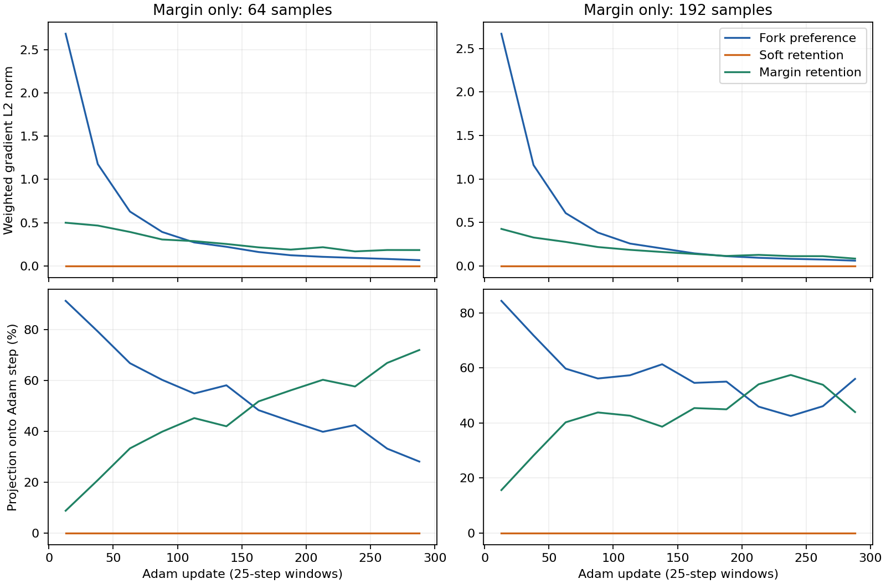

# 去掉全局软保持并增大成功余量批次

同一 200 间上，仅成功余量 192 对比软保持 128 ＋成功余量 64，闭环净差 -0.17 [-3.00, +2.67] 个百分点。

三个种子各自从既有第 4 轮开始，以同一 50 个开发房间的第 5 轮分叉做一次 300 步更新。每次抽 64 个硬偏好。关闭软保持的两组分别另抽 64 和 192 个成功路线边界，先均匀抽成功轨迹，再均匀抽轨迹中的可用边界，均有放回。192 组的前 64 个与小批组及原有双保持组逐步相同，剩余 128 个使用独立随机数流。每批余量损失仍对所有余量样本取平均，权重 0.25，logit 余量 0.2，阈值对应旧动作概率约 55%。模型、优化器、分叉偏好小批次和训练次数一致。

每个可路由边界的旧动作标签跟随旧 actor 的实际选择。两条首步在旧 actor 续跑下都成功时保留该选择，余量满足后梯度为零。两专家从同一初态分别成功不会触发整局的专门选路规则。

## 此前已查看的 200 个自然房间

| 更新方案 | seed17 | seed29 | seed43 | 平均救回 | 平均丢失 | 旧成功保留率 | 旧失败救回率 |
|---|---:|---:|---:|---:|---:|---:|---:|
| 第 4 轮 | 107 | 104 | 105 | 0.0 | 0.0 | 100.0% | 0.0% |
| 仅软保持 128 | 108 | 109 | 106 | 10.7 | 8.3 | 92.1% | 11.3% |
| 软保持 128 ＋成功余量 64 | 108 | 110 | 108 | 12.0 | 8.7 | 91.8% | 12.7% |
| 仅成功余量 64 | 114 | 109 | 103 | 13.3 | 10.0 | 90.5% | 14.1% |
| 仅成功余量 192 | 113 | 111 | 101 | 13.7 | 10.7 | 89.9% | 14.4% |

| 配对比较 | 成功率差 | 保留率差 | 救回率差 |
|---|---:|---:|---:|
| 仅成功余量 192 对 软保持 128 ＋成功余量 64 | -0.17 [-3.00, +2.67] | -1.90 [-5.54, +1.60] | +1.76 [-2.50, +6.01] |
| 仅成功余量 64 对 软保持 128 ＋成功余量 64 | +0.00 [-3.00, +3.00] | -1.27 [-4.88, +2.42] | +1.41 [-3.08, +5.80] |
| 仅成功余量 192 对 仅成功余量 64 | -0.17 [-2.00, +1.50] | -0.63 [-2.70, +1.24] | +0.35 [-2.30, +3.04] |
| 仅成功余量 192 对 仅软保持 128 | +0.33 [-2.67, +3.33] | -2.22 [-5.99, +1.29] | +3.17 [-1.66, +8.14] |
| 仅成功余量 192 对 第 4 轮 | +1.50 [-1.33, +4.33] | -10.13 [-13.83, -6.89] | +14.44 [+9.89, +19.40] |

## 用于本次更新的 50 个开发房间

| 更新方案 | seed17 | seed29 | seed43 | 平均救回 | 平均丢失 | 旧成功保留率 | 旧失败救回率 |
|---|---:|---:|---:|---:|---:|---:|---:|
| 第 4 轮 | 20 | 23 | 21 | 0.0 | 0.0 | 100.0% | 0.0% |
| 仅软保持 128 | 23 | 27 | 25 | 4.3 | 0.7 | 96.9% | 15.1% |
| 软保持 128 ＋成功余量 64 | 23 | 26 | 26 | 3.7 | 0.0 | 100.0% | 12.8% |
| 仅成功余量 64 | 23 | 25 | 25 | 3.7 | 0.7 | 96.9% | 12.8% |
| 仅成功余量 192 | 24 | 26 | 25 | 4.3 | 0.7 | 96.9% | 15.1% |

| 配对比较 | 成功率差 | 保留率差 | 救回率差 |
|---|---:|---:|---:|
| 仅成功余量 192 对 软保持 128 ＋成功余量 64 | +0.00 [-5.33, +5.33] | -3.12 [-8.57, +0.00] | +2.33 [-7.69, +11.94] |
| 仅成功余量 64 对 软保持 128 ＋成功余量 64 | -1.33 [-6.00, +3.33] | -3.12 [-8.57, +0.00] | +0.00 [-9.41, +9.20] |
| 仅成功余量 192 对 仅成功余量 64 | +1.33 [-2.00, +5.33] | +0.00 [+0.00, +0.00] | +2.33 [-3.80, +8.99] |
| 仅成功余量 192 对 仅软保持 128 | +0.00 [-6.00, +6.00] | +0.00 [-6.45, +6.67] | +0.00 [-9.90, +9.71] |
| 仅成功余量 192 对 第 4 轮 | +7.33 [+2.00, +13.33] | -3.12 [-8.57, +0.00] | +15.12 [+6.41, +24.69] |

## 固定开发边界与梯度

| 组别 | 成功边界改选 | 分叉拟合命中 | 有效余量比例 | 全程 Adam 方向份额（偏好 / 软保持 / 余量） |
|---|---:|---:|---:|---:|
| 软保持 128 ＋成功余量 64 | 4/534 | 34/34 | 5.3% | 36.0% / 56.3% / 7.7% |
| 仅成功余量 64 | 9/534 | 34/34 | 5.6% | 74.2% / 0.0% / 25.8% |
| 仅成功余量 192 | 8/534 | 34/34 | 4.7% | 71.2% / 0.0% / 28.8% |

三个种子使用同一评估面板，所有差值单位为百分点，95% 区间按房间配对重采样 10,000 次，保留每个房间的三个模型。训练数据上的区间仅为描述。该面板已在之前的实验中查看，单轮结果不能证明多轮稳定性。旧模型结果来自同房间的历史实测，新组全部从模拟器闭环执行；梯度回放的权重与部署权重逐值一致。

[逐房间结果](rooms.csv) · [统计](results.json) · [逐步梯度](gradients.csv)

## 两条首步都成功的训练分叉

在 120 个这样的固定前缀上，旧 actor 选 B 58 次，仅余量 192 更新后选 B 59 次，总共改选 1 次。三个种子按记录计数。成功余量池合计 55 条可抽轨迹、512 个边界，其中 392 个没有实测另一首步。
