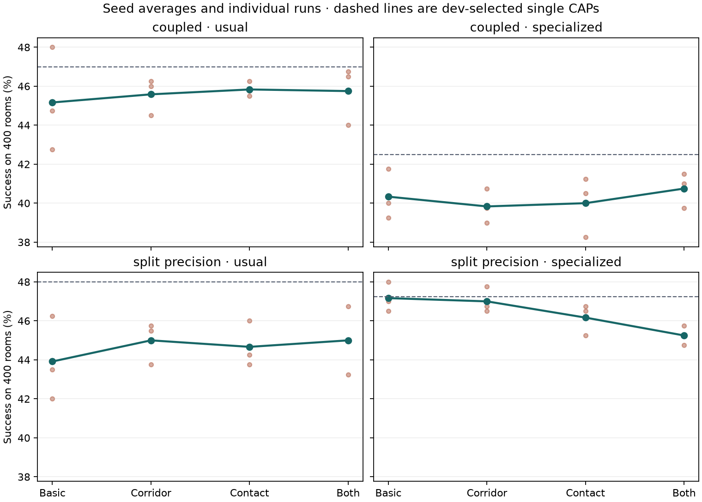

# PUSH 执行可靠性与多 CAP 语义评分

本轮完成 400 个开发房间、400 个新留出房间的完整交叉实验。两套冻结库共七个不同 CAP，交叉原一体化 PUSH、显式拆分加就位后末段调速，分别拟合四类候选动作评分器，各三个种子。共完成 11,200 个单专家控制对照、1,017 条最快教师重放、48 个拟合模型和 19,200 次混合闭环。另做了调速时机、几何可预测性、开局语义路由、保守门槛和故障交接复验。

## Option 改善了哪些能力

同一批 400 新房间中，七个冻结 CAP 的成功数都提高。共同母本从 144 提高到 168，净差 +6.0 个百分点，配对 95% 区间 [+2.5, +9.75]。常规库并集 259→274（+3.75 个百分点，区间 [+0.25, +7.5]），专精库并集 199→225（+6.50，[+2.75, +10.25]）。靠墙专家在 97 个近墙房间中两种执行器都成功 52 次，新执行器的母本是 31 次。这项专长继续存在。

在另一批 200 房间的五臂对照，两 CAP 平均为原版 39%、只拆分 38%、拆分后调速 41%、原执行器在发令前调速也为 41%。拆分后调速相对自动续推为 +3.0 个百分点，95% 区间 [+0.25,+6.0]。因此完整执行器改动的收益包含末段速度和时长调整，单独拆分在两张面板的方向不同。显式确认接触和实际推进反馈改善了诊断能力。按推向估计目标内圈剩余距离这一更复杂版本，在独立复验低于简单的固定调速 −1.5 个百分点，区间 [−4.25,+1.25]。

[全部单成员与亚型效果](option_member_effects.json) · [前导实验和配对轨迹](../2026-11-23_cap_push_phases/README.md) · [调速时机](pacing/README.md) · [按推向余程调速](geometry_pacing/README.md) · [局部几何可预测性](feasibility/README.md)

## 完整逐边界混合

固定单 CAP 由开发集选择。并集是每房间任一固定专家能独自完成的覆盖。右侧四列是同一批 400 房间中三个训练种子的成功率平均。

| 执行器与库 | 开发最佳单 CAP | 专家并集 | 基础评分 | 加通道 | 加接触 | 两类都加 |
|---|---:|---:|---:|---:|---:|---:|
| 原一体化，常规库 | 188/400 | 259/400 | 45.17% | 45.58% | 45.83% | 45.75% |
| 原一体化，专精库 | 170/400 | 199/400 | 40.33% | 39.83% | 40.00% | 40.75% |
| 拆分调速，常规库 | 192/400 | 274/400 | 43.92% | 45.00% | 44.67% | 45.00% |
| 拆分调速，专精库 | 189/400 | 225/400 | 47.17% | 47.00% | 46.17% | 45.25% |

专精库在基础评分下因更换执行器和重新拟合提高 **+6.83 个百分点**，区间 [+2.92, +10.75]。两个 200 房间面板分别改善 +4.50 和 +9.17 个百分点，三种子都向上。常规库基础组是 −1.25，区间 [−4.42, +1.92]，虽然固定专家并集扩大。控制改善能传到部分混合策略，传导程度取决于执行器、专家产物和从其采到的训练边界。

四个执行器与库组合里，追加通道、接触或两类语义量相对各自基础评分器的配对区间全部跨零。使用拆分调速的专精库，同时加两类语义平均 −1.92 个百分点，区间 [−4.08, +0.25]。它在两个面板和三个种子的差值都偏负。该库基础混合的三个种子是 188、186、192 个成功，固定最佳是 189。平均差 −0.08 个百分点，区间 [−2.50, +2.42]。常规库在新控制上的最好三种子平均约 45%，低于同库固定最佳 48%。

专精库的最快成功教师有 213 或 216 个房间，产生 1,455 或 1,373 个多候选边界。常规库为 288 或 300 个房间，产生 4,728 或 4,894 个。训练教师命中为 91.9%–100%。各库每个控制条件重新拟合，因此控制改动的效应包含可得教师和实际访问状态变化。专精库新增成功出现，但重新拟合的评分器仍未稳定超过固定专家。常规库留出并集比开发最佳单 CAP 多 82 个房间，说明还有可以利用的互补性。

## 语义在哪个决策层有用

给每位专精专家学习开局成功概率时，完整通道证据对基础几何的增益在第一批 400 房间上为 +3.50 和 +4.25 个百分点，分别对应原执行器和拆分调速。固定预测器及其专家分派再跑另一批 400 个新房间时，专精库在两种执行器上等权增益为 **+2.375** [0.625, 4.125] 个百分点，常规库为 −1.75。两库交互为 **+4.125** [1.0, 7.375]。这一发现属于开局一次选择，可以跨这两种执行器复现；本次逐边界模型没有相应增益。

绝对水平仍是问题。独立复验上，拆分调速的专精库基础路由成功 175/400，加语义 182/400，开发集选定最佳单 CAP 191/400。随后在开发集做五折置信门槛选择，两执行器的最优门槛都选择始终提交给最佳单专家。第三批 400 新房间上，拆分调速的无门槛语义开局为 191/400，最佳单 CAP 为 188/400，区间 [−1.5, +3.0] 个百分点。方向可变，幅度小。

接触超时后的整局一次交接极少触发，常规库 3/400、专精库 0/400。放宽到长时低进展，允许回到开发集最强 CAP，在新的 400 场景中触发 7 次，救回 0、丢失 2。观测上识别出停滞，并未自动提供证据说明备选 CAP 在这个已到达状态上更好。

[开局路由首次检查](initial_routing/README.md) · [独立复验](initial_confirmation/README.md) · [预测优势门槛](selective_semantics/README.md) · [接触超时交接](contact_handoff/README.md) · [低进展交接](progress_handoff/README.md)

## 对研究路线的判断

可以保留两条有不同证据的主张。末段调速和明确的接触阶段改善了若干物理与闭环指标。专业化训练目标能产生一部分可读出的开局结构，语义证据在这对冻结专家库的专精组上带来可复验的相对路由增量。两者组合后，仍缺少“语义让逐边界混合稳定超越最佳单 CAP”的证据。后续最直接的监督数据是实际可达的接触、阻塞、低进展前缀上，多个候选专家从同一点继续的配对终局。它可以给改选提供相对优势标签，也能揭示某个专家是否只在自然开局有效。若重做作者对照，可以将这种可观测中间状态、相同 Option 版本和等开发预算纳入条件，并重复作者以检验是否能主动提高专家优势的可辨认度。

[冻结协议](protocol.md) · [完整逐案数据](rooms.csv) · [三个种子、并集保留与效应区间](results.json) · [主运行记录](../../../../outputs/semantic_rl/cap_option_semantic_factorial_20261123_01/campaign.log)
