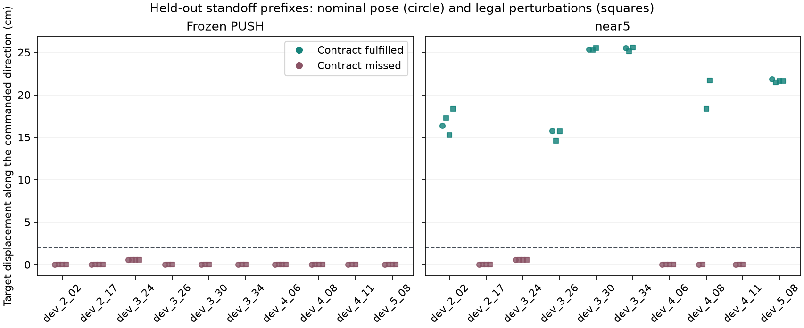
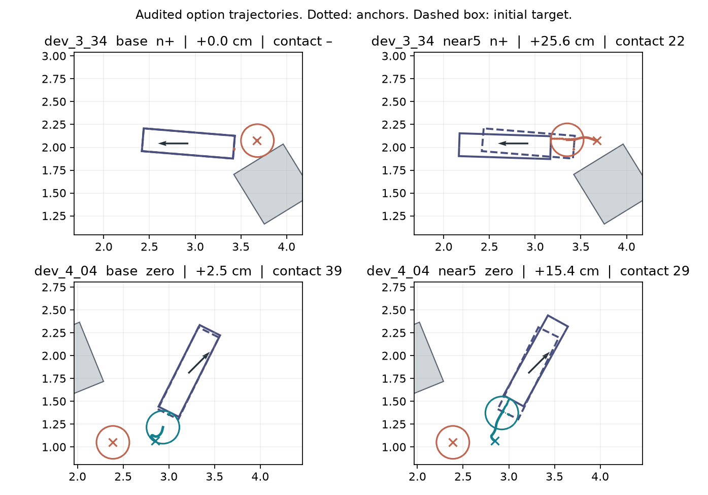

# PUSH 的局部效果、接触拆分与闭环回归

## 测量

单机平移 PUSH 局部达标要求物理接触持续至少 3 ticks，目标物沿命令方向推进至少 2 cm，横向偏移不超过 3.5 cm 或纵向位移的 75%（取较大者）。另记录队友及非目标表面触碰。双机组只用于行为诊断和回归，两台机器人可能有不同推向，沿第一位推手方向的投影只作描述。

从 s025、s027、s045 的真实历史筛选 123 个前缀。83 个前缀用于开发，40 个用于留出。来自同一房间的多个窗口都留在同一侧。每个前缀固定目标、两机命令、推速与时长上限，分别测试原位、切向 ±1.5 cm、法向 ±1.0 cm。施加位移时保持速度与控制器历史，重算扫描和合法性。留出 200 次尝试中 164 次合法，包含 116 次单机 PUSH。其余是初始重叠、越界或原动作失去合法性。仿真真值仅用于扰动与物理审计。

## 一体化 PUSH 的改动

开发测台比较 11 种配方，包括同面几何近点、按扫描净空选择、缩短找位离面距离、局部减小排斥裕度。先按正常组和新增触碰过滤，再依次按停滞与低进展组的净救回、邻域稳定性、建立接触和触碰指标排序。选定版本在未触碰目标且停在 standoff 5 ticks、位置变化很小时，在同一观测支持面上向近处重选一次接触点，搜索半径为 15 cm。

| 留出组 | 合法分支 | 稳定接触，原版 → 换点 | 合同达标，原版 → 换点 | 扰动会翻转达标结果的邻域 |
|---|---:|---:|---:|---:|
| 找位停滞 | 36 | 0 → 19 | 0 → 19 | 0/10 → 1/10 |
| 低推进 | 33 | 27 → 33 | 5 → 11 | 3/9 → 1/9 |
| 正常推进 | 47 | 47 → 47 | 47 → 47 | 0/11 → 0/11 |

找位组原版的 10 个邻域全部不达标。换点后的 10 个邻域中 5 个全部通过、4 个全部未通过、1 个混合。低推进组中已有稳定接触却未达标的分支仍有 22 个。单机合计 52/116 到 77/116，无原达标回退。全部四组按房间配对重抽的等权净增区间为 +6.8 至 +31.1 个百分点。单机触及非目标表面的分支从 44 降至 43，两机触碰分支数相同。局部减小排斥裕度在开发停滞组没有净救回，新增 7 个非目标接触分支。接触后的附加切向速度（上限 0.04 或 0.08 m/s）没有改变开发合同成败，正常推进组侧移绝对值的中位变化分别为 −0.14 和 −0.26 cm。

用开局目标点数、接触状态、站位净空、法向距离、切向错位和队友距离等量做线性读出。加入几何后的跨房间 AUC 在原版为 .524、换点版为 .333，Brier 都比仅动作参数更差。这一读出尚无法在动作前稳定地区分是否达标。

第一例 dev_3_34 原样卡在静态障碍附近，换点后沿指令推进 25.6 cm，第 22 tick 记为连续接触成立。虚线和实线分别表示目标开始和结束的姿态，点线表示接触锚点，浅黄多边形是该动作开始时的其他可动物体。dev_4_04 原版实推 2.5 cm，换点后达到 15.4 cm。

## 拆分接触与推动

CONTACT 接受目标和离散期望法向。第一次发生实际触碰时返回，只有公开扫描能找到方向相容的有限面段，且触觉点与面的位置相符，才返回就绪。PUSH_FROM_CONTACT 在相同接触证据下才开始，失去接触会提前返回。原型覆盖单台平移推手，另一台执行原联合命令。接触和推动两段共享原命令的总时长上限。

| 留出 116 个合法单机分支 | CONTACT 确认就绪 | 实际开始 PUSH | 整段合同达标 |
|---|---:|---:|---:|
| 原一体化 PUSH | 一体化 | 一体化 | 52 |
| 拆分，原找位 | 78 | 76 | 51 |
| 拆分，8 ticks 停滞换点 | 95 | 95 | 72 |
| 拆分，5 ticks 停滞换点 | 99 | 99 | 76 |
| 一体化，5 ticks 停滞换点 | 一体化 | 一体化 | 77 |

拆分并保留 5 ticks 换点时，17 次未开始推动，14 次接触超时，3 次环境在准备阶段终止。99 次开始后，76 次达标，6 次失去接触提前退出。CONTACT 中目标沿向位移中位数 0.21 cm，随后的 PUSH 为 21.2 cm。在剩余预算能容纳 12 个推动 ticks 的 93 次中，89 次走完且始终保持接触，69 次还达到 2 cm 位移。拆分后可以让高层根据准备结果重新决策，同时保留了大部分一体化的物理效果。此处由测台脚本接续推动。

## 第二批前缀复验和公开执行反馈

在另一张已查看的 200 个房间的原 s025 轨迹取 54 个前缀，每类 18 个，按相同方法施加扰动。270 次尝试含 217 次合法分支。原控制与单独拆分都是 93/217 达标。一体化换点与拆分换点均为 132/217。找位组一体化换点从 1/70 到 30/70，有 7/18 个前缀在所有合法扰动下均达标。拆分换点有 166 次确认接触、164 次开始推动。剩余时长足够的 126 次推进中，124 次保持接触满 12 ticks，其中 101 次沿指定方向推进至少 2 cm。

PUSH 执行后也可用公开点云估计推进量。将推动前后目标拟合框中心的差投影到命令方向，观测长度明显变化时返回“支持面变化”。164 次推进中有 147 次给出估计，17 次报告支持面变化。使用 2 cm 门槛，147 次可估计中的判断有 140 次和物理审计一致，含 4 次假阳性、3 次假阴性，平均绝对误差 2.42 cm。在真实沿向位移绝对值至少 2 cm 的 119 次可估计案例中，119 次方向符号一致。开启估计后，执行时间、物理轨迹和结果与同一个拆分换点控制逐分支相同。这个量用于动作后反馈，动作前预测仍缺少对应证据。

[第二批接触和推动结果](phases_stress.json) · [公开估计逐分支](effect_feedback.csv) · [估计误差及覆盖](effect_feedback.json)

## 整局回归

冻结 s025 在 160 个开发房间中，宽触发换点得到 75→66，救回 22、丢失 31。146 个房间触发，共 720 次。200 个已有诊断房间中得到 78→86，救回 36、丢失 28，配对 95% 区间为 −4.0 至 +12.0 个百分点。进一步测量两个收窄触发的版本。它们都要求同一机器人在前一段相同推向上执行至少 12 ticks，完全未触碰目标且移动不到 4.5 cm，下一段仍卡在找位时才换点。分别测试每房间至多一次及 100 ticks 冷却。

两版在开发集均为 75→76/160，救回 2、丢失 1，触发房间均为 12 个。每房间一次的版本累计触发 12 次，冷却版触发 18 次。选触发较少的版本去新冻结的 200 房间做配对。新房间同样只触发 12 次，73→74/200，救回 1、丢失 0，188 个未触发房间的完整历史与基准逐项相符。单个救回不足以确认总体成功率提高。

本轮共执行 8,400 个固定前缀分支尝试（含合法性拒绝）和 1,080 次整局重跑。测台建议保留两项已验证的能力：在持续找位停滞时允许一次观测同面换点，把确认接触和实际推动效果作为公开反馈。两台同时推、重新开发 CAP 后能否学习利用显式接触动作、以及调整物理半径的作用，仍需按各自版本测量。现有 CAP 的默认入口保持原版。

[配对整局结果](closedloop.json) · [源码和面板校验值](provenance.json)

[局部逐分支与排除状态](branches.csv) · [局部汇总](result.json) · [接触与推动分段数据](phases.csv) · [分段汇总](phases.json) · [测台实现](../../../../tools/push_contract_bench.py) · [拆分原型](../../../../experiments/planar_tasks/semantic_rl/push_phases.py) · [换点控制](../../../../experiments/planar_tasks/semantic_rl/push_contact_recovery.py)
