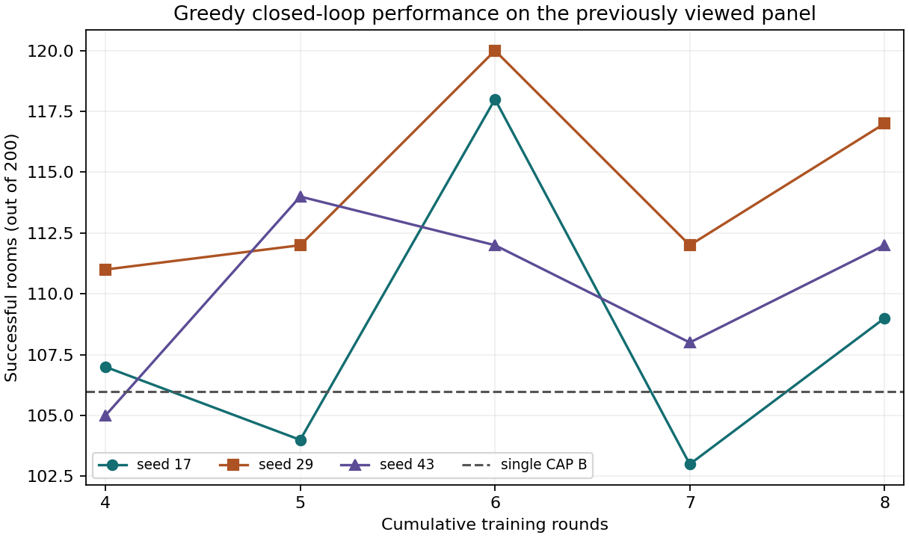

# 无教师路由的第 4 轮与第 8 轮对照

新确认面板单 CAP B 成功 87/200。三种子平均从 95.3 到 94.7/200，第 8 轮相对第 4 轮 -0.3 [-3.7, +3.0] 个百分点。

本次加倍预算未在确认面板上显示稳定的泛化提升。区间仍允许小幅改善或退化，无法据此确定第 4 轮已达上限。

新确认面板在训练前冻结。每个种子从上一轮锁定的末轮权重接续，使用相同顺序的 200 个新开发房间，分四轮采样，每轮 50 间、300 次 Adam 更新。第 8 轮累计见过 400 个开发房间、更新 2,400 次。自采前缀、单步分叉、自身续跑、保持损失、公开停滞门控和九个语义特征的屏蔽方式沿用上一轮。沿用原实现，每轮重置优化器，采样小批次的随机种子为训练种子加绝对轮数。

## 新确认面板的成对比较

| 种子 | 第 4 轮 | 第 8 轮 | 相对第 4 轮救回/丢失 | 保留第 4 轮成功 | 净变化及 95% 区间（百分点） | 第 8 轮相对 B 救回/丢失 |
|---|---:|---:|---:|---:|---:|---:|
| 17 | 92 | 90 | 16/18 | 74/92 | -1.0 [-6.5, +4.5] | 21/18 |
| 29 | 95 | 94 | 15/16 | 79/95 | -0.5 [-6.0, +5.0] | 23/16 |
| 43 | 99 | 100 | 13/12 | 87/99 | +0.5 [-4.5, +5.5] | 28/15 |

三个种子中有 1 个在第 8 轮多解了房间。平均救回 14.7 间、丢失 15.3 间。相对固定单 CAP B 的净差从第 4 轮 +4.2 [-0.0, +8.3] 到第 8 轮 +3.8 [-1.3, +9.2] 个百分点。

从 B 单独执行的结果看，第 4 轮平均救回 19.7 间、丢失 11.3 间。到第 8 轮分别为 24.0 和 16.3 间。新接手带来的收益需要与原有成功的保留一起衡量。

## 已查看面板的逐轮诊断

| 种子 | 第 4 轮 | 第 5 轮 | 第 6 轮 | 第 7 轮 | 第 8 轮 |
|---|---:|---:|---:|---:|---:|
| 17 | 107 | 104 | 118 | 103 | 109 |
| 29 | 111 | 112 | 120 | 112 | 117 |
| 43 | 105 | 114 | 112 | 108 | 112 |

该面板固定 B 为 106/200。第 4 轮与 B 的结果沿用上轮相同房间、相同权重的已完成闭环。第 5 至 8 轮全部重新执行。按预定方案，确认面板只比较两端和 B。

## 新增训练数据

| 种子 | 新增分叉 | 产生硬偏好的分叉 | 第 5 至 8 轮各轮硬偏好 |
|---|---:|---:|---|
| 17 | 505 | 50 | 8, 12, 12, 18 |
| 29 | 501 | 45 | 11, 8, 12, 14 |
| 43 | 502 | 48 | 15, 11, 9, 13 |

新增训练房间和确认房间按去除 scene_id 后的内容哈希去重。三个种子共用训练房间和评估房间。区间按房间成对重采样 10,000 次，每次保留同一房间的三个种子，描述这三个固定模型在新房间上的不确定性。该对照同时增加训练房间和参数更新次数，可判断两者合计的收益。

[逐房间结果](rooms.csv) · [配对统计](results.json)
