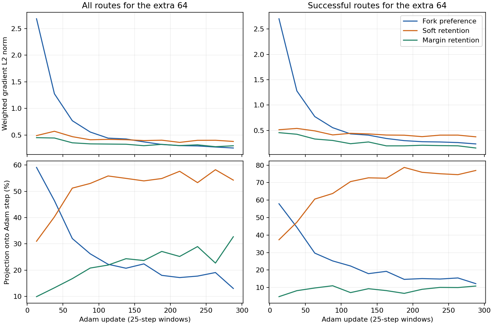

# 成功路线额外保留样本的单轮配对实验

新 200 间上，成功路线组相对等预算全部轨迹组的净差为 +1.00 [-0.67, +2.67] 个百分点。旧成功的保留率差为 +0.95 [-0.33, +2.38] 个百分点，旧失败的救回率差为 +1.06 [-2.03, +4.30] 个百分点。

三种子各自从锁定的第 4 轮权重出发，读取原第 5 轮同一批 50 个开发房间的前缀和分叉。固定 64 个偏好样本和 128 个软保持样本的小批抽样序列，原更新复现的最终权重逐值等于此前第 5 轮。两组新方法都加 64 个额外边界，用同一个独立随机数流先均匀抽符合条件的轨迹，再均匀抽边界。两组额外池均排除已知有严格偏好的边界，后者继续接受原硬监督。成功组只改变可抽取轨迹的成败条件。两组的网络、九个语义特征的屏蔽、Adam、300 次更新保持一致。

余量项为 0.25 × mean(max(0, 0.2 − s × logit))，原选择 B 时 s=+1，原选择 A 时 s=−1。0.2 logit 对应原选择概率约 0.55。三个损失分别取均值后相加。权重和余量在看结果之前固定。

## 新冻结的 200 个自然房间

| 组别 | seed17 成功 | seed29 成功 | seed43 成功 | 平均保住 | 平均丢失 | 平均救回 | 旧成功保留率 | 旧失败救回率 |
|---|---:|---:|---:|---:|---:|---:|---:|---:|
| 第 4 轮起点 | 107 | 104 | 105 | 105.3 | 0.0 | 0.0 | 100.0% | 0.0% |
| 原更新 | 108 | 109 | 106 | 97.0 | 8.3 | 10.7 | 92.1% | 11.3% |
| 全部轨迹加 64 | 109 | 108 | 103 | 95.7 | 9.7 | 11.0 | 90.8% | 11.6% |
| 成功轨迹加 64 | 108 | 110 | 108 | 96.7 | 8.7 | 12.0 | 91.8% | 12.7% |

均以各自种子的第 4 轮成败区分旧成功和旧失败。以下差值按房间配对，95% 区间使用 10,000 次房间重采样，每次保留三个固定种子的整组记录。保留率和救回率的分母分别是各次重采样中的旧成功、旧失败数。训练房间上的区间仅作描述。

- 成功轨迹加 64 相对 全部轨迹加 64，闭环净差 +1.00 [-0.67, +2.67]，保留率差 +0.95 [-0.33, +2.38]，救回率差 +1.06 [-2.03, +4.30] 个百分点。
- 成功轨迹加 64 相对 原更新，闭环净差 +0.50 [-1.17, +2.17]，保留率差 -0.32 [-2.00, +1.31]，救回率差 +1.41 [-1.22, +4.33] 个百分点。

## 用于此次更新的 50 个开发房间

| 组别 | seed17 成功 | seed29 成功 | seed43 成功 | 平均保住 | 平均丢失 | 平均救回 | 旧成功保留率 | 旧失败救回率 |
|---|---:|---:|---:|---:|---:|---:|---:|---:|
| 第 4 轮起点 | 20 | 23 | 21 | 21.3 | 0.0 | 0.0 | 100.0% | 0.0% |
| 原更新 | 23 | 27 | 25 | 20.7 | 0.7 | 4.3 | 96.9% | 15.1% |
| 全部轨迹加 64 | 22 | 23 | 25 | 20.7 | 0.7 | 2.7 | 96.9% | 9.3% |
| 成功轨迹加 64 | 23 | 26 | 26 | 21.3 | 0.0 | 3.7 | 100.0% | 12.8% |

均以各自种子的第 4 轮成败区分旧成功和旧失败。以下差值按房间配对，95% 区间使用 10,000 次房间重采样，每次保留三个固定种子的整组记录。保留率和救回率的分母分别是各次重采样中的旧成功、旧失败数。训练房间上的区间仅作描述。

- 成功轨迹加 64 相对 全部轨迹加 64，闭环净差 +3.33 [+0.67, +6.00]，保留率差 +3.12 [+0.00, +8.62]，救回率差 +3.49 [+0.00, +7.69] 个百分点。
- 成功轨迹加 64 相对 原更新，闭环净差 +0.00 [-3.33, +2.67]，保留率差 +3.12 [+0.00, +8.77]，救回率差 -2.33 [-7.69, +0.00] 个百分点。

## 固定成功前缀上的改选

| 组别 | 旧成功边界发生改选 | 有效分叉偏好命中 |
|---|---:|---:|
| 原更新 | 32/534 | 34/34 |
| 全部轨迹加 64 | 11/534 | 34/34 |
| 成功轨迹加 64 | 4/534 | 34/34 |

## 梯度与参数更新

每一步在同一参数和同一批次，分别计算三部分加权损失的全参数梯度。方向余弦为负表示两项在一阶上拉向相反方向。将各项梯度分别维护 Adam 一阶矩，使用原更新的共同二阶矩分母，可将实际步长分解为三项。表中份额为各分量与总步长的内积之和除以总步长平方范数之和，按步长能量加权。这里使用实际共同的 Adam 缩放，各份额之和为 100%；它衡量这次更新方向的投影，不能直接归因任务成功率。

| 额外池 | 更新区间 | 梯度范数（偏好 / 软保持 / 余量） | Adam 方向份额（同顺序） | 偏好与软保持余弦 | 偏好与余量余弦 |
|---|---|---|---|---:|---:|
| 原更新 | 1–50 | 1.964 / 0.564 / 0.000 | 52.4% / 47.6% / 0.0% | -0.28 | — |
| 原更新 | 1–300 | 0.624 / 0.441 / 0.000 | 36.5% / 63.5% / 0.0% | -0.36 | — |
| 原更新 | 251–300 | 0.232 / 0.399 / 0.000 | 16.8% / 83.2% / 0.0% | -0.32 | — |
| 全部轨迹加 64 | 1–50 | 1.980 / 0.531 / 0.449 | 54.7% / 34.2% / 11.1% | -0.30 | -0.17 |
| 全部轨迹加 64 | 1–300 | 0.666 / 0.428 / 0.340 | 37.3% / 45.0% / 17.7% | -0.35 | -0.10 |
| 全部轨迹加 64 | 251–300 | 0.267 / 0.392 / 0.291 | 16.0% / 56.2% / 27.8% | -0.30 | -0.04 |
| 成功轨迹加 64 | 1–50 | 1.990 / 0.527 / 0.441 | 53.1% / 40.9% / 6.0% | -0.29 | -0.12 |
| 成功轨迹加 64 | 1–300 | 0.653 / 0.435 / 0.265 | 36.0% / 56.3% / 7.7% | -0.35 | -0.07 |
| 成功轨迹加 64 | 251–300 | 0.248 / 0.392 / 0.176 | 13.9% / 75.7% / 10.4% | -0.33 | -0.02 |

成功组额外抽取的边界中，全程平均 5.3% 低于余量、会触发梯度，最后 50 步仅 2.9%。全部轨迹组对应为 8.2% 和 5.6%。

九份优化回放的最终权重均与闭环所用模型逐值一致，方向余弦仅汇总范数乘积超过 1e-12 的项。该实验只更新一次，没有测试多轮积累或其他余量权重。

[逐房间数据](rooms.csv) · [配对统计](results.json) · [每步梯度](gradients.csv) · [分时段和分种子梯度](gradient_summary.json)
