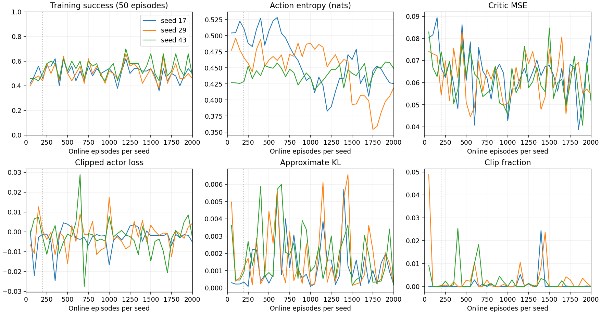

# 当前无门控 A/B 的 PPO-Clip 对照

新确认面板上，最终 PPO 三个种子分别成功 [110, 114, 111] /200。相对父模型的成功率变化为 +0.83 [-1.83, +3.50] 个百分点。相对默认分叉更新 +0.33 [-2.17, +2.83] 个百分点，相对纯 B 为 +5.33 [+0.83, +9.83] 个百分点。

| 面板与模型 | seed17 | seed29 | seed43 | 平均成功率 |
|---|---:|---:|---:|---:|
| 已查看 · 父 actor | 114 | 116 | 111 | 56.8% |
| 已查看 · 默认分叉更新 | 110 | 114 | 118 | 57.0% |
| 已查看 · PPO 200 局 | 115 | 118 | 111 | 57.3% |
| 已查看 · PPO 2,000 局 | 111 | 121 | 115 | 57.8% |
| 已查看 · 纯 A / 纯 B / 两者并集 | 107 / 113 / 136 | | | |
| 新确认 · 父 actor | 108 | 114 | 108 | 55.0% |
| 新确认 · 默认分叉更新 | 109 | 116 | 108 | 55.5% |
| 新确认 · PPO 2,000 局 | 110 | 114 | 111 | 55.8% |
| 新确认 · 纯 A / 纯 B / 两者并集 | 102 / 101 / 121 | | | |

## 新确认面板的配对差异

| 比较基线 | PPO 独赢 | 基线独赢 | PPO 减基线（百分点，95% 区间） |
|---|---:|---:|---:|
| 父 actor | 36 | 31 | +0.83 [-1.83, +3.50] |
| 默认分叉更新 | 33 | 31 | +0.33 [-2.17, +2.83] |
| 纯 A | 62 | 33 | +4.83 [+0.50, +9.50] |
| 纯 B | 64 | 32 | +5.33 [+0.83, +9.83] |
| 固定 B 五步后交给 A | 56 | 39 | +2.83 [-1.67, +7.33] |

| 房间条件 | 父 actor 成功 | 最终 PPO 成功 |
|---|---:|---:|
| 父 actor 原成功 | 330/330 | 299/330 |
| 父 actor 原失败 | 0/270 | 36/270 |
| 仅 A 成功 | 33/60 | 36/60 |
| 仅 B 成功 | 35/57 | 34/57 |
| 两专家均成功 | 236/246 | 237/246 |
| 两专家均失败 | 26/237 | 28/237 |

种子共享面板，计数为房间与种子组合。区间按房间配对重抽 10,000 次，每次保留三个种子，仅描述这三份模型的房间抽样差异。

## 训练与评估

固定两位专家、72 束局部中心感知、公开历史和动作参数、64×64 actor，屏蔽九个教师语义量。每个种子从与默认无回放分叉方法相同的第四轮父 actor 开始，独立 critic 最后一层初始化为常数 0.5。从第一次不同提案起在 A/B 概率中采样，温度为 1；相同提案执行共同命令并使用规范编号 A。每个训练批次只用本轮新轨迹，终局成功奖励 1、其余为 0，耗尽任务预算按终止。GAE 只在可选的分歧边界推进，γ=1、λ=.95。PPO clip=.2，最多四个 epoch，平均近似 KL 超过 .015 提前结束本轮。minibatch 128、actor/critic 学习率 3e-5 / 3e-4，价值损失权重 .5，无熵奖励、分叉损失、全局软保持或成功回放。部署使用贪心选择。更新前逐边界复算行为策略对数概率。

每种子每轮 50 个房间。前四轮重复默认分叉研究中的同一批 50 间，检查点为 200 次采样；分叉对照每种子使用 50 个父轨迹加最多 150 次分叉重跑，模拟 ticks、优化器更新与数据结构各有差异。从第五轮起每轮在固定 200 间开发池中无放回抽 50 间，同房间每轮重新采样动作。训练抽样与两位专家的成败无关。200 个母房间中，A 独胜 10、B 独胜 25、双胜 77、双败 88 间；每种子 2,000 个预定训练 episode 对应 103、270、761、866 局。第 4、10、20、40 轮累计见过 50、167、199、200 个不同房间。较早的分层 rollout 刻意多抽独胜房间，后来的无教师分叉每轮引入 50 个新房间；二者与长程 PPO 的训练分布均有差异。

最终为预先指定的第 40 轮，无检查点或种子择优。另在训练中、查看 PPO 诊断或确认结果前登记上一轮的固定 B 五步转 A 作为次要参考。独立确认面板在训练前按场景内容哈希冻结，最终模型锁定后执行。已查看的诊断面板复用父模型、分叉模型、纯专家的既有同房间结果，两个 PPO 检查点均重新执行。

[逐房间数据](rooms.csv) · [配对结果](results.json) · [逐轮训练记录](training.csv) · [按四种房间类型分解梯度](strata.md)

## 这些结果怎样约束能力上限

设 J 为同一目标房间分布下一次实际执行的成功率。相同动作和预算约束下，存在以下顺序。

\[J(\pi_{\mathrm{PPO,greedy}})\;\leq\;\sup_{\theta} J(\pi_{\theta,\mathrm{greedy}})\;\leq\;\sup_{\pi(\mathrm{public\ history})} J(\pi).\]

第一项能通过冻结面板估计。第一处差距涉及有限场景、轨迹覆盖和优化；当前策略很少访问的多步准备与接手序列很难给出学习信号。训练用随机动作而部署用贪心动作，训练目标和这个评测指标也存在差异。第二处差距涉及公开历史被压缩成固定输入以及网络表达能力。如果可部署策略在不可逆动作之前只能看到相同历史，即使有全历史也可能无法同时满足潜在状态之间的相反选择；特权状态规划的最优值还可更高。重复采样固定 200 间只能改善这些房间上的动作探索，不能消除对新房间的估计误差。房间分层是影响训练分布的一个选择，双败房间仍可能通过切换成功。

B 五步后交给 A 提供同一信息约束下可执行的固定参照。事后从多条完整路线挑选得到的覆盖只对这些候选路线的事后挑选有直接解释；它不能给任意公开历史路由提供已证上界。 [策略梯度的最优性、近似误差与分布偏移](https://jmlr.org/papers/v22/19-736.html) · [PPO 原论文](https://arxiv.org/abs/1707.06347)
